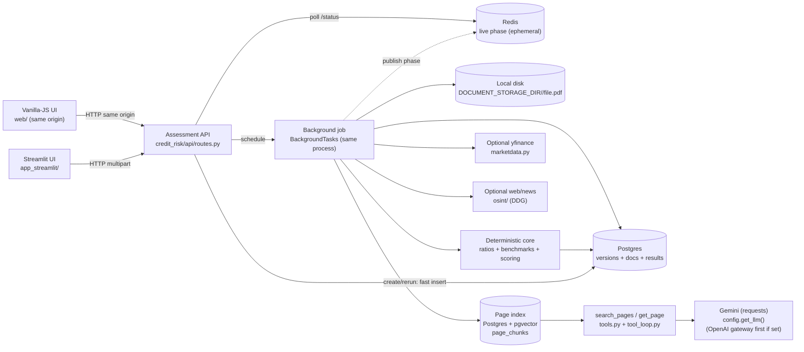
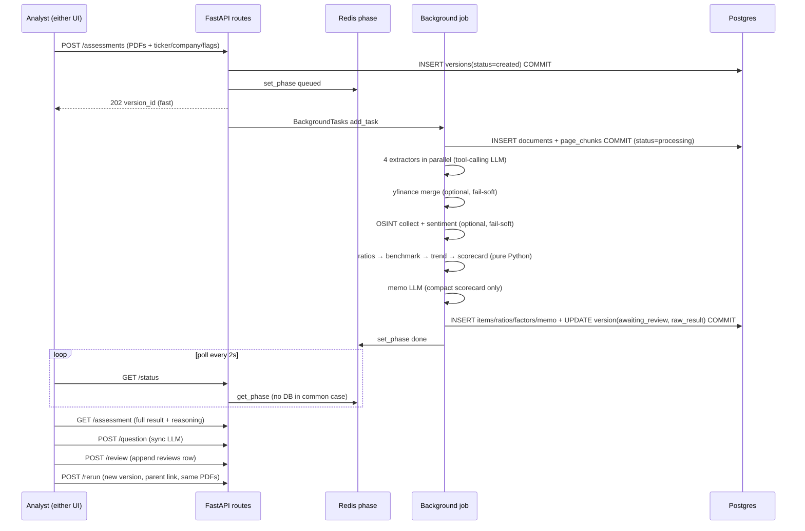
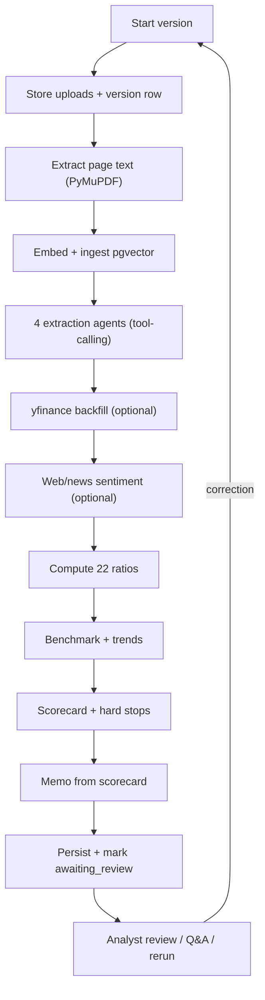
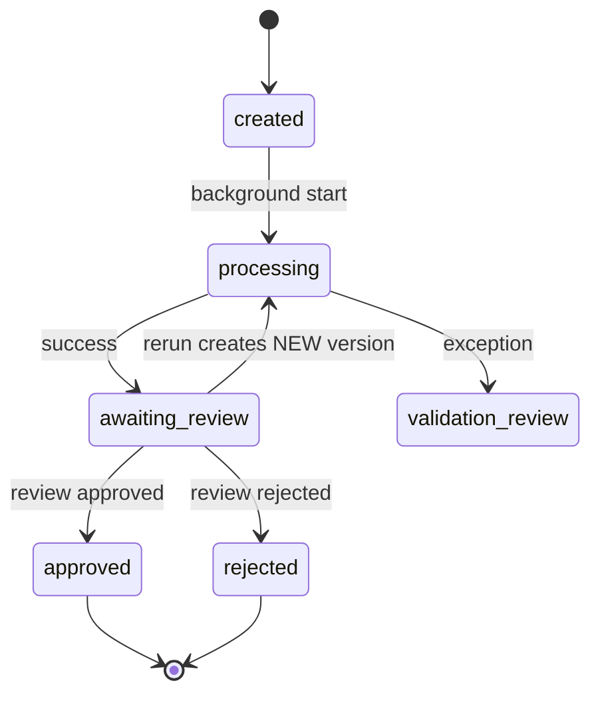
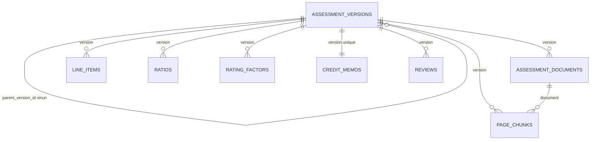

# Credit Risk Assessment Agent — NEW_CASE_STUDY (Complete Engineering Replication Guide)

> Purpose: single document that describes **every detail of the code** in
> `Credit_Risk_Assesment_Agent/` so a new / fresher engineer can **rebuild the project
> without reading the source**.
> Covers: inputs (mandatory/optional), what the user submits, step-by-step pipeline,
> every task/agent, exact prompts and I/O schemas, sample LLM payloads, web/news module,
> deterministic math, persistence (types, modelling, S3/warehouse guidance), APIs,
> config, run-book, and mermaid diagrams.
>
> Codebase snapshot: single FastAPI service `credit_risk/api/main.py:app` + 2 thin UIs
> (`app_streamlit/ui.py`, `web/`), Postgres+pgvector store, Redis ephemeral phase,
> local-disk uploads, Gemini chat via plain `requests` (OpenAI-compatible gateway
> tried first when `LLM_ENDPOINT` is set), yfinance + DuckDuckGo optional
> enrichment, plain-text logging with code place, tracing off by default.
> Entry: `uvicorn credit_risk.api.main:app --host 0.0.0.0 --port 8000`.

---

## Table of contents

1. [Repo map](#1-repo-map)
2. [System principle](#2-system-principle)
3. [Inputs — what the end user submits](#3-inputs--what-the-end-user-submits)
4. [What happens after Submit — end-to-end](#4-what-happens-after-submit--end-to-end)
5. [Pipeline tasks and agents](#5-pipeline-tasks-and-agents)
6. [Agent detail sheets (prompt, I/O, sample)](#6-agent-detail-sheets-prompt-io-sample)
7. [Deterministic calculation core](#7-deterministic-calculation-core)
8. [Market-data module (yfinance)](#8-market-data-module-yfinance)
9. [Web / news OSINT module](#9-web--news-osint-module)
10. [Memo and Q&A agents](#10-memo-and-qa-agents)
11. [Persistence — where and how data is stored](#11-persistence--where-and-how-data-is-stored)
12. [API contract](#12-api-contract)
13. [Config / env vars](#13-config--env-vars)
14. [Mermaid diagrams](#14-mermaid-diagrams)
15. [Fresher run-book — replicate from zero](#15-fresher-run-book--replicate-from-zero)
16. [Sample end-to-end payloads](#16-sample-end-to-end-payloads)
17. [Known gaps](#17-known-gaps)

---

## 1. Repo map

```
Credit_Risk_Assesment_Agent/
  credit_risk/
    api/main.py          # FastAPI app, lifespan init_schema, CORS, static web/
    api/routes.py        # 8 REST endpoints, BackgroundTasks job
    api/schemas.py       # HTTP DTOs (Summary/Response/Status/Rerun/Question/Review/Audit)
    api/exceptions.py    # 404/409 handlers
    agent_graph.py       # orchestration: assess_pack + run_credit_assessment + answer_question
    extraction.py        # 4 LLM extractors (company, line_items, notes, facility)
    tools.py             # make_tools(): search_pages + get_page (LangChain tools)
    tool_loop.py         # bounded 6-turn tool-calling loop
    llm_json.py          # tolerant JSON parse (fence strip + span find)
    config.py            # get_llm() (OpenAI gateway -> Gemini) + get_embedder() (OpenAI -> local HF) from env
    gemini_requests.py   # GeminiChat (BaseChatModel over requests) + list_gemini_models; functionDeclarations, thoughtSignature echo, tool results as user turns
    doc_index.py         # PyMuPDF page splitter (PageChunk DTO, global numbering)
    ratios.py            # 22 deterministic ratios
    benchmarks.py        # sector compare + trend classify
    scoring.py           # 13-factor scorecard, grade, PD/LGD/EL, decision
    narrative.py         # memo LLM (compact scorecard -> CreditMemo JSON)
    marketdata.py        # yfinance fetch + label map
    reference.py         # benchmark medians, PD/LGD tables, thresholds, grade bands
    osint/search.py      # DuckDuckGo web+news + fetch_page_text
    osint/collect.py     # 12-query evidence collector
    osint/sentiment.py   # sentiment LLM -> WebSentimentResult
    db/models.py         # 8 SQLAlchemy tables
    db/page_index.py     # PgPageIndex ingest/search/get_page (pgvector)
    db/persist.py        # persist_line_items/ratios/factors/memo
    db/session.py        # lazy engine postgresql+psycopg
    status_tracker.py    # Redis live phase (queued..done/failed, TTL 3600s)
    logconf.py           # plain-text stderr logging with module:line funcName (no JSON)
    tracing.py           # no-op unless CREDIT_RISK_TRACING=1 (no console span dumps)
    schemas.py           # domain Pydantic models (source of truth)
  app_streamlit/ui.py    # Streamlit HTTP client (same API, port 8501)
  web/index.html + js/api.js + js/poll.js + js/app.js + css/styles.css  # vanilla-JS same-origin UI (renderResult keeps #result-view skeleton; failures render into #headline + ensureResultSkeleton, so a later render never null-crashes)
  data/documents/<uuid>/<file.pdf>  # runtime uploads (git-ignored content)
  tests/test_llm_json.py, test_tool_loop.py, test_llm_validation.py,
  test_clean_code_refactor.py, test_gemini_requests.py (HTTP mocked), conftest.py
  (explicit dotenv load; forces PG_DATABASE=credit_risk_test) — 44 tests total
  check_gemini_llm.ipynb  # key/model/invoke/bind_tools smoke notebook
  examples/parse_product_gemini.py  # standalone Gemini product-extraction demo (reads GEMINI_API_KEY)
  Dockerfile, k8s/deployment.yaml + service.yaml + configmap.yaml + secret.yaml
  requirements.txt, pyproject.toml ([tool.ruff] pinned py310), .env.example, CASE_STUDY.md, DOCUMENTATION.md
```

No microservices. One process. `BackgroundTasks` = in-process background job (not Celery).

---

## 2. System principle

```
LLM reads text and writes explanations. Python calculates everything that matters.
```

- LLM **never** computes a ratio, score, rating, PD, LGD, or decision.
- LLM outputs are **evidence to validate**, never numbers to trust.
- Same PDFs + same reference tables + same model version → same rating (reproducibility).
- Every material value carries `page` / `document` / `period` / `currency` / `unit` lineage.
- Result is always a **draft** (`awaiting_review`) until human `approved`/`rejected`.
- Optional enrichments (yfinance, web) **fail soft** — they skip, never abort the run.

---

## 3. Inputs — what the end user submits

### 3.1 Transport

`POST /assessments` is `multipart/form-data`. Both UIs send the same fields.
`POST /assessments/{id}/rerun` is `application/json` (reuses stored PDFs).

### 3.2 Field table

| Field | Location | Mandatory? | Type / constraints | What to type | Default if blank |
|---|---|---|---|---|---|
| `files` | form-file `files` (repeatable) | **Effectively mandatory** — pipeline runs with 0 files but extracts nothing, all ratios `null`, score ~0 | PDF only, `application/pdf`, any page count (tested 50–300 pp). Multi-file OK. Original filename preserved. | Audited annual reports, interim/management accounts, info memo, facility letter, debt schedule, covenant certificate | `[]` (allowed, not useful) |
| `company_name` | form-text | Optional but **strongly recommended** | free text ≤255 chars, e.g. `Acme Manufacturing Ltd` | Filed legal name if known; overwritten in DB by extracted filed name after run | `""` → `None`; OSINT skipped if still unknown after extraction |
| `ticker` | form-text | Optional | e.g. `AAPL`, `RELIANCE.NS`; ≤16 chars, stripped | Listed ticker for yfinance backfill + cross-check | `""` → `None`; yfinance skipped |
| `question` | form-text | Optional | free text; legacy upfront Q&A | e.g. `What is the leverage trend?` (new web UI hides this; use `/question` after) | `""` → `None` |
| `search_region` | form-text | Optional | DuckDuckGo region, e.g. `wt-wt`, `us-en`, `uk-en` | narrows web search | `None` → server `OSINT_REGION=wt-wt` |
| `enable_web_sentiment` | form-checkbox | Optional | `true`/`false` | uncheck to disable all web calls (offline / private borrower) | `True` |
| `requested_by` | form-text | Optional | free text ≤128 chars | analyst id for audit column | `"local-analyst"` |

Rerun body (`RerunRequest`, all optional):

```json
{ "instruction": "Corrected revenue FY2023 is 12.4m not 14.2m — re-run",
  "question": "…", "search_region": "us-en", "enable_web_sentiment": true }
```

Review body (`ReviewRequest`):

```json
{ "reviewer": "jane.risk", "action": "approved|corrected|rejected",
  "corrected_fields": {"revenue_FY2023": 12400000}, "reason": "… " }
```

Question body: `{ "question": "Why is DSCR weak?" }`.

### 3.3 What the analyst should actually upload (business guidance)

1. Latest 3–5 years audited annual reports (balance sheet + P&L + cash flow + auditor report + notes).
2. Most recent interim / management accounts if annual is >6 months old.
3. Facility request letter (amount, type, tenor, purpose) — else `FacilityRequest` returns nulls.
4. Debt schedule + covenant certificate if available (maturities, breaches feed OBS/hard-stop logic).
5. Ticker **only** for listed borrowers; private borrowers leave blank (no yfinance, no web if name is generic).

No CSV/XLSX, no images, no OCR — scanned PDFs with no text layer raise `ValueError` and fail the run.

---

## 4. What happens after Submit — end-to-end

### 4.1 Fast accept vs slow execute

`POST /assessments` does **only** this synchronously (<1 s): save files → insert
`assessment_versions(status="created")` → commit → `set_phase(queued)` → schedule
`BackgroundTasks` → return `202 + version_id`. The multi-minute pipeline runs after the
HTTP response. Client polls `GET /status` every ~2 s, then `GET /assessment` once terminal.

Why: browsers/proxies (nginx/ALB/Cloudflare) kill idle connections well under a minute;
holding one connection for a 1–5 min LLM pipeline would lose the `version_id`.

### 4.2 Step-by-step (numbered, with code pointer)

| # | Step | Code | What happens |
|---|---|---|---|
| 1 | Upload | `routes._save_uploads` | `DOCUMENT_STORAGE_DIR/<random-uuid>/<orig filename>` written, `mkdir -p`. Returns absolute paths list. |
| 2 | Version row | `routes.create_assessment` | `AssessmentVersion(id=uuid4, status="created", company_name/ticker/question/flags/requested_by, requested_at=now)` committed. |
| 3 | Phase | `status_tracker.set_phase(id,"queued")` | Redis `credit_risk:assessment_status:{id} = {phase,detail,updated_at}`, TTL 3600 s. Never raises. |
| 4 | Background start | `routes._run_assessment_job` | New DB session (request session is gone). `run_credit_assessment(..., session, version)`. |
| 5 | PDF → pages | `doc_index.load_pack_as_pages` | PyMuPDF `fitz` per-PDF `get_text("text")`, skip empty pages, **global renumber** across pack (doc1 pp 1–35, doc2 continues 36…). Raises if zero text pages. |
| 6 | Persist docs+pages | `agent_graph.assess_pack` | `AssessmentDocument(filename, storage_uri=abspath, sha256(file bytes), page_count)` ×N + `PageChunk(page_number global, doc_name, text, embedding)` ×P. Embedding = single `embed_documents` batch via `get_embedder()`. `session.commit()` **before** parallel step (threads need committed rows). `status → "processing"`, phase `indexing_documents`. |
| 7 | 4 extractors in parallel | `ThreadPoolExecutor(max_workers=4)` + `_run_extractor` | Each thread opens own session, builds `PgPageIndex(session, version_id)`, `make_tools(index)`, calls one extractor (see §6). Read-only on `page_chunks`. Phase `extracting_financials`. LLM calls = 4 (0 if no PDFs). |
| 8 | yfinance backfill | `agent_graph._merge_yfinance_items/_merge_metadata/_cross_check` | Only if `ticker` non-blank and `yfinance+pandas` installed. Fetch 5 y financials/balance/cashflow + `info`. Align by 4-digit year. Fill **only** missing (doc,period,label) cells. Cross-check docs vs yf at `YF_DISCREPANCY_TOL=0.02` → `discrepancies[]`. Never overwrites a doc value. Fail-soft to “skipped”. |
| 9 | Web/OSINT | `osint.collect + sentiment.run_web_sentiment` | Only if `enable_web_sentiment` and resolved name (`input company_name` else extracted). 12 queries → dedup → sentiment LLM. Fail-soft to `None`. Phase `enriching_and_scoring`. LLM +1 if run. |
| 10 | Ratios | `ratios.compute_ratios` | Group by period, unit-normalise (`absolute×1, thousands×1e3, millions×1e6`), derive ebitda/total_debt, 22 formulas. Pure Python. |
| 11 | Benchmark+trend | `benchmarks.benchmark_ratios + analyse_trends` | Industry key resolve → median/p25/p75 compare; 7 trend ratios direction/magnitude; commentary keyword signal. Pure Python. |
| 12 | Scorecard | `scoring.score_case` | 13 factors, hard stops, 0–100 score, grade/band/PD/LGD/EL/decision/pricing/conditions. Pure Python. Phase still `enriching_and_scoring`. |
| 13 | Memo | `narrative.synthesize_credit_memo` | One LLM call on **compact scorecard JSON only** (never raw PDFs). Phase `writing_memo`. LLM +1. |
| 14 | Persist results | `db.persist.*` | `line_items` + `ratios` + `rating_factors` + `credit_memos` inserts (flushed, not yet committed). |
| 15 | Finalize | `agent_graph` | `version(status="awaiting_review", grade/band/decision/PD/LGD/EL/hard_stop, latency_ms, llm_call_count, raw_result=CreditAssessment dump, reasoning=[7 strings], completed_at, company_name=resolved)` — **single commit** with step 14 (atomic: never half-written scorecard). Phase `done`. |
| 16 | Poll + read | UIs | `GET /status` (Redis fast path) until `awaiting_review/validation_review/approved/rejected`, then `GET /assessment` full result. |
| 17 | Follow-ups | `routes` | `POST /question` (sync LLM, overwrites `answer`), `POST /review` (appends `reviews` row; approved/rejected flips status), `POST /rerun` (new version with `parent_version_id`, re-reads same `storage_uri` paths, repeats steps 5–15), `GET /audit` (read-only trace). |
| On exception steps 7–13 | `run_credit_assessment` except | `status="validation_review"`, `set_phase(failed)`, commit version+docs/pages only. No partial scorecard rows. |

`llm_call_count = (4 if pdfs else 0) + 1 memo + (1 if web ran) + (1 if question)`.

---

## 5. Pipeline tasks and agents

| # | Task | Agent / function | File | LLM? | Tools given | Input | Output |
|---|---|---|---|---|---|---|---|
| T1 | Index pages | `load_pack_as_pages` + `PgPageIndex.ingest` | `doc_index.py`, `db/page_index.py` | No (embeddings only) | — | `List[str] pdf_paths` | `List[PageChunk{page_number,text,doc_name}]` + DB rows + vectors |
| T2 | Company metadata | `extract_company_metadata(tools)` | `extraction.py:101` | Yes, tool-calling | `search_pages, get_page` | page index only (no args) | `CompanyMetadata` |
| T3 | Line items | `extract_line_items(tools)` | `extraction.py:151` | Yes, tool-calling | `search_pages, get_page` | page index only | `list[LineItem]` (one per item×period) |
| T4 | Notes / contingencies | `extract_notes(tools)` | `extraction.py:232` | Yes, tool-calling | `search_pages, get_page` | page index only | `list[NoteItem]` |
| T5 | Facility | `extract_facility_request(tools)` | `extraction.py:268` | Yes, tool-calling | `search_pages, get_page` | page index only | `FacilityRequest` |
| T6 | Market backfill | `fetch_fundamentals(ticker)` + merge fns | `marketdata.py`, `agent_graph.py` | No | yfinance API | `ticker: str` | `List[LineItem](page=None, source=yfinance:ticker)` + `CompanyMetadata` patch + `DataReconciliation` |
| T7 | Web evidence | `collect.collect_evidence(seed)` | `osint/collect.py` | No | DuckDuckGo `ddgs.text/news` | `CompanySeed` | `List[WebEvidenceItem]` |
| T8 | Web sentiment | `synthesize_sentiment(seed, evidence)` | `osint/sentiment.py` | Yes, single-shot (no tools) | — (evidence pasted) | `CompanySeed + evidence[]` | `WebSentimentResult` |
| T9 | Ratios | `compute_ratios(line_items)` | `ratios.py` | No | — | `List[LineItem]` | `(periods[], ratios_by_period[])` |
| T10 | Benchmark | `benchmark_ratios(latest, industry)` | `benchmarks.py` | No | — | `FinancialRatios + industry?` | `SectorBenchmarkResult` |
| T11 | Trends | `analyse_trends(periods, ratios, commentary)` | `benchmarks.py` | No | — | ratios + `management_commentary?` | `TrendAnalysis` |
| T12 | Scorecard | `score_case(...)` | `scoring.py` | No | — | ratios+benchmark+trend+company+notes+revenue+sentiment | `CreditScorecard` |
| T13 | Memo | `synthesize_credit_memo(assessment)` | `narrative.py` | Yes, single-shot | — (compact JSON pasted) | `CreditAssessment` | `CreditMemo` |
| T14 | Q&A | `answer_question(assessment, q)` | `agent_graph.py` | Yes, single-shot | — (compact JSON pasted) | `CreditAssessment + question` | `str` answer |

How information is given to each LLM agent: **never raw PDFs**. T2–T5 get only two
LangChain tools (`search_pages(query,k)` → top-k page texts, `get_page(n)` → full page)
plus a system prompt with the exact JSON shape; they must call tools themselves inside
`run_tool_calling_loop` (max 6 iterations, then forced “answer now”). T8/T13/T14 get a
single pasted JSON block (evidence list / compact scorecard) and return a single JSON
object / string — no tools.

---

## 6. Agent detail sheets (prompt, I/O, sample)

Common loop (`tool_loop.py`): `llm.bind_tools(tools)`, invoke → if `tool_calls` execute
via `_invoke_tool` → append `ToolMessage(json)` → repeat; unknown tool →
`"Unknown tool: {name}"`; exception → `"Tool error: {T}: {msg}"`; after 6 turns append
HumanMessage `"You've searched enough. Answer now with ONLY the JSON object/array
requested — no further tool calls, no prose."` and one final invoke. `DEFAULT_MAX_ITERATIONS=6`.
Parse with `llm_json.safe_json_loads` (strip ```json fences, else first `{`/`[`→last `}`/`]`).

Tool definitions (`tools.py::make_tools(page_index)` — request-scoped, fixes old global):

```python
search_pages(query: str, k: int = 5) -> [{page_number:int, doc_name:str, text:str}]
# "Semantically search the credit-submission pack and return the top-k matching pages."
get_page(page_number: int) -> {page_number, doc_name, text}
# "Return the full text of a specific page number (1-based, global across the pack)."
```

`PgPageIndex.search` = embed query → `ORDER BY embedding <=> query LIMIT k` filtered by
`assessment_version_id`. `get_page` raises `PageNotFoundError` if missing.

### 6.1 T2 — Company metadata

- Function: `extract_company_metadata(tools) -> CompanyMetadata` (`extraction.py:101`).
- System prompt (verbatim):
  > You read the front matter, directors' report and auditor's report of a set of company
  > financial statements. Use the search_pages/get_page tools to find the relevant pages
  > before answering — try queries like 'company name principal activities industry sector
  > country of incorporation' and "auditor's report opinion number of employees registration
  > number". From the page text you retrieve ONLY, extract the company's identity and the
  > audit opinion. Classify the audit opinion as one of ['clean','qualified','adverse',
  > 'disclaimer','unknown'] (clean = unqualified). Summarize any forward-looking / outlook /
  > going-concern commentary into `management_commentary` (<= 600 chars). Use ONLY the text
  > you retrieved; never guess. When you're done searching, output ONLY a JSON object — no
  > prose, no markdown fence — matching:
  > `{"company_name": str|null, "legal_entity_type": str|null, "industry": str|null,`
  > `"sub_industry": str|null, "country": str|null, "registration_number": str|null,`
  > `"years_in_operation": int|null, "employee_count": int|null, "auditor": str|null,`
  > `"audit_opinion": one of [...], "reporting_currency": str|null,`
  > `"management_commentary": str|null, "page": int|null}`
- Task message: `"Extract the company metadata now."`
- Expected output struct (`schemas.CompanyMetadata`): all `Optional`, `audit_opinion` enum
  default `unknown`, `management_commentary` truncated `[:600]` in Python.
- Sample LLM input (what the model actually sees after 2 tool turns):
  ```
  [System as above]
  [Human] Extract the company metadata now.
  [AI] tool_call search_pages("company name principal activities industry sector") 
  [Tool] [{page_number:2, doc_name:"annualreport-2025.pdf",
            text:"ACME MANUFACTURING LTD … Principal activities: precision components … Country of incorporation: United Kingdom …"}]
  [AI] tool_call search_pages("auditor's report opinion") 
  [Tool] [{page_number:48, text:"Independent auditor's report … In our opinion … give a true and fair view … PricewaterhouseCoopers …"}]
  ```
- Sample LLM output:
  ```json
  {"company_name":"ACME MANUFACTURING LTD.","legal_entity_type":"Limited company",
   "industry":"manufacturing","sub_industry":"precision components","country":"United Kingdom",
   "registration_number":"01234567","years_in_operation":null,"employee_count":1240,
   "auditor":"PricewaterhouseCoopers","audit_opinion":"clean",
   "reporting_currency":"GBP","management_commentary":"Order book remains resilient; management guides flat volumes with input-cost pressure.","page":2}
  ```

### 6.2 T3 — Line items (core extraction)

- Function: `extract_line_items(tools) -> list[LineItem]` (`extraction.py:151`).
- System prompt (verbatim rules): spread analyst; search separately for balance sheet /
  income / cash flow (`k=10+`); **ONE record per (line item × period)**; synonym map
  (Turnover→revenue, Operating profit→ebit, Profit for year→net_income, Trade
  receivables→accounts_receivable, Borrowings→short/long_term_debt by maturity + total_debt
  if printed, Shareholders' funds→total_equity, Cash generated from operations→
  operating_cash_flow, Purchase of PP&E→capital_expenditure); transcribe value EXACTLY
  (no compute/sum/scale; `(123)` negative; blank/dash omitted); `unit` =
  thousands/millions if `$'000` else absolute; SAME `period` string (`FY2023`) across
  statements; `period_end_date` ISO only if stated; `period_length_months` ∈ {12,6,3,9}.
  Output ONLY JSON array:
  `[{"label":str,"standardised_label":one of 32,"value":number|string|null,`
  `"currency":str|null,"unit":"absolute"|"thousands"|"millions","period":str,`
  `"period_type":one of [annual,interim,quarterly],"period_end_date":"YYYY-MM-DD"|null,`
  `"period_length_months":int|null,"statement_type":one of [balance_sheet,`
  `income_statement,cash_flow_statement,notes,other],"page":int}]`
- Task: `"Extract every financial line item now."`
- Python post-parse: `_num()` (strip `,%`, `(x)`→`-x`, `-/—/n/a`→None), `_enum` with fallback
  (`OTHER`/`ANNUAL`/`OTHER`), `_parse_date(%Y-%m-%d)`, `_period_length` (else None),
  `source_snippet = label[:200]`. Rows missing `label` or `period` dropped.
- `StandardLabel` vocabulary (32): `revenue, cost_of_goods_sold, gross_profit,
  operating_expenses, ebit, ebitda, depreciation_amortization, interest_expense,
  pretax_income, tax_expense, net_income, cash_and_equivalents, accounts_receivable,
  inventory, current_assets, property_plant_equipment, total_assets, accounts_payable,
  short_term_debt, current_liabilities, long_term_debt, total_debt, total_liabilities,
  total_equity, operating_cash_flow, capital_expenditure, free_cash_flow,
  debt_principal_repayment, dividends_paid, other`.
- Sample output (2 records for one row × 2 periods):
  ```json
  [{"label":"Revenue","standardised_label":"revenue","value":12400000,"currency":"GBP",
    "unit":"absolute","period":"FY2023","period_type":"annual",
    "period_end_date":"2023-12-31","period_length_months":12,
    "statement_type":"income_statement","page":12},
   {"label":"Revenue","standardised_label":"revenue","value":11800000,"currency":"GBP",
    "unit":"absolute","period":"FY2022","period_type":"annual",
    "period_end_date":"2022-12-31","period_length_months":12,
    "statement_type":"income_statement","page":12}]
  ```

### 6.3 T4 — Notes / contingencies

- Function: `extract_notes(tools) -> list[NoteItem]`.
- System: search `'contingent liabilities guarantees commitments operating lease litigation
  legal proceedings related party transactions going concern off balance sheet'`;
  `category ∈ {operating_lease, guarantee, litigation, related_party, going_concern, other}`.
  Output ONLY `[{"category":str,"description":str,"amount":number|null,"currency":str|null,"page":int}]`.
- Task: `"Extract the notes and contingencies now."`
- Post: `description[:400]`. Sample:
  ```json
  [{"category":"guarantee","description":"Guarantee of subsidiary borrowings £2.0m","amount":2000000,"currency":"GBP","page":61},
   {"category":"going_concern","description":"Directors note material uncertainty on refinancing","amount":null,"currency":null,"page":55}]
  ```
  The second row alone triggers the scorecard hard stop (§7).

### 6.4 T5 — Facility request

- Function: `extract_facility_request(tools) -> FacilityRequest`.
- System: search `'credit facility loan request term loan revolving credit facility amount
  requested purpose of facility tenor proposed financing'`; nulls if absent. Output ONLY
  `{"facility_type":str|null,"amount":number|null,"currency":str|null,"purpose":str|null,"tenor":str|null,"page":int|null}`.
- Task: `"Identify the facility request now."`
- Sample: `{"facility_type":"term loan","amount":5000000,"currency":"GBP","purpose":"capex expansion","tenor":"5 years","page":4}`.

---

## 7. Deterministic calculation core

All pure Python, no LLM, no I/O. Same inputs → same outputs (floats rounded as noted).

### 7.1 Unit normalisation + grouping (`ratios.py`)

`UNIT_MULTIPLIERS = {absolute:1.0, thousands:1000.0, millions:1000000.0}`.
`group_by_period`: sum duplicate `(period, standard_label)` (restated rows), ignore
`OTHER`/None, keep first page. `order_periods`: sort by first `\d{4}` then string.
Derived: `ebitda = ebitda else ebit + depreciation_amortization`;
`total_debt = total_debt else short_term_debt + long_term_debt` (either leg suffices).
Magnitudes: `interest=abs(interest_expense)`, `capex=abs(capital_expenditure)`,
`principal=abs(debt_principal_repayment)`. `_ratio = round(n/d,4)` else None (missing or zero denom).

### 7.2 22 ratio formulas (latest period drives scoring; all periods computed)

| Category | `ratio_name` | Formula |
|---|---|---|
| leverage | `debt_to_equity` | `total_debt / total_equity` |
| leverage | `debt_to_assets` | `total_debt / total_assets` |
| leverage | `net_debt_to_ebitda` | `(total_debt − cash_and_equivalents if cash else total_debt) / ebitda` |
| leverage | `total_liabilities_to_equity` | `total_liabilities / total_equity` |
| liquidity | `current_ratio` | `current_assets / current_liabilities` |
| liquidity | `quick_ratio` | `(current_assets − inventory if both else current_assets) / current_liabilities` |
| liquidity | `cash_ratio` | `cash_and_equivalents / current_liabilities` |
| profitability | `ebitda_margin` | `ebitda / revenue` |
| profitability | `ebit_margin` | `ebit / revenue` |
| profitability | `net_margin` | `net_income / revenue` |
| profitability | `return_on_equity` | `net_income / total_equity` |
| profitability | `return_on_assets` | `net_income / total_assets` |
| profitability | `return_on_capital_employed` | `ebit / (total_assets − current_liabilities if both else None)` |
| coverage | `interest_coverage` | `ebitda / abs(interest_expense)` |
| coverage | `dscr` | `(ebitda − abs(capex) if both else None) / ((abs(interest) or 0)+(abs(principal) or 0) if either else None)` |
| coverage | `ocf_to_total_debt` | `operating_cash_flow / total_debt` |
| cash_flow | `cash_conversion` | `operating_cash_flow / net_income` |
| cash_flow | `fcf_margin` | `(operating_cash_flow − abs(capex) if both else None) / revenue` |
| efficiency | `asset_turnover` | `revenue / total_assets` |
| efficiency | `inventory_days` | `round(inventory / abs(cost_of_goods_sold) × 365, 1)` |
| efficiency | `days_sales_outstanding` | `round(accounts_receivable / revenue × 365, 1)` |

Each stored as `RatioValue{name, value?, category, inputs_used[], missing_inputs[], pages[]}`.

### 7.3 Benchmarks + trends (`benchmarks.py`, `reference.py`)

- Industry resolve: substring match (`manufactur/industr/factory/production→manufacturing`,
  `retail/consumer/store/wholesale→retail`, `service/software/technology/consult/financ→services`,
  else `general`). Reference medians in `reference._SAMPLE_BENCHMARKS` (illustrative p25/median/p75;
  override via `SECTOR_BENCHMARKS_PATH` JSON).
- Per-ratio classify: higher-better → `≥p75 above_75th, ≥median above_median, ≤p25 below_25th`
  (flipped if lower-better); `is_material_gap = (class==below_25th and name in MATERIAL_RATIOS)`.
  `MATERIAL_RATIOS = {net_debt_to_ebitda, interest_coverage, dscr, current_ratio, ebitda_margin, ocf_to_total_debt}`.
- Overall: `strong` if ≥60% strong and 0 gaps; `weak` if ≥50% weak or ≥2 gaps; else `average`.
- Trends on 7 ratios `[net_debt_to_ebitda, interest_coverage, dscr, ebitda_margin, net_margin,
  current_ratio, ocf_to_total_debt]`: `<2 points → stable`; `|pct|<0.10 → stable` where
  `pct=(last−first)/abs(first)`; sign-changes≥1 and `|pct|<0.25` and len≥3 → `volatile`;
  else improving iff `(pct>0)==higher_better`. Magnitude `≥0.10 moderate, ≥0.25 significant`.
  Aggregate: `≥2 deteriorating and >improving → deteriorating` (mirror for improving);
  both → `mixed`. Only moderate/significant count. Commentary signal: count
  risk words (`going concern, loss, decline, …, challenging, shortfall`) vs positive words
  (`growth, record, improved, …, robust, outperform`): risk if risk>pos.

### 7.4 Scorecard (`scoring.py`) — exact weights and logic

Weights (`FACTOR_WEIGHTS`): `leverage 22, debt_service_coverage 22, liquidity 16,
profitability 16, cash_flow_quality 14, deteriorating_trend 16, sector_underperformance 10,
size_scale 8, jurisdiction 6, audit_quality 20, off_balance_sheet 10, adverse_media 14,
market_sentiment 8`.

Severity multiplier: `low×0.0, medium×0.6, high×1.0, critical×1.6`;
`contribution = round(weight × mult, 2)`; `present = (severity != low)`.

Thresholds (`reference.py`): leverage med/high/crit `3.0/4.5/6.0` (higher-worse on
net_debt_to_ebitda); interest-cover `4.0/2.0/1.0` (lower-worse); DSCR `1.5/1.2/1.0`;
current-ratio `1.2/1.0/0.8`; EBITDA-margin `0.10/0.05/0.0`; cash-conversion `0.8/0.5/0.2`;
size `SIZE_SMALL_REVENUE=10_000_000 → medium, SIZE_MICRO_REVENUE=2_000_000 → high`
(unit-normalised latest revenue; None → low). Coverage factor = worse of IC/DSCR.
Trend: `deteriorating + significant on core (net_debt/IC/DSCR/ebitda_margin) → high`
else medium; `mixed or commentary==risk → medium`. Sector: `weak+gaps≥2 → high`,
`weak → medium`. Jurisdiction always low (placeholder). Audit: `adverse/disclaimer →
critical + hard_stop="Audit opinion: X (non-reliance)."`; going_concern note → critical +
`hard_stop="Going-concern uncertainty disclosed in the notes."`; `qualified → high`.
OBS: litigation → high; any guarantee/litigation/lease → medium. Adverse-media: each web
finding discounted one notch, single-source caps at medium, ≥2 high findings → high,
low disambiguation caps at medium. Market sentiment: negative+high-conf → high else medium;
mixed+med/high-conf → medium; else low.

Aggregate: `raw = round(Σ contribution,2)`; `normalized = min(100, raw)` (100.0 on hard stop).
Grade (`SCORE_TO_GRADE` max-score): `5 AAA, 12 AA, 20 A, 32 BBB, 45 BB, 60 B, 75 CCC,
88 CC, 97 C, 100 D`. Band (`GRADE_TO_BAND`): `AAA/AA investment_grade_strong, A/BBB
investment_grade, BB sub_investment_grade, B/CCC speculative, CC/C distressed, D default`.
`PD = pd_table[grade]` (`AAA 0.0001, AA 0.0003, A 0.0008, BBB 0.0025, BB 0.01, B 0.04,
CCC 0.12, CC 0.25, C 0.45, D 1.0`); `LGD = lgd_for_industry(industry)`
(`manufacturing 0.40, retail 0.45, services 0.55, general 0.45`); `EL = round(PD×LGD,6)`.
Decision: hard-stop/default/distressed → `decline`; speculative → `refer_credit_committee`;
sub-investment or gaps≥1 → `approve_with_conditions`; else `approve`.
Conditions (only if not decline): leverage → max Net Debt/EBITDA covenant; coverage → min
DSCR; liquidity → min liquidity; cash → cash-sweep + dividend restriction; OBS → cap
guarantees; BB/B → collateral + quarterly accounts. Pricing: strong `+80–130bps`,
investment `+130–220`, sub `+250–400`, speculative `+450–700`, distressed `Bespoke /
secured only`, default `n/a` (None on decline).

---

## 8. Market-data module (yfinance)

- Input: `ticker: str` (e.g. `AAPL`), `max_years=5`. Runs only if non-blank and
  `yfinance+pandas` importable (`marketdata.yfinance_available()`).
- Fetch: `yfinance.Ticker(t).financials / .balance_sheet / .cashflow` (columns = Timestamps)
  + `.info{longName/shortName→name, industry, sector→sub_industry, country,
  fullTimeEmployees→employee_count, financialCurrency/currency}`.
- Label map: normalised Yahoo row → `StandardLabel` (60+ entries, e.g. `Total Revenue/
  Operating Revenue→revenue`, `Cost Of Revenue→cogs`, `Operating Income/EBIT→ebit`,
  `Normalized EBITDA→ebitda`, `Interest Expense→interest_expense`, `Total Debt→total_debt`,
  `Operating Cash Flow→operating_cash_flow`, `Capital Expenditure→capex`,
  `Repayment Of Debt→principal`). Period label `FY<year>` from column year.
  Output items: `LineItem(unit="absolute", page=None, source_snippet="yfinance:{ticker}")`.
- Merge (`agent_graph`): align yf `FY<year>` to doc period string by 4-digit year
  (`_year_of`); fill **only** `(period,label)` cells missing from docs; patch metadata only
  (`company_name, industry, sub_industry, country, employee_count, reporting_currency`) if
  blank. Cross-check docs vs yf per cell at `YF_DISCREPANCY_TOL=0.02` (2%) →
  `DataReconciliation{...filled[], discrepancies[], ratio_gaps[], yfinance_attempted/
  available, doc/yf counts}`. All fail-soft (exception → skip, note in `reasoning`).
- Output example: `filled=["revenue FY2022 from yfinance"]`,
  `discrepancies=["revenue FY2023 docs=12.4m yf=12.9m Δ=4.0%"]`.

---

## 9. Web / news OSINT module

### 9.1 Input

`CompanySeed{company_name: str (required), aliases: str[] = [], country?: str,
industry?: str, ticker?: str, search_region?: str}` built from
`resolved_name = input company_name or extracted company.company_name`.
Skipped entirely if no name or `enable_web_sentiment=False`.

### 9.2 Collection (`osint/collect.py`, `search.py`)

- Backend: `ddgs.DDGS().text / .news` (fallback `duckduckgo_search`), `requests+bs4`
  `fetch_page_text(url, max 4000 chars, UA CreditRiskBot/1.0)`. Env `OSINT_TIMEOUT=10`,
  `OSINT_REGION=wt-wt`, `OSINT_MAX_RESULTS=5`. `search_available()` false → `[]`.
- 12 exact queries (`{name} + ctx` where `ctx = "country industry"`):
  general: `{name} {ctx}`, `{name} news`; financial: `{name} results OR revenue OR profit
  OR guidance`, `{name} earnings OR financial performance`; adverse: `{name} fraud OR
  investigation OR lawsuit OR scandal`, `{name} regulatory OR penalty OR fine OR sanctions`
  (+ per-alias `{alias} fraud OR investigation OR lawsuit`); distress: `{name} debt OR
  default OR restructuring OR covenant breach`, `{name} layoffs OR insolvency OR bankruptcy
  OR liquidation`; governance: `{name} CEO OR board OR management resignation`,
  `{name} accounting OR audit OR going concern`; market: `{name} analyst OR rating OR
  downgrade OR outlook`, `{name} investor OR shares OR bond`.
  News angles (web+news): general/financial/adverse/distress; web-only otherwise.
- Dedup by `url` or `snippet[:120]` → `List[WebEvidenceItem{dimension∈{general_news,
  financial_performance, adverse, credit_distress, governance, market_view}, query, title?,
  url?, snippet?, source∈{web,news}, published?}]`.

### 9.3 Sentiment LLM (`osint/sentiment.py`)

- Empty evidence → neutral stub (`disambiguation low, "No public web/news results…"`).
- System prompt (verbatim): credit analyst reviewing PUBLIC footprint; using ONLY numbered
  evidence: (1) `disambiguation_confidence` low/med/high (same-name watch), (2)
  `overall_sentiment` positive/neutral/mixed/negative + ≤3-sentence summary, (3)
  `adverse_findings` concrete only (fraud/litigation/regulatory/default/distress/governance
  with category/summary/severity low|med|high/url), (4) `positive_highlights` + `data_gaps`;
  no invented facts/figures/ratings; output ONLY JSON.
- User payload sample:
  ```
  Company: ACME MANUFACTURING LTD. | United Kingdom | manufacturing
  Evidence:
  [1] (adverse/web) Acme faces lawsuit over supply contract
   url: https://example.com/news/1
   snippet: …filed 12 Mar 2024…
  ```
  Expected JSON: `{"disambiguation_confidence":"medium","overall_sentiment":"mixed",`
  `"sentiment_summary":"…","adverse_findings":[{"category":"litigation","summary":"…",`
  `"severity":"medium","url":"…"}],"positive_highlights":["…"],"data_gaps":["…"]}`.
- Python: clamp severity, `summary[:300]`, `citations = urls[:25]`; gateway error → neutral fallback.
- Output `WebSentimentResult{seed, disambiguation_confidence, overall_sentiment,
  sentiment_summary, adverse_findings[{category,summary,severity,url}],
  positive_highlights[], evidence[], citations[], data_gaps[]}`.
- How passed to scoring: `score_case(..., web_sentiment)` → `_adverse_media_severity`
  (discount + cap as §7.4) and `_market_sentiment_severity`; evidence strings
  `"{category}: {summary[:90]} [{severity}]"` stored on factor rows.

---

## 10. Memo and Q&A agents

### 10.1 Memo (`narrative.py::synthesize_credit_memo`)

- Input: full `CreditAssessment`, compacted by `_compact()` to
  `{company, industry, country, audit_opinion, facility{type,amount,currency,purpose},
  periods, rating_grade, risk_band, normalized_score, PD, LGD, EL, decision,
  suggested_pricing, hard_stop_reason, deterministic_conditions,
  latest_ratios{name:value non-null}, active_factors[{factor,severity,contribution,evidence}],
  sector_benchmark{industry_used, overall_position, material_gaps},
  trend{overall_trajectory, commentary_signal, ratio_trends[]},
  off_balance_sheet[{category,description,amount}],
  web_sentiment{overall, disambiguation, summary, adverse[], positives}|None}`.
- System (verbatim gist): senior credit analyst; ratios/scorecard AUTHORITATIVE — do NOT
  recompute; explain with actual values; strengths/risks/mitigants/covenants/triggers
  consistent with deterministic conditions; web = corroborating colour only, never override,
  flag low disambiguation; output ONLY JSON
  `{"executive_summary":str,"financial_analysis":str,"key_strengths":[str],`
  `"key_risks":[str],"mitigants":[str],"recommended_covenants":[str],"monitoring_triggers":[str]}`.
- User: `"Computed assessment (authoritative):\n{compact_json}\n\nWrite the credit-memo JSON now."`
  → `get_llm().invoke` → `safe_json_loads` → `CreditMemo` (missing → `""`/`[]`).
- Sample compact input (truncated):
  ```json
  {"company":"ACME MANUFACTURING LTD.","rating_grade":"BB","risk_band":"sub_investment_grade",
   "normalized_score":38.5,"decision":"approve_with_conditions","latest_ratios":{"net_debt_to_ebitda":3.4,"interest_coverage":3.1},
   "active_factors":[{"factor":"leverage","severity":"medium","contribution":13.2,"evidence":["Net Debt/EBITDA = 3.4"]}]}
  ```

### 10.2 Q&A (`agent_graph.answer_question`)

- Input: finished `CreditAssessment` + `question: str`. 409 if `raw_result is None`.
- System: `You answer questions about a completed credit assessment. Use ONLY the supplied
  figures (already correct and final). If the assessment does not contain the answer, say so.
  Never invent ratios, a different grade, or a different decision.`
- User: `Question:\n{q}\n\nAssessment:\n{compact_json}\n\nAnswer concisely.` where compact =
  `{company, grade, band, normalized_score, decision, pd, lgd, latest_ratios non-null,
  active_factors, sector_position, material_gaps, trajectory, web_sentiment|None}`.
- Output: `str` stored overwriting `version.answer` (no history).

---

## 11. Persistence — where and how data is stored

### 11.1 Files (local disk today)

- `_save_uploads`: `DOCUMENT_STORAGE_DIR (default ./data/documents)/<request-uuid>/<original filename>`
  (`mkdir parents=True`). `AssessmentDocument.storage_uri = abspath`.
- Rerun re-reads parent `storage_uri` paths (no re-upload).
- Consequence: single-node only → `k8s/deployment replicas: 1` pinned deliberately.
  S3 guidance in §11.5.

### 11.2 Postgres (source of truth) — 8 tables, full column types

All PKs `UUID(as_uuid=False)` generated Python-side `uuid4()`; all children FK →
`assessment_versions.id`, `delete-orphan` cascade; enums as plain `String`.

| Table | Columns (type) |
|---|---|
| `assessment_versions` | `id UUID PK, parent_version_id UUID FK→self?, status String(32) (created/processing/awaiting_review/validation_review/approved/rejected), company_name String(255)?, ticker String(16)?, question Text?, instruction Text?, answer Text? (latest only), enable_web_sentiment Bool=true, search_region String(16)?, model_name String(128)?, embed_model_name String(128)?, grade String(8)?, band String(32)?, decision String(32)?, probability_of_default Float?, loss_given_default Float?, expected_loss_pct Float?, hard_stop_reason Text?, latency_ms Float?, llm_call_count Int?, raw_result JSONB? (full CreditAssessment dump), reasoning JSONB? (list[str]), requested_by String(128)=local-analyst, requested_at timestamptz, completed_at timestamptz?` |
| `assessment_documents` | `id UUID PK, assessment_version_id UUID FK!, filename String(255), storage_uri Text (abspath), sha256_hash String(64) (file bytes), page_count Int` |
| `page_chunks` | `id UUID PK, assessment_version_id UUID FK!, document_id UUID FK→documents?, page_number Int (global 1-based), doc_name String(255) (denorm), text Text (full page), embedding Vector(EMBED_DIM default 384, pgvector)` — 384 = local HF MiniLM fallback dim; a table built earlier as `vector(1536)` rejects 384-dim inserts, so it was dropped + recreated (`create_all` never alters columns) |
| `line_items` | `id, version FK!, label String(255) (printed), standardised_label String(64), value Float?, currency String(8)?, unit String(16)=absolute, period String(32) (FY2023), period_type String(16)=annual, period_end_date Date?, period_length_months Int?, statement_type String(32)=other, page Int? (global), source_snippet Text?` |
| `ratios` | `id, version FK!, period String(32), ratio_name String(64), value Float?, category String(32), inputs_used JSONB[], missing_inputs JSONB[], pages JSONB[]` |
| `rating_factors` | `id, version FK!, factor_type String(64) (13 enum values), present Bool, severity String(16) (low/medium/high/critical), weight Float, contribution Float, evidence JSONB[], pages JSONB[]` |
| `credit_memos` | `id, version FK! UNIQUE, executive_summary Text, financial_analysis Text, key_strengths/key_risks/mitigants/recommended_covenants/monitoring_triggers JSONB[]` |
| `reviews` | `id, version FK!, reviewer String(128) (free text), action String(16) (approved/corrected/rejected), corrected_fields JSONB?, reason Text?, reviewed_at timestamptz` |

`raw_result` holds **everything else** not normalised: notes, facility, benchmark,
trend, web_sentiment, reconciliation (still fully captured, just not separately queryable).
`init_schema()`: `CREATE EXTENSION IF NOT EXISTS vector` + `create_all` (no Alembic).

### 11.3 Redis (ephemeral, not truth)

Key `credit_risk:assessment_status:{version_id}` = `{phase, detail, updated_at}`, TTL 3600 s.
Phases: `queued, indexing_documents, extracting_financials, enriching_and_scoring,
writing_memo, done, failed`. `set_phase` never raises; `get_phase` None on miss/error.
`GET /status` reads Redis unless phase `done/failed`/missing → Postgres `status`.

### 11.4 Modelling notes + correct join pattern

One-hop-from-anchor: every child filters by `assessment_version_id`; never join two
children directly (fan-out: 24 items × 84 ratios = 2016 meaningless rows). One query per
collection (what `_to_response`/`get_audit_trace` do). Lineage via recursive
`parent_version_id`; pgvector search `WHERE version AND ORDER BY embedding <=> query LIMIT k`.

### 11.5 Do we need S3 / warehouse? (guidance)

- **Need S3 (or equivalent object store) before any scale-out**: today `storage_uri` is a
  local abspath — second replica / rolling restart loses uploads. Migrate: store
  `s3://bucket/<version-id>/<filename>` + sha256, keep `filename/hash/page_count` columns
  unchanged; add `storage_backend` enum column if dual-running. No schema redesign.
- **Warehouse**: not needed for the app. For cross-case analytics (ratings by quarter,
  PD calibration, override rates) replicate `assessment_versions + rating_factors + reviews`
  nightly to warehouse (append-only, keyed by `id`); keep `raw_result` JSONB out of the
  fact tables — flatten grade/band/decision/PD/LGD/score + factor contributions.
- **Embeddings**: keep in Postgres pgvector (per-version scope, no cross-case search need).
  Move to dedicated vector store only if corpus-level “find similar borrowers” is added.

---

## 12. API contract

Base `http://localhost:8000`. All version ids are UUID strings.

| Method + path | Req | Resp |
|---|---|---|
| `GET /health` | — | `{status:"ok"}` |
| `GET /assessments` | — | `[AssessmentSummary{version_id,parent_version_id?,status,company_name?,ticker?,grade?,band?,decision?,requested_at,completed_at?}]` newest first |
| `POST /assessments` → 202 | multipart `files[], ticker="", company_name="", question="", search_region=None, enable_web_sentiment=True, requested_by="local-analyst"` | `AssessmentResponse` (full shape below; `assessment=null` while processing) |
| `GET /assessments/{id}` | — | `AssessmentResponse` |
| `GET /assessments/{id}/status` | — | `StatusResponse{version_id,status,phase?,phase_detail?}` |
| `POST /assessments/{id}/rerun` → 202 | JSON `RerunRequest` | new `AssessmentResponse` |
| `POST /assessments/{id}/question` | JSON `{question}` | `{answer}` (409 if not finished) |
| `POST /assessments/{id}/review` | JSON `ReviewRequest` | `ReviewResponse{id,reviewer,action,reason?,reviewed_at}` |
| `GET /assessments/{id}/audit` | — | `AuditTraceResponse{version_id,parent?,status,model/engine/requested/completed,documents[{filename,sha256_hash,page_count}],line_items[{label,standardised_label,value?,period,page?}],rating_factors[{factor_type,present,severity,weight,contribution,evidence}],reviews[]}` |

`AssessmentResponse = Summary + question?, answer?, instruction?, probability_of_default?,
loss_given_default?, expected_loss_pct?, hard_stop_reason?, latency_ms?, llm_call_count?,
model_name?, embed_model_name?, assessment?:dict (raw CreditAssessment), reasoning:string[],
requested_by, enable_web_sentiment, search_region?, documents:[filenames]`.
Errors: bad UUID / missing → `404 {detail}`; question before finish → `409`; else `500`.

curl:

```bash
curl -X POST http://localhost:8000/assessments \
  -F "files=@annualreport-2025.pdf" -F "company_name=Acme Manufacturing Ltd" \
  -F "ticker=" -F "enable_web_sentiment=true" -F "requested_by=local-analyst"
# → {"version_id":"…","status":"created",…}
curl http://localhost:8000/assessments/<id>/status
curl http://localhost:8000/assessments/<id>
curl -X POST http://localhost:8000/assessments/<id>/question \
  -H "Content-Type: application/json" -d '{"question":"Why is leverage medium?"}'
curl -X POST http://localhost:8000/assessments/<id>/review \
  -H "Content-Type: application/json" -d '{"reviewer":"jane","action":"approved"}'
curl -X POST http://localhost:8000/assessments/<id>/rerun \
  -H "Content-Type: application/json" -d '{"instruction":"Revenue FY2023 is 12.4m"}'
```

---

## 13. Config / env vars

LLM (`config.py` chain: OpenAI-compatible gateway → Gemini): `LLM_ENDPOINT=""`
(tried first via `ChatOpenAI` only when set), else Gemini via plain `requests`
(`gemini_requests.GeminiChat`, no SDK). `GEMINI_API_KEY` required for Gemini;
`LLM_MODEL_NAME="gemini-3.5-flash-lite"` (verified working; `gemini-2.5-flash` is
retired for new accounts, `gemini-flash-latest` 503s under load).
Embeddings: `OpenAIEmbeddings` (gateway, `EMBED_MODEL_NAME`/
`EMBED_API_KEY`→`LLM_API_KEY` fallback) → local HuggingFace MiniLM
(`sentence-transformers/all-MiniLM-L6-v2`, 384-dim). `LLM_TEMPERATURE=0.0`,
`LLM_MAX_TOKENS=4096` (single `_parse_env` helper). Client singletons cached
per process; `get_llm(model_name/max_tokens)` bypasses the cache.

Gemini tool-call specifics (`gemini_requests.py`): tools bound as
`functionDeclarations` (schemas sanitized — `$schema`/`additionalProperties`
stripped, property names preserved); tool results return as `user` turns
(this backend 400s on role `function`); the model-issued `thoughtSignature`
(a sibling of `functionCall`, not nested) is stored per call id and echoed on
replay or multi-turn calls 400. Key validated up-front via `GET /models`.

| Var | Default | Effect |
|---|---|---|
| `GEMINI_API_KEY` | `""` (required for Gemini path) | chat LLM auth (`x-goog-api-key`) |
| `LLM_MODEL_NAME` | `gemini-3.5-flash-lite` | chat model for both gateway + Gemini |
| `LLM_ENDPOINT` | `""` (gateway tried only when set) | OpenAI-compatible base_url for chat |
| `PG_HOST/PORT/USER/PASSWORD/DATABASE` | `127.0.0.1/5432/postgres/""/credit_risk` (DB required, raises if missing) | `postgresql+psycopg://…` engine |
| `EMBED_DIM` | `384` | `Vector(dim)`; must match the active embedder (384 = HF MiniLM) |
| `REDIS_HOST/PORT/DB` | `127.0.0.1/6379/0` | phase tracker (1 s timeouts, fail-soft) |
| `DOCUMENT_STORAGE_DIR` | `./data/documents` | upload root |
| `YF_DISCREPANCY_TOL` | `0.02` | doc-vs-yf flag threshold |
| `OSINT_REGION/MAX_RESULTS/TIMEOUT` | `wt-wt/5/10` | DuckDuckGo scope |
| `SECTOR_BENCHMARKS_PATH/RATING_PD_TABLE_PATH/INDUSTRY_LGD_TABLE_PATH` | unset → built-in samples | JSON overrides for reference tables |
| `CREDIT_RISK_LOG_LEVEL/FILE` | `INFO/unset` | plain-text stderr logging with code place |
| `CREDIT_RISK_TRACING` | unset (off) | set `1` to enable FastAPI OTel instrumentation (no console exporter) |
| `API_HOST/PORT` | `0.0.0.0/8000` | uvicorn bind |
| `CREDIT_RISK_API_BASE_URL` | `http://localhost:8000` | Streamlit target |

Failure persistence: a failed background job rolls back the poisoned transaction
first, then re-applies `validation_review` in a fresh transaction (routes +
agent_graph) — otherwise the status commit itself raises `PendingRollbackError`
and masks the real error.

k8s `configmap.yaml` pins non-secrets (incl. `replicas:1` rationale); `secret.yaml` template
holds `PG_USER/PASSWORD, LLM_ENDPOINT/API_KEY/MODEL_NAME, EMBED_MODEL_NAME`
(update to `GEMINI_API_KEY` when deploying the Gemini path).

---

## 14. Mermaid diagrams

### 14.1 High-level architecture (accept vs execute)



### 14.2 End-to-end sequence (create → poll → read → Q&A/review/rerun)



### 14.3 In-processing flowchart (targets vs built)



### 14.4 Version lifecycle (literal `status` values)



(`corrected` review only appends a row; rerun is a separate explicit call. `ESCALATED`
does not exist.)

### 14.5 Entity-relationship (literal tables)



---

## 15. Fresher run-book — replicate from zero

1. **Prereqs**: Python 3.10+ (lint pinned to py310 via `[tool.ruff]`), Postgres 15+
   with `pgvector` extension, Redis, Poppler-free (PyMuPDF only), `GEMINI_API_KEY`
   (https://aistudio.google.com/apikey) — or an OpenAI-compatible `LLM_ENDPOINT`+key
   instead; `yfinance` optional.
2. **Clone + env**:
   ```bash
   pip install -r requirements.txt
   cp .env.example .env   # fill GEMINI_API_KEY, PG_DATABASE=credit_risk, PG_PASSWORD
   ```
3. **DB**: ensure `CREATE EXTENSION vector;` allowed; app runs `init_schema()` on startup
   (no Alembic). `EMBED_DIM` must equal your embedder dim (default 384 = local HF
   fallback; a stale `vector(1536)` column must be dropped + recreated).
4. **Run API**: `uvicorn credit_risk.api.main:app --host 0.0.0.0 --port 8000` → `GET /health`.
   Web UI at `http://localhost:8000/` (static `web/`). Healthcheck same path in Docker.
5. **Run Streamlit (optional)**: `CREDIT_RISK_API_BASE_URL=http://localhost:8000 streamlit run app_streamlit/ui.py`
   (port 8501, CORS allow-listed in `main.py`).
6. **First case**: upload `credit_risk/annualreport-2025.pdf` via either UI with
   `company_name`, no ticker → poll status → read Decision/Ratios/Memo tabs.
7. **Docker**: `docker build -t credit-risk .` (py3.12-slim, installs requirements, copies
   `credit_risk/ + web/`, `CMD uvicorn …:8000`); compose must add Postgres+pgvector + Redis
   + env + volume for `DOCUMENT_STORAGE_DIR` (to survive restarts; S3 later).
8. **k8s**: apply `configmap.yaml` (edit hosts), `secret.yaml` (fill), `deployment.yaml`
   (`replicas:1` — do not raise until S3), `service.yaml` (ClusterIP 8000). CI
   `test + build-and-push` real; `deploy` needs cluster kubeconfig.
9. **Tests**: `pytest` — 44 tests (`conftest` loads `.env` explicitly, forces
   `PG_DATABASE=credit_risk_test`; needs that DB + `vector` extension). Covers
   `llm_json`, `tool_loop`, `llm_validation`, scoring/benchmark refactors, and
   `test_gemini_requests` (10 cases, HTTP mocked at `requests`). Lint gate:
   `ruff check` + `ruff format --check` must be clean. Add extractor golden tests
   + ratio/scorecard fixtures before prod.
10. **Rebuild checklist** (if re-implementing): Pydantic schemas (§6/§10) → tolerant JSON +
    6-turn tool loop → 2 tools over pgvector → 4 extractor prompts → PyMuPDF global pages →
    22 ratios → benchmark/trend → 13-factor scorecard with hard stops → yfinance merge (2%
    tolerance) → 12-query OSINT + sentiment prompt → memo prompt → 8 tables + Redis phases →
    8 endpoints with accept/execute split → 2 thin UIs.

---

## 16. Sample end-to-end payloads

Create (form): `files=[annualreport-2025.pdf], company_name="ACME MANUFACTURING LTD.",
ticker="", enable_web_sentiment=false`.

Extractor → ratio → scorecard (mini trace):

```json
{"line_items":[{"label":"Revenue","standardised_label":"revenue","value":12400000,"period":"FY2023","page":12}],
 "ratios":{"FY2023":{"net_debt_to_ebitda":3.4,"interest_coverage":3.1,"current_ratio":1.35,"ebitda_margin":0.13}},
 "scorecard":{"normalized_score":38.5,"grade":"BB","band":"sub_investment_grade","pd":0.01,"lgd":0.40,"el":0.004,"decision":"approve_with_conditions"}}
```

Q&A: Q `Why approve_with_conditions?` → A references `Net Debt/EBITDA 3.4 (medium),
sector weak, 1 material gap` — never a new grade.

---

## 17. Known gaps

1. No validation gates (schema/citation/grounding/scorecard/memo re-checks) — trust is implicit.
2. No retry/backoff on LLM; no idempotent create (double-click = 2 versions).
3. Review `approved` not enforced downstream (`awaiting_review` readable as final).
4. No SSO/RBAC; secrets in env, no vault; no log redaction.
5. Local-disk uploads → single replica; needs S3 for scale.
6. Per-call tokens/cost not tracked (only per-run `llm_call_count/latency_ms`).
7. `deploy` workflow needs real kubeconfig; reference only.
8. Rerun re-embeds unchanged PDFs (correct but wasteful).

