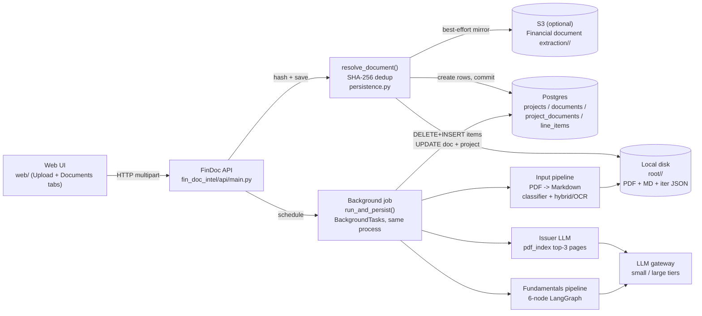
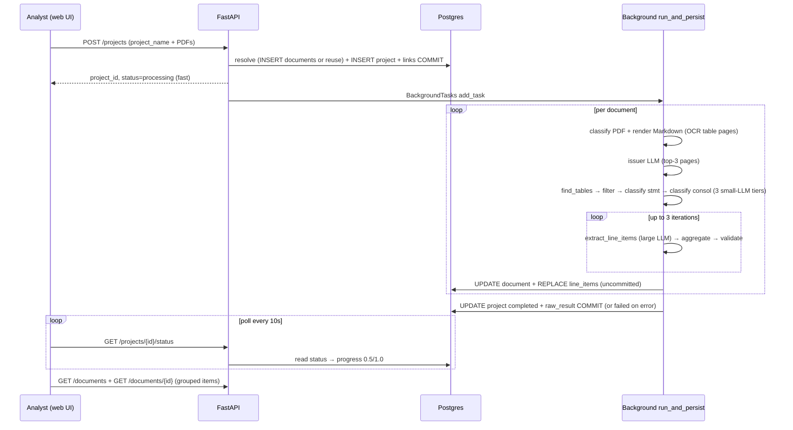
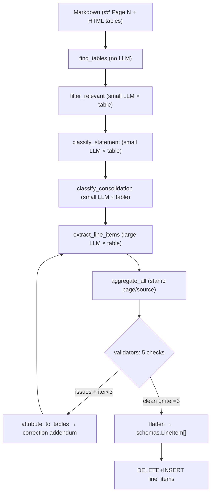
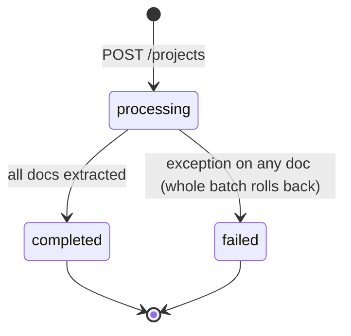
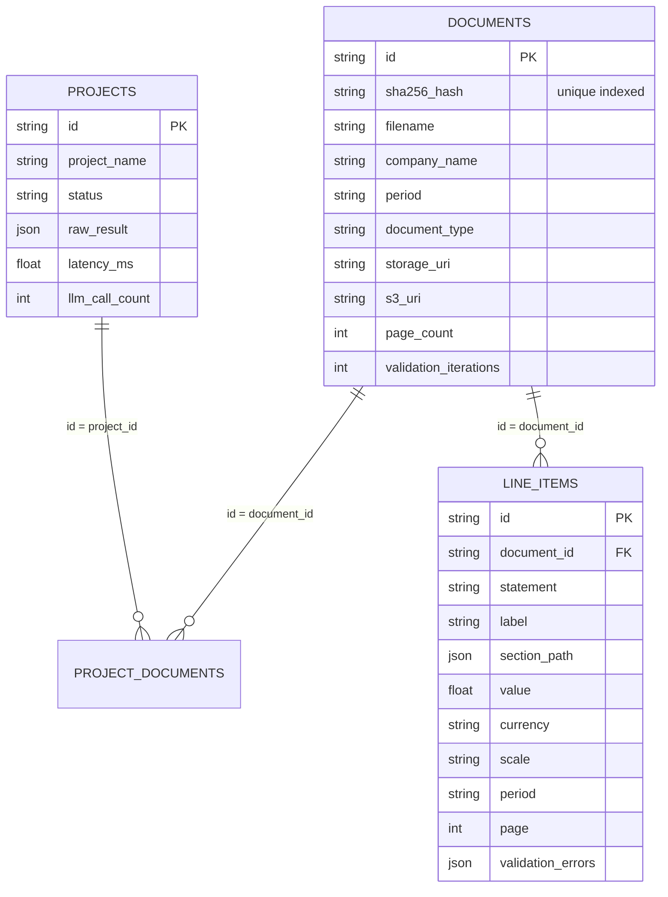

# Financial Document Data Extraction Agent (FinDoc Intelligence Agent) — NEW_CASE_STUDY (Complete Engineering Replication Guide)

> Purpose: single document describing **every detail of the code** in
> `FinDoc_IIntelligence_Agent/` so a new / fresher engineer can **rebuild the project
> without reading the source**.
>
> In this document the system is called the **Financial Document Data Extraction Agent**.
> Covers: inputs (mandatory/optional), what the user submits, step-by-step pipeline,
> every task/agent, exact prompts and I/O schemas, sample LLM payloads, the
> internet/news question, deterministic logic, persistence (types, modelling,
> S3/warehouse guidance), APIs, config, run-book, and mermaid diagrams.
>
> Codebase snapshot: single FastAPI service `fin_doc_intel/api/main.py:app` + one
> vanilla-JS UI (`web/`, served by the API itself), Postgres store, local-disk +
> best-effort S3-mirror storage, LangGraph 6-node table extraction pipeline,
> OpenAI-compatible LLM gateway, in-memory page index for issuer detection.
> Entry: `uvicorn fin_doc_intel.api.main:app --host 0.0.0.0 --port 8000`.
>
> Scope warning (honest): `CASE_STUDY.md §§1–6`, `DOCUMENTATION.md`, `REQUIREMENTS.md`
> narrate a broader multi-company time-series / ratios / screening / research-note
> vision. **None of that is built.** What is built is: **single-document financial
> line-item extraction with global content-hash-deduped storage**. This guide
> documents what the code actually does.

---

## Table of contents

1. [Repo map](#1-repo-map)
2. [System principle](#2-system-principle)
3. [Inputs — what the end user submits](#3-inputs--what-the-end-user-submits)
4. [What happens after Submit — end-to-end](#4-what-happens-after-submit--end-to-end)
5. [Pipeline tasks and agents](#5-pipeline-tasks-and-agents)
6. [Agent detail sheets (prompt, I/O, sample)](#6-agent-detail-sheets-prompt-io-sample)
7. [Deterministic / heuristic logic (no LLM)](#7-deterministic--heuristic-logic-no-llm)
8. [Internet / news module — what exists](#8-internet--news-module--what-exists)
9. [Persistence — where and how data is stored](#9-persistence--where-and-how-data-is-stored)
10. [API contract](#10-api-contract)
11. [Config / env vars](#11-config--env-vars)
12. [Mermaid diagrams](#12-mermaid-diagrams)
13. [Fresher run-book — replicate from zero](#13-fresher-run-book--replicate-from-zero)
14. [Sample end-to-end payloads](#14-sample-end-to-end-payloads)
15. [Known gaps](#15-known-gaps)

---

## 1. Repo map

```
FinDoc_IIntelligence_Agent/
  fin_doc_intel/
    api/main.py                  # FastAPI app + all 7 endpoints + DTOs
    api/__init__.py              # 1-line package marker
    config.py                    # Config dataclass + get_llm()/get_embedder()
    schemas.py                   # Final output LineItem + StatementType (flat schema)
    extraction.py                # Orchestrator: input_pipeline + 4 classify nodes + extract/aggregate retry loop + issuer LLM
    tools.py                     # search_pages/get_page LangChain tools (DEFINED BUT UNUSED)
    pdf_index.py                 # PageChunk + PageIndex (fitz + cosine search, issuer detection only)
    storage.py                   # DocumentStorage: local authoritative + S3 best-effort mirror
    db/models.py                 # 4 SQLAlchemy tables
    db/session.py                # engine/SessionLocal/init_db/get_db/get_db_session
    db/persistence.py            # resolve_document + create_project_and_documents + run_and_persist
    input_pipeline/
      __init__.py / models.py / classifier.py / processor.py
      extractors/base.py / hybrid_pdf.py / ocr_pdf.py / table_post_processor.py
    fundamentals_pipeline/
      __init__.py / models.py / state.py / table_finder.py
      prompts.py / structured_llm.py / nodes.py / validators.py / graph.py
  web/index.html                 # 2-tab vanilla-JS UI (Upload + Documents), inline CSS/JS
  data/uploads/<document_id>/    # runtime: <filename>.pdf + <stem>.md + iter N output/*.json (git-ignored)
  tests/test_api.py / test_extraction.py (stale) / conftest.py
  Dockerfile, k8s/deployment.yaml + service.yaml + configmap.yaml + secret.yaml
  Makefile, pyproject.toml, requirements.txt, .env.example
  CASE_STUDY.md, DOCUMENTATION.md (stale), REQUIREMENTS.md (vision scope)
```

No microservices. One process. `BackgroundTasks` = in-process job (not Celery/queue).

---

## 2. System principle

```
Table HTML is the contract. LLM classifies and transcribes tables. Python finds tables, validates, retries, stores.
```

- PDF is first rendered to **Markdown with HTML tables** (`## Page N` headings). Every
  downstream LLM node reads that Markdown — never the raw PDF bytes.
- LLM **never** computes ratios, growth, screening, or research notes (those modules do
  not exist despite old docs). It only: (a) keeps/drops tables, (b) buckets tables into
  5 statement types, (c) picks consolidated columns, (d) transcribes numeric cells,
  (e) names the issuer/period/currency.
- Every extracted fact keeps `page`, `section_path`, `period_end_date`, `scale`,
  `currency`, `consolidated`, `source_snippet`, `validation_errors`.
- A **document is global** (content-hash identity); a **project is one upload event**
  linking to 1..N documents. Re-uploading identical bytes updates rather than duplicates.
- Validation retries extraction up to 3 times per document; survivors are stored with
  their `validation_errors` flags, not rejected.

---

## 3. Inputs — what the end user submits

### 3.1 Transport

`POST /projects` is `multipart/form-data` (web UI Upload tab). All other calls are GET.

### 3.2 Field table

| Field | Location | Mandatory? | Type / constraints | What to type | Default if blank |
|---|---|---|---|---|---|
| `project_name` | form-text | **Mandatory** (`Form(...)`) | `str`, stored `VARCHAR(255) NOT NULL` | e.g. `Q4 Bank Results`, `FinDoc Analysis` (UI sends `FinDoc Analysis`) | 422 error if missing |
| `description` | form-text | Optional | `str` / `TEXT NULL` | free-text purpose note | `None` |
| `files` | form-file `files` (repeatable) | Optional at HTTP level (`File(None)`), **effectively mandatory** for useful work | PDF only (`%PDF-` magic checked). Max ~100 MB (`MAX_UPLOAD_SIZE_MB`, not enforced in code path — document the intent). Multi-file OK, any page count. Original filename preserved. | Audited annual reports, 10-K/20-F, quarterly reports, prospectuses, investor PDFs with tables | `None` → project with 0 documents; pipeline loop does nothing, project still `completed` |

There is **no** ticker, company-name, period, currency, question, review, rerun, or
search-region input. Issuer/period/currency are **detected by the system** (§6.1),
not supplied. There is no per-document status input and no correction/rerun API —
re-upload the file to reprocess.

### 3.3 What the analyst should actually submit (business guidance)

1. One or more text-based financial PDFs (annual/quarterly filings). Scanned PDFs work
   but force full-document OCR (`LightOnOCR-2-1B`, GPU preferred, CPU very slow).
2. XBRL files are **rejected** (`UnsupportedDocumentError`) — convert to PDF first.
3. Image-only PDFs with zero extractable text raise `ValueError("No extractable text…")`.
4. Tables must be real tables (detectable via `page.find_tables()` or >5% image area);
   narrative-only PDFs yield zero candidates → zero line items (not an error).
5. Filenames should be human-meaningful — the first upload's filename is kept forever
   (later identical-byte re-uploads under different names do not overwrite it).

---

## 4. What happens after Submit — end-to-end

### 4.1 Fast accept vs slow execute

`POST /projects` does **only** this synchronously (<1 s): hash each file → resolve
document identity → save PDF → insert `projects` + `project_documents` → commit →
schedule `BackgroundTasks(run_and_persist)` → return `project_id`. The minutes-long
extraction runs after the response. UI polls `GET /projects/{id}/status` every 10 s
(max 360 polls ≈ 60 min), then reads `GET /projects/{id}` / `GET /documents`.

### 4.2 Step-by-step (numbered, with code pointer)

| # | Step | Code | What happens |
|---|---|---|---|
| 1 | Upload | `api/main.create_project` | `await file.read()` → bytes per file. `DocumentStorage()` constructed. |
| 2 | Identity | `db/persistence.resolve_document` | `sha256(content)`; lookup `documents.sha256_hash`. Miss → new `Document(id=uuid4, hash, filename, page_count=fitz pages, storage_uri="")`. Hit → reuse row (filename/page_count kept from first upload). `storage.save_pdf(id, filename, content)` writes `<root>/<id>/<filename>` (overwrite = deliberate no-op on identical bytes) + best-effort S3 mirror → set `storage_uri=local path`, `s3_uri` if mirrored. Added to session (no commit yet). |
| 3 | Project row | `db/persistence.create_project_and_documents` | `Project(id=passed uuid, project_name, description, status="processing", requested_at)` + `ProjectDocument` ×N. **One commit** covering steps 2–3. Response `ProjectResponse(project_id, status="processing", documents=[{document_id, filename}])`. |
| 4 | Background start | `BackgroundTasks.add_task(run_and_persist, project_id, doc_ids)` | New session via `get_db_session()`. Timer starts. `total_llm_calls=0`. |
| 5 | Per doc: Markdown | `extraction.extract_document_content` → `InputProcessor.process(pdf_path, pdf.parent)` | `DocumentClassifier.classify`: XBRL sniff (suffix + first 4096 bytes markers) → `UnsupportedDocumentError`; else PDF magic check; count image-dominant pages (>50% image area) + text-layer probe (>50 chars). `scanned` if dominant≥10 or no text layer. Text PDF → `HybridPdfExtractor` (per page: `find_tables` or >5% image → `OcrPdfExtractor.ocr_page`, else `pymupdf4llm.to_markdown`); scanned → full OCR. Writes `<stem>.md` next to PDF with `## Page N` headings. Returns `ExtractionResult(document_class, markdown_path?, page_count, metadata)`. None markdown → `ExtractionRunResult(diagnostics=[input_pipeline error])`, skip to step 9 bookkeeping. |
| 6 | Per doc: issuer LLM | `extraction.detect_issuer_metadata(PageIndex(load_pdf_as_pages(storage_uri)))` | Embed each page (`get_embedder().embed_documents`, L2-norm), cosine search `"company name annual report financial year reporting currency document type"` k=3 → evidence block → 1 small-LLM call → `{"issuer","period","currency","document_type"}` (see §6.1). Fail-soft to all-None. +1 LLM call. |
| 7 | Per doc: classify ×4 | `fundamentals_pipeline.nodes` ×4 on Markdown text | `find_tables_node` (regex/BS4, no LLM) → `filter_relevant` (small LLM × tables) → `classify_statement` (small LLM × kept) → `classify_consolidation` (small LLM × classified). LLM so far = `len(raw)+len(relevant)+len(classified)`. |
| 8 | Per doc: extract+validate loop ≤3 | `extract_line_items` (large LLM × kept tables) → `aggregate_all` → `validators.run_all` → artifacts | Large-model `ExtractedLineItems` per table (+ correction addendum on retries 2–3). `aggregate_all` stamps `source_table="page N"`, `page="N"`. 5 validators (bracket sign, numeric label, duplicate value, ambiguous label, period-type). Save `<root>/<id>/iter {i} output/extraction.json` + `validation_report.json`. If issues and i<3: `correction_notes=attribute_to_tables(...)`, retry only last two nodes. LLM += `len(consolidation_filtered)` per iteration. `iterations_run=i`. |
| 9 | Per doc: persist | `db/persistence.run_and_persist` loop body | `document.company_name/period/document_type = meta`, `validation_iterations=iterations_run`; `DELETE line_items WHERE document_id`; INSERT one `LineItemRecord` per flattened `LineItem` (`statement=.value`, `validation_errors=[flag dicts]`). Not committed yet. Append per-doc summary `{document_id, company_name, line_items, iterations_run, diagnostics}`. |
| 10 | Project finalize | same function after loop | `project.raw_result={"documents":[...]}`, `latency_ms=round(elapsed×1000,2)`, `llm_call_count=total`, `status="completed"`, `completed_at`. **One commit for all docs + project.** |
| On exception any doc | `run_and_persist` except | Rollback (discards even successful docs in batch) + `_mark_failed(status="failed", raw_result={"error":str}, completed_at)`, commit. |
| 11 | Read | UI | `GET /documents` (picker), `GET /documents/{id}` (grouped line items), `GET /documents/{id}/file` (PDF inline iframe — exists but UI does not call it), `GET /projects/{id}` (counts). |

LLM-call accounting per document ≈ `1 (issuer) + T_raw + T_relevant + T_classified + I × T_kept` where `T_*` are table counts and `I` ∈ {1,2,3} iterations.

---

## 5. Pipeline tasks and agents

| # | Task | Agent / function | File | LLM? (model tier) | Input given | Output |
|---|---|---|---|---|---|---|
| T0 | Classify PDF | `DocumentClassifier.classify` | `input_pipeline/classifier.py` | No (PyMuPDF heuristics) | `Path` to PDF | `ClassificationReport{document_class, page_count, image_dominant_pages, has_text_layer}` |
| T1 | PDF → Markdown | `HybridPdfExtractor.extract` / `OcrPdfExtractor.extract` | `input_pipeline/extractors/` | Only on OCR pages (vision `LightOnOCR-2-1B`, `dpi=300`, `max_new_tokens=4096`) | PDF path + output dir | `<stem>.md` path (`## Page N` + HTML tables) |
| T2 | Find tables | `find_tables_node` | `fundamentals_pipeline/nodes.py` | No (regex + BeautifulSoup depth tracking) | Markdown text | `raw_tables: List[StatementCandidate]` (1 per `<table>`) |
| T3 | Filter relevant | `filter_relevant` | `nodes.py` + `prompts.RELEVANCE_PROMPT` | Yes, **small** (`SMALL_LLM_MODEL_NAME`, default haiku) ×1 per table, structured `RelevanceVerdict` | candidate summary + table HTML | `relevant_tables` (drops on `relevant=false` or LLM error) |
| T4 | Classify statement | `classify_statement` | `nodes.py` + `STATEMENT_CLASSIFIER_PROMPT` | Yes, **small** ×1 per kept table, structured `StatementClassification` | summary + HTML | `classified_tables` (+ `is_breakdown`, `breakdown_of`) |
| T5 | Classify consolidation | `classify_consolidation` | `nodes.py` + `CONSOLIDATION_PROMPT` | Yes, **small** ×1 per classified table, structured `ConsolidationMeta` | summary + statement type + numbered headers | `consolidation_filtered` (drops `skip && segment_id is None`) |
| T6 | Extract line items | `extract_line_items` | `nodes.py` + `LINE_ITEM_EXTRACTION_PROMPT` | Yes, **large** (`LARGE_LLM_MODEL_NAME`, default sonnet, `max_tokens=8192`) ×1 per kept table per iteration, structured `ExtractedLineItems` | summary + statement/segment/keep-columns + HTML + correction addendum (retries) | `extracted_per_table` (flat `LineItem{label, section_path, values[Cell]}`) |
| T7 | Aggregate | `aggregate_all` | `nodes.py` | No | `extracted_per_table` | `aggregated: Dict[statement, List[LineItem]]` + page stamps |
| T8 | Validate + attribute | `validators.run_all` + `attribute_to_tables` | `fundamentals_pipeline/validators.py` | No (5 rule checks) | `aggregated` | `issues[]` → `correction_notes{table_idx: [notes]}` or stop |
| T9 | Flatten to output | `_flatten_pipeline_items` | `extraction.py` | No | `aggregated + issues` | `List[schemas.LineItem]` (one per cell) |
| T10 | Issuer metadata | `detect_issuer_metadata` | `extraction.py` | Yes, **default** LLM ×1 per doc, raw JSON (not structured output) | top-3 pages for issuer query | `{"issuer","period","currency","document_type"}` |

How information is given to each LLM agent: **structured-output function-calling**
(`StructuredExtractor.with_structured_output(schema, method="function_calling")`,
empty → `EmptyStructuredOutputError` → table dropped) for T3–T6; raw JSON prompt
(`_safe_json`) for T10; vision chat template (system instruction + page image) for OCR
pages in T1. No agent receives tools — `tools.py` exports `search_pages`/`get_page`
but **nothing calls them** (issuer search calls `PageIndex` directly).

---

## 6. Agent detail sheets (prompt, I/O, sample)

### 6.0 Shared plumbing

- `StructuredExtractor(schema, model, max_tokens=8192)`: `llm=get_llm(model, max_tokens)`,
  `chain=llm.with_structured_output(schema, method="function_calling")`,
  `extract(messages) → schema` or raise.
- Candidate summary passed to every table agent (`_candidate_summary`):
  ```
  Nearest H1: <h1> / Nearest H2: <h2> / Caption: <last text line> / Outer scale annotation: <(in … millions)> / Page: <N>
  Table HTML:
  <table>…</table>
  ```
- Table HTML comes from OCR-corrected Markdown (`table_post_processor.fix_ocr_output`:
  split merged `$ 2,489 | $ 894` cells, normalize thead colspan/rowspan, W3C grid fill).
- `tools.py` (unused): `search_pages(query, k=5) → [{page_number, text}]`,
  `get_page(n) → {page_number, text}` — implemented against a module-global
  `PageIndex` via `set_page_index()`, but `extraction.py` never sets it.

### 6.1 T10 — Issuer / period / currency detection

- Function: `detect_issuer_metadata(index: PageIndex) -> dict` (`extraction.py`).
- Retrieval first: `_evidence_from_pages(index, "company name annual report financial
  year reporting currency document type", k=3)` →
  ```
  --- PAGE 2 ---
  <page text>…

  --- PAGE 1 ---
  <page text>…
  ```
- System prompt (verbatim): `Identify the reporting entity metadata from the text.
  \`document_type\` is a short free-text label for what kind of filing this is (e.g.
  "Annual Report", "10-K", "20-F", "Quarterly Report", "Prospectus") — use the label
  the document itself uses, or your best judgment if it doesn't say. Output ONLY a
  JSON object: '{"issuer": str|null, "period": str|null, "currency": str|null,
  "document_type": str|null}'`
- Human message: the evidence block. Model: default `get_llm()` (not small/large tier).
- Parse: `_strip_json` (fence strip) → `_safe_json` (json.loads or None); non-dict →
  all-None. Returns `{"issuer","period","currency","document_type"}`.
- Sample in/out:
  ```json
  // LLM output
  {"issuer":"Acme Manufacturing Ltd","period":"FY2024","currency":"GBP","document_type":"Annual Report"}
  // stored on documents: company_name="Acme…", period="FY2024", document_type="Annual Report"
  ```

### 6.2 T3 — Relevance filter

- Output schema: `RelevanceVerdict{relevant: bool, reason: str}` (one sentence).
- System prompt: `prompts.RELEVANCE_PROMPT` (verbatim, §7 table) — relevant = any analyst
  datapoint (headline IS/BS/CF, segment P&Ls, fee/expense/loan/deposit/RWA/capital/MREL/
  maturity breakdowns, GAAP reconciliations, KPI dashboards, ratio/margin tables even
  without absolutes, rating tables, share counts); not relevant = narrative-only,
  glossaries, contacts.
- User message: candidate summary + `Table HTML:\n{html}`.
- Sample:
  ```
  IN: Nearest H1: Financial statements / Caption: Consolidated income statement / Page: 12 / <table>…Revenue…</table>
  OUT: {"relevant": true, "reason": "Headline consolidated income statement with revenue and expense line items."}
  IN: <table>…Glossary of terms…</table>
  OUT: {"relevant": false, "reason": "Glossary with no numeric data."}
  ```

### 6.3 T4 — Statement classifier (5 buckets)

- Output: `StatementClassification{statement_type: balance_sheet|income_statement|
  cash_flow|changes_in_equity|other, is_breakdown: bool, breakdown_of: str?}`.
- System: `STATEMENT_CLASSIFIER_PROMPT` — read **labels**, not headings; RWA/capital/MREL/
  maturity ladders → `balance_sheet`; segment P&Ls → `income_statement` with
  `is_breakdown=false`; KPIs/ratios/counts/NPS → `other` (**kept**, shown as
  `KPIs, Ratios & Other` in UI); `is_breakdown=true` for decompositions
  (fee breakdown, opex by category, loans by sector, RWA by type, capital composition).
- Sample: income-statement HTML → `{"statement_type":"income_statement",
  "is_breakdown":false,"breakdown_of":null}`; fee-breakdown table →
  `{"statement_type":"income_statement","is_breakdown":true,
  "breakdown_of":"Net fee and commission income"}`.

### 6.4 T5 — Consolidation filter

- Output: `ConsolidationMeta{consolidated_columns: int[], unconsolidated_columns: int[],
  segment_id: str?, skip: bool, reason: str}`.
- System: `CONSOLIDATION_PROMPT` — numbered 0-based headers; skip Change/%/vs-prior;
  Group/Consolidated/Holding/no-qualifier → consolidated; Bank/Company/Parent/Standalone →
  unconsolidated; segment from heading (`Retail Banking…`) → `segment_id`, all columns
  treated consolidated-in-segment; `skip=true` only if zero consolidated and no segment.
- User: summary + `Statement type: … / Breakdown: … / Column headers (0-based):\n[0] 2024
  Group\n[1] 2024 Bank\n…` + HTML.
- Sample: headers `[0] 2024 Group, [1] 2024 Bank, [2] Change %` →
  `{"consolidated_columns":[0],"unconsolidated_columns":[1],"segment_id":null,
  "skip":false,"reason":"Group is consolidated; Bank is parent-only; Change % skipped."}`

### 6.5 T6 — Line-item extraction (large model, retryable)

- Output: `ExtractedLineItems{line_items: [{label, section_path[], values: [Cell]}]}`,
  `Cell{coordinates{period_end: ISO, period_type: point|3M|6M|9M|12M, segment_id?,
  consolidation?, source_table?, page?…}, value: float, currency?, scale?,
  raw_text? (verbatim token)}`.
- System: `LINE_ITEM_EXTRACTION_PROMPT` (full rules in §7): keep only listed columns;
  `raw_text` verbatim before sign conversion; `period_end` ISO + `period_type`
  (`3Q2025→3M, FY2024→12M, 30 Sep 2025→point`); PD-band tables append metric header to
  label (`0.50 to < 2.00 — Original exposure`); **skip** variance columns
  (Amount/%/Variance/Change/Difference/vs/±/bps/Increase/Decrease/bare %);
  emit **every** numeric row incl. sub-items; section-stack tracking
  (push subheader, pop on matching Total/Net, pop conflicts; `section_path`
  outermost-first); `(123)→-123`; strip footnotes; currency/scale precedence
  row > subheader > outer annotation; per-row `(in € billion)/%/bps` overrides.
- User: summary + `Statement type / Segment id / Breakdown / Column indices to KEEP:
  [0, 2] or 'all numeric columns'` + `Outer scale annotation` + correction addendum
  (retries only, via `build_correction_addendum`: `Your previous extraction … was
  validated and the following issues were found… - {note}`) + `Table HTML`.
- Sample output cell:
  ```json
  {"label":"Revenue","section_path":[],"values":[
    {"coordinates":{"period_end":"2024-12-31","period_type":"12M","consolidation":"consolidated","source_table":"page 12","page":"12"},
     "value":12400000,"currency":"GBP","scale":"actual","raw_text":"12,400,000"}]}
  ```
- Flatten (`_flatten_pipeline_items`): one `schemas.LineItem` per cell —
  `period=period_end ISO string`, `period_end_date=date.fromisoformat or None`,
  `period_length_months={"3M":3,"6M":6,"9M":9,"12M":12}[period_type]`
  (balance-sheet `point` → None), `consolidated=(consolidation=="consolidated")`,
  `page=int or None`, `source_snippet=source_table` (`"page N"` tag),
  `unit=None` (currency/scale carried in `currency`/`scale` fields),
  `validation_errors=flags for (statement,label,section_path,coords)` key.

### 6.6 Final output structure (what every agent converges to)

`schemas.LineItem` (flat — hierarchy in `section_path`, never a tree):

```python
statement: balance_sheet|income_statement|cash_flow|changes_in_equity|other  # required
label: str            # verbatim, footnotes stripped
section_path: [str]   # e.g. ["Assets","Current assets"], outermost first
value: float          # signed, (123) already → -123
unit: str?            # e.g. 'INR mn' (often None; scale field preferred)
currency: str?        # e.g. 'GBP', '€'
period: str?          # ISO period_end, e.g. '2024-12-31' (NOT 'FY2024')
period_end_date: date?
period_length_months: int?   # 3/6/9/12; None for point-in-time BS rows
scale: actual|thousands|millions|billions|percentage?
consolidated: bool?
page: int?            # global PDF page number
source_snippet: str?  # 'page N' tag
validation_errors: [{check, severity: warning|error, message}]  # survivors after 3 tries
```

---

## 7. Deterministic / heuristic logic (no LLM)

| Area | Function | Exact rule |
|---|---|---|
| PDF classification | `DocumentClassifier.classify` | XBRL if suffix `.xbrl` or first 4096 bytes contain `<xbrl` / `<xbrli:xbrl` / xbrl.org / xhtml NS; PDF iff first 5 bytes `%PDF-` else `UnsupportedDocumentError`; image-dominant page = image_area/page_area > 0.50 (`IMAGE_BLOCK_TYPE=1`); scanned if dominant ≥ 10 pages (`SCANNED_PAGE_THRESHOLD`) or no page has >50 chars text (`TEXT_LAYER_MIN_CHARS`) |
| Table discovery | `table_finder.find_tables` | Depth-track `<table>` spans in Markdown; BeautifulSoup-validate; track `#{1,6}` headings, `## Page N`, caption = last non-empty non-heading non-scale line, outer annotation = last `\(in [€$£¥EURUSDGBPJPY]? (thousand|million|billion)s? …\)` match |
| OCR trigger | `HybridPdfExtractor._page_has_table` | `find_tables().tables` non-empty **or** image_area/page_area > 0.05 → OCR that page; else `pymupdf4llm.to_markdown` |
| OCR contract | `_OCR_INSTRUCTION` | All tables as HTML (`table/thead/tbody/tr/th/td`); multi-level headers via `colspan`; every tbody row exactly leaf-header column count; one value per `<td>` (no `|` inside); exact copy of `$(),-`; blanks `<td></td>` |
| HTML repair | `table_post_processor.fix_ocr_output` | Split merged `$ 2,489 \| $ 894`; normalize thead (strip rowspan when leaf count = Σ colspans; align `%` subheader); W3C grid fill gaps + rebuild |
| Validators (5) | `validators.*` | `bracket_sign` (error: parenthesized/`-`-prefixed raw must be <0 and vice versa); `numeric_label` (error: label is bare numbers/ranges); `duplicate_value` (warning ×2 per pair: same value+currency+scale, different period_end/segment); `ambiguous_duplicate_label` (error: same label+section+period+segment, distinct values); `period_type_mismatch` (error: BS must be `point`, flows must be 3M/6M/9M/12M) |
| Retry | `extraction.extract_document_content` loop | `MAX_EXTRACTION_ITERATIONS=3`; artifacts saved per iteration; `attribute_to_tables` maps issues to `source_index` via page→table map; only `extract_line_items` + `aggregate_all` re-run (classification frozen) |
| Dedup identity | `resolve_document` | `sha256(content)` unique-indexed; identical bytes → same `document_id`/folder; PDF bytes overwritten (no-op); filename kept from first upload |
| Replace semantics | `run_and_persist` | `DELETE line_items WHERE document_id` then INSERT fresh; `documents.company_name/period/document_type/validation_iterations` overwritten; project commit covers whole batch atomically |

Prompt texts (reference — full verbatim in `fundamentals_pipeline/prompts.py`):
`RELEVANCE_PROMPT` (relevant = any analyst datapoint incl. KPIs/ratios/ratings/shares;
not relevant = narrative/glossary/contacts); `STATEMENT_CLASSIFIER_PROMPT` (label-driven
5-bucket + `is_breakdown`/`breakdown_of`); `CONSOLIDATION_PROMPT` (0-based headers,
Group→consolidated, Bank/Parent→unconsolidated, segment capture, skip rule);
`LINE_ITEM_EXTRACTION_PROMPT` (keep-columns, raw_text, coordinates, PD-band label
append, variance skip-list, section-stack, sign/footnote/currency rules).

---

## 8. Internet / news module — what exists

**Short answer: there is no internet/news module in this codebase.**

- No `osint/` package, no DuckDuckGo/`ddgs`, no `requests`+`bs4` fetching, no sentiment
  LLM, no `WebEvidenceItem`/`WebSentimentResult` schemas, no `CompanySeed`, no adverse/
  market-sentiment factors. `requirements.txt` has no `ddgs`/`yfinance`; `web/index.html`
  has no sentiment tab; `line_items` store filing facts only.
- If a fresher is asked to "replicate the news part": there is nothing to replicate.
  The issuer detector (§6.1) is the only LLM that reads free text, and its evidence
  comes from the **uploaded PDF itself** (top-3 pages), never the web.

For completeness — **if** a news module were added later (mirroring the sister
Credit-Risk agent), the contract to implement would be:

| Aspect | Recommended shape (not built — do not treat as existing) |
|---|---|
| Input | `CompanySeed{company_name (from documents.company_name), aliases[], country?, ticker?, search_region?}` + enable flag per project |
| Retrieval | 12 fixed queries (`{name} news/results/fraud/regulatory/debt/layoffs/CEO/accounting/analyst/investor…`), `ddgs.text` + `ddgs.news`, dedup by URL, `fetch_page_text` ≤4000 chars |
| LLM input | `Company + numbered evidence [{title, url, snippet}]`, system: disambiguation confidence + overall sentiment + adverse findings (category/summary/severity/url) + highlights/gaps, JSON-only |
| LLM output | `WebSentimentResult{disambiguation_confidence, overall_sentiment, sentiment_summary, adverse_findings[], positive_highlights[], evidence[], citations[], data_gaps[]}` |
| How passed on | Never into `line_items`; separate table or `projects.raw_result.web_sentiment`; scoring (does not exist here) would discount one notch + cap single-source at medium |
| Sample | In: `Company: Acme Ltd \| UK` + `[1] (adverse/web) Acme faces lawsuit… url…`; Out: `{"disambiguation_confidence":"medium","overall_sentiment":"mixed","adverse_findings":[{"category":"litigation",…}]}` |

---

## 9. Persistence — where and how data is stored

### 9.1 Files (local authoritative + S3 best-effort)

`DocumentStorage` (`storage.py`) is the only module that knows the layout.
`config.document_storage_dir` default `./data/Financial document extraction`
(code) / `./data/uploads` (`.env.example`); **runtime observed: `data/uploads/`**.

| Artifact | Exact path | Example |
|---|---|---|
| PDF | `<root>/<document_id>/<original filename>` | `data/uploads/03e76705-…/Annual Report FY2026.pdf` |
| Markdown | `<pdf_dir>/<stem>.md` (processor called with `output_dir=pdf.parent`) | `data/uploads/03e76705-…/Annual Report FY2026.md` |
| Iteration dump | `<root>/<document_id>/iter {N} output/extraction.json` (spaces literal) | `data/uploads/<id>/iter 1 output/extraction.json` |
| Validation report | `<root>/<document_id>/iter {N} output/validation_report.json` | same dir |
| S3 mirror (if `S3_BUCKET` set) | key `Financial document extraction/<id>/<relative>`, URI `s3://<bucket>/…` | PDF + both JSONs mirrored (`application/pdf` / `application/json`); failures swallowed (`False`), local remains truth |

`save_pdf` always rewrites local bytes (identical re-upload = no-op overwrite);
`save_json` writes `json.dumps(indent=2, default=str)`. Reads always hit local —
S3 is write-only mirror; `_build_s3_client` needs `boto3` (not in requirements —
install it to enable).

### 9.2 Postgres (source of truth) — 4 tables, full column types

PKs are `String` UUIDs (`str(uuid4())`) generated Python-side. `JSON` = Postgres
`JSON` (not `JSONB`); dates naive `utcnow`.

| Table | Columns (type) |
|---|---|
| `projects` | `id String PK, project_name String(255) NOT NULL, description Text?, status String(32) (created/processing/completed/failed), model_name String(128)?, embed_model_name String(128)?, raw_result JSON? ({"documents":[{document_id,company_name,line_items,iterations_run,diagnostics}]} — NOT the line items), reasoning JSON?, latency_ms Float?, llm_call_count Int?, requested_by String(128)=local-analyst (free text, no auth), requested_at DateTime, completed_at DateTime?` |
| `documents` | `id String PK (= storage folder name), sha256_hash String(64) NOT NULL UNIQUE INDEXED (dedup key), filename String(255) NOT NULL (first upload wins), company_name String(255)? (issuer LLM, null until run), period String(64)? (e.g. FY2024), document_type String(128)? (Annual Report/10-K/…), storage_uri Text NOT NULL (local abspath), s3_uri Text? (only if mirrored), page_count Int NOT NULL (fitz, never recomputed on hit), uploaded_at DateTime, validation_iterations Int? (1–3, null until run)` |
| `project_documents` | `id String PK, project_id String FK→projects.id NOT NULL, document_id String FK→documents.id NOT NULL` — pure join, no metadata |
| `line_items` | `id String PK, document_id String FK→documents.id NOT NULL (NO project_id), statement String(32) NOT NULL (5 values), label Text NOT NULL, section_path JSON NOT NULL (flat list, outermost first), value Float NOT NULL, unit String(64)?, currency String(16)?, period String(64)? (ISO period_end), period_end_date Date?, period_length_months Int?, scale String(16)? (actual/thousands/millions/billions/percentage), consolidated Boolean?, page Int?, source_snippet Text? ("page N"), validation_errors JSON NOT NULL ([{check, severity, message}] survivors)` |

Modelling notes: `documents` has **no** `project_id` (global entity);
`line_items` scoped to `document_id` only (reprocess replaces all rows for that doc
regardless of triggering project); `section_path` flat list, not a tree;
`validation_errors` is data, not logs (UI counts `flagged_line_item_count` via
`json_array_length(validation_errors)>0` — Postgres-specific, breaks on SQLite).

### 9.3 Redis

Configured (`REDISHOST/PORT/PASSWORD/DB` in `config.py`) but **never used** — no
`status_tracker`, no phase keys, no Celery broker. Status is Postgres `projects.status`
polled directly. Do not provision Redis for a rebuild unless adding a queue.

### 9.4 Correct join pattern

```sql
-- project → its documents → their facts (never join line_items to projects directly)
SELECT d.* FROM documents d
JOIN project_documents pd ON pd.document_id = d.id
WHERE pd.project_id = :pid;
SELECT * FROM line_items WHERE document_id = :did ORDER BY statement, page;
-- counts / flagged (what the API does)
SELECT document_id, count(*) FROM line_items GROUP BY document_id;
SELECT document_id, count(*) FROM line_items
WHERE json_array_length(validation_errors) > 0 GROUP BY document_id;
```

### 9.5 Do we need S3 / warehouse?

- **S3: yes before any scale-out or durability need.** Today the PDF + Markdown +
  iteration JSONs live on one machine's disk (`storage_uri` is a local path;
  `k8s/deployment replicas:1` pinned for this reason; pod move = data loss).
  Minimal migration: keep `documents` schema, set `storage_uri=s3://…` (or keep local
  cache + `s3_uri` authoritative), download to scratch file for `fitz/pymupdf4llm`
  (both need local files), upload PDF+Markdown back. `boto3` must be added to
  requirements; wire `S3_BUCKET/S3_REGION` (already in `Config`, already mirrored
  best-effort — just never read back).
- **Warehouse: not needed.** Corpus queries are key-based (project→docs→items) with
  trivial joins; no cross-document analytics, screening, or time-series exist to
  justify ETL. If multi-doc analytics are later built, replicate `line_items`
  nightly (append-only on `(document_id, statement, label, period_end_date)`) and keep
  Postgres as the operational store.

---

## 10. API contract

Base `http://localhost:8000`. IDs are UUID strings.

| Method + path | Req | Resp |
|---|---|---|
| `GET /` | — | `web/index.html` (Upload + Documents tabs) |
| `GET /health` | — | `{"status":"healthy","timestamp":"…"}` (k8s probes) |
| `POST /projects` | multipart `project_name* (Form, required)`, `description (Form?)`, `files[] (File?)` | `ProjectResponse{project_id, project_name, status:"processing", created_at, completed_at:null, documents:[{document_id, filename}]}` (background scheduled; 422 if `project_name` missing) |
| `GET /projects/{id}` | — | `ProjectResponse` with per-doc `{document_id, filename, company_name?, period?, document_type?, line_item_count, validation_iterations?, flagged_line_item_count}`; 404 `project not found` |
| `GET /projects/{id}/status` | — | `{"project_id","status","progress": 0.5 processing / 1.0 completed|failed / 0.0 other}` |
| `GET /documents` | — | `[DocumentSummary]` newest first; `line_item_count==0` = processing-or-failed (no finer signal) |
| `GET /documents/{id}` | — | `DocumentDetail(Summary + line_items: [LineItem] ordered by statement,page)`; 404 `document not found` |
| `GET /documents/{id}/file` | — | PDF inline (`media_type=application/pdf`, `inline` disposition) — implemented, UI does not call it |

`DocumentSummary{document_id, filename, company_name?, period?, document_type?,
line_item_count=0, validation_iterations?, flagged_line_item_count=0}`;
`DocumentDetail` adds `line_items: [schemas.LineItem]`; `ProjectResponse{project_id,
project_name, status, created_at (iso), completed_at? (iso), documents[]}`.
Errors: missing project/document → `404 {detail}`; missing `project_name` → `422`;
pipeline exception → `status:"failed"`, `raw_result:{"error":…}` (no 500 to poller).

curl:

```bash
curl -X POST http://localhost:8000/projects -F "project_name=FinDoc Analysis" -F "files=@annualreport-2025.pdf"
# → {"project_id":"…","status":"processing","documents":[{"document_id":"…","filename":"annualreport-2025.pdf"}]}
curl http://localhost:8000/projects/<pid>/status
curl http://localhost:8000/projects/<pid>
curl http://localhost:8000/documents
curl http://localhost:8000/documents/<did>
curl http://localhost:8000/documents/<did>/file --output back.pdf
```

---

## 11. Config / env vars

`Config.from_env()` + lazy `get_config()`; `get_llm(model?, max_tokens?)` →
`ChatOpenAI(model, api_key=LLM_API_KEY, base_url=LLM_ENDPOINT, temperature=0.0,
max_tokens)`; `get_embedder()` → `OpenAIEmbeddings(EMBED_MODEL_NAME, api_key,
base_url)`. Defaults: `LLM_MODEL_NAME=SMALL=anthropic.claude-4-5-haiku`,
`LARGE=anthropic.claude-sonnet-4-6`, `EMBED=openai.text-embedding-3-large`,
`EMBED_DIM=1536`, `LLM_TEMPERATURE=0.0`, `LLM_MAX_TOKENS=4096`.

| Var | Default | Effect |
|---|---|---|
| `LLM_ENDPOINT / LLM_API_KEY` | `""` | gateway base_url + key for chat + embeddings |
| `LLM_MODEL_NAME` | `anthropic.claude-4-5-haiku` | default + small-tier fallback |
| `SMALL_LLM_MODEL_NAME` | = default model | T3/T4/T5 classifiers |
| `LARGE_LLM_MODEL_NAME` | `anthropic.claude-sonnet-4-6` | T6 extractor (`max_tokens=8192` override) |
| `EMBED_MODEL_NAME / EMBED_DIM` | `openai.text-embedding-3-large / 1536` | issuer page index only |
| `LLM_TEMPERATURE / LLM_MAX_TOKENS` | `0.0 / 4096` | determinism; extractor raises to 8192 |
| `PGHOST / PGPORT / PGDATABASE / PGUSER / PGPASSWORD` | `localhost / 5433 / findoc_db / findoc_user / 7194` | `Config`; note `db/session.py` instead reads `PGUSER(default postgres)` + `DATABASE_URL` override — set both consistently |
| `DATABASE_URL` | unset → built from PG* | session engine (`postgresql://…`); needs `psycopg2-binary` driver string compatible |
| `REDISHOST / REDISPORT / REDIS_PASSWORD / REDIS_DB` | `localhost / 6379 / None / 0` | parsed, **unused** |
| `LOG_LEVEL` | `INFO` | logging |
| `MAX_UPLOAD_SIZE_MB` | `100` | documented intent, not enforced |
| `DOCUMENT_STORAGE_DIR` | `./data/Financial document extraction` (example: `./data/uploads`) | local root; runtime uses `data/uploads/` |
| `S3_BUCKET / S3_REGION` | `None` | enables best-effort mirror (needs `boto3`, not in requirements) |

k8s `configmap.yaml` keys (`LLM_BASE_URL/LLM_MODEL/EMBED_MODEL`, `PGHOST=postgres-service…`)
are **stale** vs `config.py` (`LLM_ENDPOINT/LLM_MODEL_NAME/EMBED_MODEL_NAME`) — align
them before deploying. `secret.yaml` holds `PGUSER/PGPASSWORD/REDIS_PASSWORD/LLM_API_KEY`.

---

## 12. Mermaid diagrams

### 12.1 High-level architecture (accept vs execute + global dedup)



### 12.2 End-to-end sequence (upload → poll → browse)



### 12.3 Table-pipeline detail (6 nodes + retry)



### 12.4 Project lifecycle (literal `status` values)



(No review/version/rerun states. Re-upload = new project, possibly same `document_id`.)

### 12.5 Entity-relationship (literal tables)



---

## 13. Fresher run-book — replicate from zero

1. **Prereqs**: Python ≥3.12, Postgres (any version with `JSON` + `json_array_length`;
   port 5433 per defaults), `torch`+`transformers`+`accelerate` for OCR pages
   (GPU strongly advised; CPU full-OCR is very slow), LLM gateway URL+key
   (OpenAI-compatible; two tiers recommended: fast small + strong large), `boto3`
   only if S3 mirror needed.
2. **Install + env**:
   ```bash
   pip install -r requirements.txt
   cp .env.example .env   # fill LLM_ENDPOINT, LLM_API_KEY
   # set PG* consistently for BOTH config.py (findoc_user) and session.py (postgres/DATABASE_URL)
   # set DOCUMENT_STORAGE_DIR=./data/uploads, EMBED_DIM per embed model
   ```
3. **DB**: `python -c "from fin_doc_intel.db.session import init_db; init_db()"` or
   `make init-db` (also runs on app startup via `lifespan`). No migrations.
4. **Run API**: `uvicorn fin_doc_intel.api.main:app --host 0.0.0.0 --port 8000`
   (or `make run`) → `GET /health` → open `http://localhost:8000/` (UI at `/`,
   static at `/static`). Ignore `make run-streamlit` (target file deleted).
5. **First extraction**: Upload tab → choose PDF(s) → Create runs
   `POST /projects` → poll `GET /projects/{id}/status` → Documents tab →
   pick document → verify groups (`Balance Sheet / Income Statement / Cash Flow /
   Changes in Equity / KPIs, Ratios & Other`) + section trees + `flagged` counts.
   Check disk: `data/uploads/<document_id>/` (PDF + `.md` + `iter N output/*.json`).
6. **Docker**: `docker build -t findoc-api:latest .` (py3.12-slim, copies
   `fin_doc_intel/ + web/`, `CMD uvicorn …:8000`); compose must add Postgres +
   volume for storage dir (S3 later). Healthcheck `GET /health`.
7. **k8s**: fix `configmap.yaml` keys to `LLM_ENDPOINT/LLM_MODEL_NAME/EMBED_MODEL_NAME`
   first; fill `secret.yaml`; keep `replicas:1`; apply configmap/service/deployment.
   CI `test → build-and-push` real; `deploy` needs `KUBE_CONFIG` secret.
8. **Tests**: `pytest tests/ -v` — `test_api.py` should pass; `test_extraction.py`
   is stale (imports deleted functions) — rewrite it against `extract_document_content`
   + validators before trusting CI.
9. **Rebuild checklist** (if re-implementing): Pydantic `LineItem` flat schema →
   SHA-256 `resolve_document` + local layout → 4 tables + join pattern →
   `DocumentClassifier` thresholds (50%/10 pages/50 chars) → hybrid vs full OCR
   (`find_tables` or 5% image rule, `## Page N` Markdown, `_OCR_INSTRUCTION` HTML
   contract + 3-stage repair) → `find_tables` regex/BS4 + `group` (unused) →
   4 prompts verbatim + `StructuredExtractor(function_calling)` →
   `extract (large, 8192)` + `aggregate` page stamps → 5 validators + page→table
   attribution + ≤3 retry of last two nodes → flatten mapping (period ISO,
   `point`→None length, `consolidated` bool, `source_snippet="page N"`) →
   issuer top-3 + JSON prompt → `run_and_persist` DELETE+INSERT + single project
   commit → 7 endpoints + progress map → 2-tab UI (fixed statement order,
   recursive section tree, `escapeHtml`).

---

## 14. Sample end-to-end payloads

Create:

```bash
curl -X POST http://localhost:8000/projects \
  -F "project_name=FinDoc Analysis" -F "files=@annualreport-2025.pdf"
# → {"project_id":"…","project_name":"FinDoc Analysis","status":"processing",
#    "created_at":"…","completed_at":null,
#    "documents":[{"document_id":"…","filename":"annualreport-2025.pdf",
#    "company_name":null,"period":null,"document_type":null,
#    "line_item_count":0,"validation_iterations":null,"flagged_line_item_count":0}]}
```

Document detail (after `completed`):

```json
{"document_id":"…","filename":"annualreport-2025.pdf","company_name":"Acme Manufacturing Ltd",
 "period":"FY2024","document_type":"Annual Report","line_item_count":214,
 "validation_iterations":2,"flagged_line_item_count":3,
 "line_items":[
   {"statement":"income_statement","label":"Revenue","section_path":[],"value":12400000.0,
    "unit":null,"currency":"GBP","period":"2024-12-31","period_end_date":"2024-12-31",
    "period_length_months":12,"scale":"actual","consolidated":true,"page":12,
    "source_snippet":"page 12","validation_errors":[]},
   {"statement":"other","label":"CET1 ratio","section_path":["Capital"],"value":13.4,
    "unit":null,"currency":null,"period":"2024-12-31","period_end_date":"2024-12-31",
    "period_length_months":null,"scale":"percentage","consolidated":true,"page":8,
    "source_snippet":"page 8","validation_errors":[]}]}
```

Retry artifact (`iter 2 output/validation_report.json` entry):

```json
{"check":"period_type_mismatch","severity":"error","statement_type":"balance_sheet",
 "label":"Total assets","section_path":["Assets"],"cell_coordinates":{"period_end":"2024-12-31","period_type":"12M"},
 "message":"Balance-sheet cell must use period_type 'point'"}
```

---

## 15. Known gaps

1. Local-disk storage (S3 only best-effort mirror, never read back; `boto3` not even
   installed) → single replica, no backup; `fitz`/`pymupdf4llm` need local scratch
   files even after an S3 move.
2. Whole batch in one DB transaction — one doc's exception discards sibling docs'
   extractions; project marked `failed` with nothing surviving.
3. No per-document status (`line_item_count==0` conflates processing vs failed).
4. No validation-gate enforcement beyond retry — survivors stored with flags, trusted as-is;
   no citation/grounding re-check.
5. `tools.py` dead code (nothing sets the global index); pipeline calls `PageIndex` directly.
6. Concurrent identical uploads can race the unique hash insert (`IntegrityError`, unhandled).
7. `test_extraction.py` stale (imports deleted functions); `DOCUMENTATION.md` /
   `REQUIREMENTS.md` / k8s configmap keys describe the old architecture.
8. No auth (free-text `requested_by`), no review/rerun/Q&A/screening/ratios/research APIs.
9. `deploy` job needs real `KUBE_CONFIG`; reference only until then.

