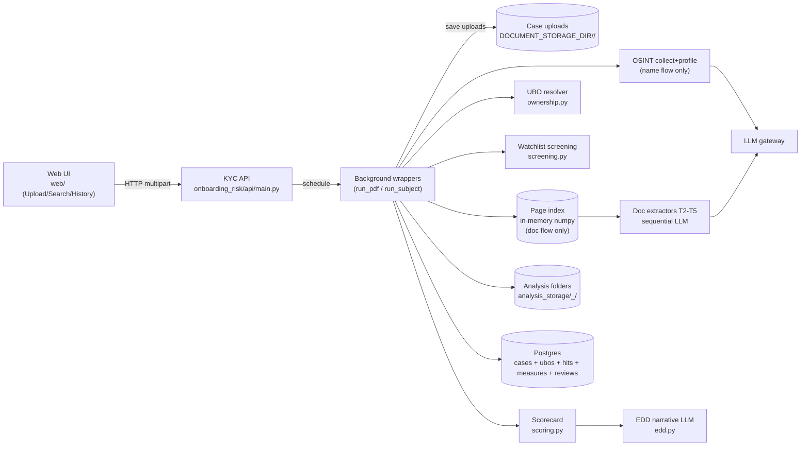
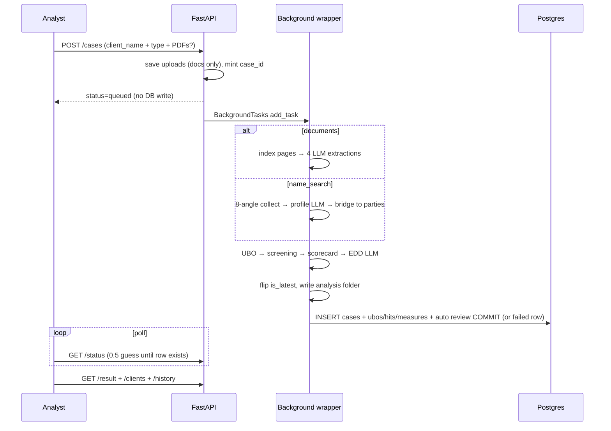
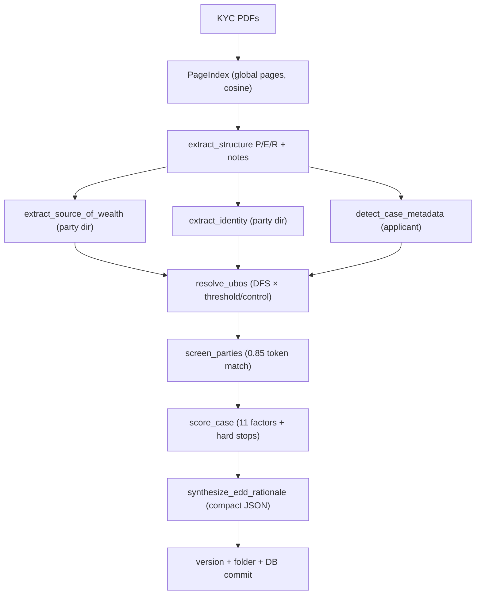
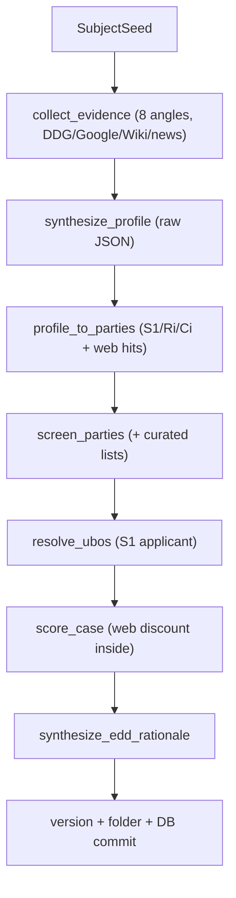
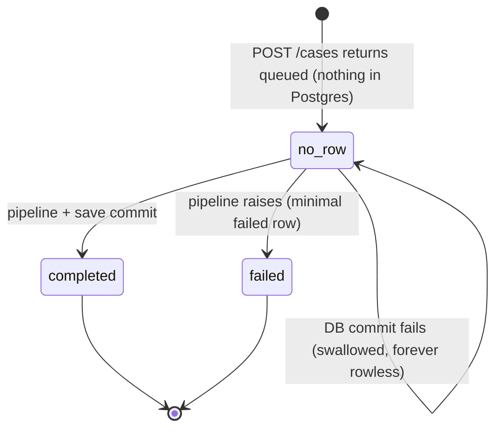
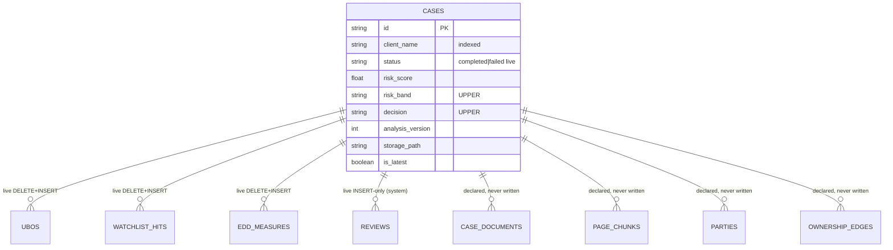

# HNI Customer Onboarding KYC Agent (Fraud Detection Agent) — NEW_CASE_STUDY (Complete Engineering Replication Guide)

> Purpose: single document describing **every detail of the code** in
> `Fraud_Detection_Agent/` so a new / fresher engineer can **rebuild the project
> without reading the source**.
>
> In this document the system is called the **HNI Customer Onboarding KYC Agent**
> (codebase name: Fraud Detection Agent / `onboarding_risk/`).
> Covers: inputs (mandatory/optional), what the user submits, step-by-step pipeline,
> every task/agent, exact prompts and I/O schemas, sample LLM payloads, the
> internet/news (OSINT) module contract, deterministic math, persistence (types,
> modelling, S3/warehouse guidance), APIs, config, run-book, and mermaid diagrams.
>
> Codebase snapshot: single FastAPI service `onboarding_risk/api/main.py:app` + one
> production web UI (`web/`, served by the API) + two dev-only Streamlit UIs
> (`app_streamlit/ui.py`, `ui_subject.py`, excluded from Docker), Postgres store,
> dual local-disk storage (case uploads + timestamped analysis folders), in-memory
> numpy page index, OpenAI-compatible LLM gateway, DuckDuckGo/Google/Wikipedia OSINT.
> Entry: `uvicorn onboarding_risk.api.main:app --host 0.0.0.0 --port 8000`.
>
> Core invariant: **LLM reads text and writes explanations. Python decides everything.**
> UBO math, watchlist matching, risk score, band, decision are all deterministic.

---

## Table of contents

1. [Repo map](#1-repo-map)
2. [System principle + two workflows](#2-system-principle--two-workflows)
3. [Inputs — what the end user submits](#3-inputs--what-the-end-user-submits)
4. [What happens after Submit — end-to-end](#4-what-happens-after-submit--end-to-end)
5. [Pipeline tasks and agents](#5-pipeline-tasks-and-agents)
6. [Agent detail sheets (prompt, I/O, sample)](#6-agent-detail-sheets-prompt-io-sample)
7. [Deterministic engine (UBO, screening, scoring)](#7-deterministic-engine-ubo-screening-scoring)
8. [Internet / news OSINT module](#8-internet--news-osint-module)
9. [EDD narrative + Q&A agents](#9-edd-narrative--qa-agents)
10. [Persistence — where and how data is stored](#10-persistence--where-and-how-data-is-stored)
11. [API contract](#11-api-contract)
12. [Config / env vars](#12-config--env-vars)
13. [Mermaid diagrams](#13-mermaid-diagrams)
14. [Fresher run-book — replicate from zero](#14-fresher-run-book--replicate-from-zero)
15. [Sample end-to-end payloads](#15-sample-end-to-end-payloads)
16. [Known gaps](#16-known-gaps)

---

## 1. Repo map

```
Fraud_Detection_Agent/
  onboarding_risk/
    api/main.py            # FastAPI app + 8 endpoints + save_assessment_to_db + wrappers
    api/__init__.py        # empty
    agent_graph.py         # PDF-pack flow: assess_pack + run_onboarding_assessment + Q&A
    subject_graph.py       # Name-search flow: assess_subject + run_subject_360 + Q&A + profile_to_parties
    extraction.py          # 4 doc LLM calls: structure, source_of_wealth, identity, case_metadata
    doc_index.py           # PageChunk + PageIndex (fitz text-only, numpy cosine, per-request)
    tools.py               # search_pages/get_page LangChain @tools + set_page_index (scaffold, see §16)
    ownership.py           # deterministic UBO resolver (no LLM)
    screening.py           # deterministic PEP/sanctions/adverse/geography matcher (no LLM)
    scoring.py             # deterministic 11-factor scorecard (no LLM)
    edd.py                 # EDD rationale LLM (compact scorecard -> EDDRationale JSON)
    reference.py           # sample PEP/sanctions/adverse/jurisdiction lists + thresholds
    schemas.py             # all Pydantic contracts (parties, edges, UBO, hits, scorecard, Profile360…)
    config.py              # Config dataclass + get_llm()/get_embedder()
    storage.py             # StorageManager (timestamped analysis_storage/<Client>_<ts>/)
    db/models.py           # 9 SQLAlchemy tables (5 live, 4 dead — see §10)
    db/session.py          # engine/SessionLocal/init_db/get_db/get_db_session
    osint/search.py        # DDG/Google/Wikipedia/news/fetch_page_text wrappers
    osint/collect.py       # 8-angle query builder + collect_evidence
    osint/profile.py       # synthesize_profile LLM -> Profile360
    osint/search.ipynb     # scratch notebook, not runtime
  web/index.html           # 3-tab vanilla-JS UI (Upload / Name Search / Historical KYC)
  app_streamlit/ui.py      # dev-only PDF flow (temp files, direct agent_graph calls)
  app_streamlit/ui_subject.py  # dev-only name flow (direct subject_graph calls)
  data/uploads/<case_id>/  # runtime case uploads (git-ignored); analysis_storage/<Client>_<ts>/ results
  tests/test_api.py / test_extraction.py
  Dockerfile, k8s/deployment.yaml + service.yaml + configmap.yaml + secret.yaml
  Makefile, pyproject.toml, requirements.txt, .env.example
```

One process. `BackgroundTasks` = in-process job (not Celery). `langgraph` is pinned but
unused — both "graphs" are sequential Python functions. `redis` is a dependency + config
but no client is ever constructed.

---

## 2. System principle + two workflows

```
LLM extracts parties and writes the EDD story. Python resolves UBOs, matches lists, scores risk.
```

| Workflow | Trigger | Evidence | LLM calls | Deterministic tail |
|---|---|---|---|---|
| **A. Document onboarding** (`case_type="documents"`) | KYC PDFs uploaded | `PageIndex` over pack text | 4 extraction + 1 EDD (+1 optional Q&A) | UBO → screening → scorecard → EDD |
| **B. Name-search 360** (`case_type="name_search"`) | `client_name` only | Web/news/Wikipedia snippets | 1 profile + 1 EDD (+1 optional Q&A) | profile→parties → screening (+web hits) → UBO → scorecard → EDD |

Both converge on the **same** `ownership.resolve_ubos → screening.screen_parties →
scoring.score_case → edd.synthesize_edd_rationale` tail and the same versioned
`cases` storage. No LLM value ever enters the score except as evidence rows the
deterministic code re-interprets.

---

## 3. Inputs — what the end user submits

### 3.1 Transport

`POST /cases` is `multipart/form-data` (web Upload + Name Search tabs, Streamlit
sidebars). All reads are GET. No rerun/review/correction endpoint exists (analyst
override = missing feature; only auto `system` reviews are written).

### 3.2 Field table

| Field | Location | Mandatory? | Type / constraints | What to type | Default / behavior if blank |
|---|---|---|---|---|---|
| `client_name` | form-text | **Mandatory** (`Form(...)`) | `str`, `cases.client_name VARCHAR(255) NOT NULL indexed` | Full legal/person name, e.g. `John Smith`, `Sunrise Holdings Ltd`. Drives versioning (`is_latest` flip per name) + storage folder sanitization + (name_search) the `SubjectSeed.full_name` | 422 if missing |
| `case_type` | form-text | **Mandatory** (`Form(...)`) | `"documents"` or `"name_search"` (free string, only these two branch) | `documents` for PDF flow; `name_search` for OSINT flow | Wrong value + no files → background task never scheduled, `case_id` returned but nothing ever runs (stuck `no_row`) |
| `description` | form-text | Optional | `TEXT NULL` (stored on no current path — accepted but not persisted to `cases.description` by `save_assessment_to_db`) | purpose note | `None` |
| `files` | form-file `files` (repeatable) | Mandatory **iff** `case_type="documents"` | PDFs, any page count; text layer required (no OCR — scanned PDFs yield `ValueError`, wrapper marks `failed`). Filenames preserved under `data/uploads/<case_id>/` | KYC forms, trust deeds, ownership charts, incorporation certs, IDs, bank statements | `[]`/missing → no task scheduled for `documents` type |
| Name-search extras | UI fields (web: `searchName/Age/Location`; Streamlit: full_name*, location, nationality, approx_age, education, work_history, known_companies, aliases, search_region=`in`, purpose, question) | Only `full_name (=client_name)` reaches the API today | Web sends **only** `client_name`; Streamlit builds full `SubjectSeed` locally (API path always `SubjectSeed(full_name=client_name)`, all else empty) | For full-seed searches use `ui_subject.py` or `subject_graph` CLI, not HTTP | API-side seed = name only |
| `question` | Streamlit/CLI only | Optional | free text | e.g. `Who are the UBOs above 25% and why was EDD triggered?` / `Summarize the main risks found.` | `""` → no Q&A call |

### 3.3 What the analyst should actually submit

1. Document flow: the full KYC pack (application form + trust deed/foundation docs +
   ownership chart/cap table + incorporation cert + IDs + SoW evidence). One `POST`
   can carry N PDFs; pages are globally renumbered across the pack for citations.
2. Name flow: at minimum the exact full name; add location/nationality/age/employer
   via Streamlit/CLI when the name is common (disambiguation is the top failure mode).
3. Private-company borrowers: prefer document flow (no public footprint → OSINT returns
   near-empty profile, score driven by structure/SOW/identity only).

---

## 4. What happens after Submit — end-to-end

### 4.1 Fast accept, no processing row

`POST /cases` mints `case_id=uuid4`, saves uploads synchronously to
`DOCUMENT_STORAGE_DIR/<case_id>/`, schedules the wrapper, returns
`status="queued"` in milliseconds — and **writes nothing to Postgres**.
The multi-minute pipeline runs after the response; client polls
`GET /cases/{id}/status` (synthesized `processing/0.5` while rowless), then
`GET /cases/{id}/result` once `completed`.

### 4.2 Step-by-step

| # | Step | Code | What happens |
|---|---|---|---|
| 1 | Accept | `api/main.create_case` | `case_id=uuid4`. If `documents`+files: `mkdir <upload_dir>/<case_id>`, write each upload bytes. If `name_search`: `SubjectSeed(full_name=client_name)`. `BackgroundTasks.add_task(wrapper)`. Return `CaseResponse(queued)`. |
| 2A | Doc: index | `agent_graph.assess_pack` | `load_pack_as_pages` (fitz `get_text`, skip empties, **global** numbers) → `PageIndex(pages)` (embed all, L2-norm) → `set_page_index` (global scaffold). Fail (no text) → exception → `failed` row. |
| 3A | Doc: 4 LLM extractions (sequential — T2 feeds T3/T4) | `extraction.*` | `extract_structure(k=8)` → parties/edges/relationships/notes; `extract_source_of_wealth(index, parties, k=6)`; `extract_identity(index, parties, k=6)`; `detect_case_metadata(index, parties)` (backfill applicant name from party). Each = evidence block + 1 `get_llm()` call + tolerant JSON parse. LLM = 4. |
| 2B | Name: collect | `osint/collect.collect_evidence(seed)` | 8-angle queries (Wikipedia BIO + web all + news ADVERSE/COMP), `max 5` per query, dedup by URL/snippet. No LLM. |
| 3B | Name: profile LLM | `osint/profile.synthesize_profile(seed, evidence)` | 1 LLM call → `Profile360` (see §6.5). Empty evidence → near-empty profile (not an error). LLM = 1. |
| 4B | Name: bridge | `subject_graph.profile_to_parties(profile)` | Deterministic mapping → `S1` subject + `Ri` related + `Ci` companies + SOW + **web-derived** `WatchlistHit`s (pep/adverse, `source=osint:web`). No LLM. |
| 5 | UBO (both) | `ownership.resolve_ubos` | Applicant resolution → DFS path products → threshold/control qualification → fallback senior official → opacity flags. Pure Python. |
| 6 | Screening (both) | `screening.screen_parties` | Token-set match ≥0.85 vs PEP/sanctions/adverse samples (or JSON overrides) + self-declared PEP + jurisdiction tier/offshore. Doc flow: curated hits only. Name flow: curated **plus** web hits from step 4B. Pure Python. |
| 7 | Scorecard (both) | `scoring.score_case` | 11 factors, hard stops, 0–100, band, EDD triggers, decision. Pure Python. |
| 8 | EDD narrative (both) | `edd.synthesize_edd_rationale` | 1 LLM call on **compact scorecard JSON only** (never raw docs/evidence). LLM +1 (doc total 5, name total 2). |
| 9 | Optional Q&A | `agent_graph._answer_over_case` / `subject_graph._answer_over_profile` | 1 LLM call on compact JSON. Included in `metrics.llm_calls` when `question` non-blank. |
| 10 | Version + store | `api/main.save_assessment_to_db` | Flip prior `is_latest` for `client_name` → `version+1`; `StorageManager.save_analysis_files` → `analysis_storage/<SafeClient>_<ts>/{PDFs?, metadata.json, analysis_result.json}`; INSERT `cases(completed, risk UPPER, raw_result, reasoning, latency, llm_calls, version, storage_path)` + DELETE+INSERT `ubos/watchlist_hits/edd_measures` + auto `reviews(reviewer=system)`. **One commit.** Outer swallow on DB error (see §16). |
| On pipeline exception | wrappers | INSERT `Case(status="failed")` minimal row, commit. `GET /result` → 400; `/status` → `failed/0.0`. |

`metrics = {documents, llm_calls: 5(+1 Q) docs / 2(+1 Q) name, parties, ubos / evidence_items, band, decision, latency_ms}`; `reasoning` = 4 markdown step strings (docs) or trace (name).

---

## 5. Pipeline tasks and agents

| # | Task | Agent / function | File | LLM? | Input given | Output |
|---|---|---|---|---|---|---|
| T1 | Page index | `PageIndex(pages)` | `doc_index.py` | No (embeddings only) | `List[PageChunk]` | cosine `search(query,k)` / `get_page(n)` |
| T2 | Structure | `extract_structure(index, k=8)` | `extraction.py` | Yes ×1 | top-8 pages for ownership query | `{parties, edges, relationships, notes}` |
| T3 | Source of wealth | `extract_source_of_wealth(index, parties, k=6)` | `extraction.py` | Yes ×1 | party directory + top-6 SOW pages | `List[SourceOfWealth]` |
| T4 | Identity | `extract_identity(index, parties, k=6)` | `extraction.py` | Yes ×1 | party directory + top-6 ID pages | `List[IdentityCheck]` |
| T5 | Case metadata | `detect_case_metadata(index, parties)` | `extraction.py` | Yes ×1 (k=4) | party directory + top-4 app-form pages | `CaseMetadata` |
| T6 | Web evidence | `collect_evidence(seed)` | `osint/collect.py` | No | `SubjectSeed` | `List[EvidenceItem]` (8 dimensions) |
| T7 | 360 profile | `synthesize_profile(seed, evidence)` | `osint/profile.py` | Yes ×1 | seed blob + numbered evidence (≤120) | `Profile360` |
| T8 | Profile bridge | `profile_to_parties(profile)` | `subject_graph.py` | No | `Profile360` | parties/relationships/web hits/SOW |
| T9 | UBO | `resolve_ubos` | `ownership.py` | No | parties/edges/relationships/applicant | `OwnershipGraphResult` |
| T10 | Screening | `screen_parties` | `screening.py` | No | parties (+ web hits merged later) | `(watchlist_hits, geography_hits)` |
| T11 | Scorecard | `score_case` | `scoring.py` | No | ownership + hits + SOW + identity | `RiskScorecard` |
| T12 | EDD narrative | `synthesize_edd_rationale` | `edd.py` | Yes ×1 | compact scorecard JSON | `EDDRationale` |
| T13 | Q&A | `_answer_over_case` / `_answer_over_profile` | `agent_graph.py` / `subject_graph.py` | Yes ×1 (optional) | compact JSON + question | `str` answer |

How information is given: T2–T5 get a **pasted evidence block**
(`--- PAGE n (doc) ---\n<text>`, top-k cosine hits for a fixed query) plus a party
directory (T3–T5) and return **JSON-only** (fence-tolerant parse, invalid rows skipped);
T7 gets seed JSON + numbered evidence lines (`[i] (dim/source) title — snippet<url>`,
≤120, snippet ≤280 chars) and returns raw JSON; T12/T13 get a **compact scorecard JSON**
(never raw docs) and return JSON / concise string. `tools.py` tools are never bound to
an LLM — extractors call `index.search()` directly.

---

## 6. Agent detail sheets (prompt, I/O, sample)

Common parse: `_strip_json` (drop ``` fences) → `json.loads` else empty; `_enum` with
fallback (`OTHER`/`EQUITY`, skip unknown roles); snippets truncated
(structure 300, SOW narrative 600 chars); edges with unknown/self endpoints dropped;
percentages coerced `float or None`.

Retrieval queries (verbatim):
- Structure (k=8): `beneficial owner shareholder register ownership percentage trust
  deed settlor trustee protector beneficiary director signatory holding company SPV foundation`
- SOW (k=6): `source of wealth source of funds origin of assets inheritance sale of
  business salary dividends investment income net worth declaration`
- Identity (k=6): `passport national identity card certificate of incorporation date of
  birth verification certified document address proof`
- Metadata (k=4): `application form account opening relationship purpose product mandate
  applicant name`

### 6.1 T2 — Structure (parties + edges + roles, one call)

- System (verbatim): map legal structure from page text only; every party (persons +
  entities); stable ids `P1,P2…` reused in edges/roles; never invent; edge
  `{owner_id, owned_id, percentage}` (null = control only); capture settlor/trustee/
  protector/beneficiary/director/shareholder/signatory/spouse/nominee/partner/applicant;
  record `page`; flag nominees + bearer mentions via `party_type='nominee'` + notes;
  output ONLY JSON object.
- User: `Page evidence:\n<blocks>\n\nReturn JSON matching:\n{"parties":[{"party_id",
  "name","party_type":one of [individual,trust,foundation,holding_company,
  operating_company,spv,partnership,fund,nominee,other],"country"|null,
  "nationality"|null,"date_of_birth_or_incorporation"|null,"identifiers":{},"declared_pep",
  "page","source_snippet"}],"edges":[{"owner_id","owned_id","percentage"|null,
  "interest_type":one of [equity,voting,beneficial,control],"page"}],"relationships":
  [{"party_id","role":one of [applicant,settlor,trustee,protector,beneficiary,director,
  shareholder,signatory,spouse,nominee,authorized_person,partner,ubo],"related_to"|null,
  "page"}],"notes":[str]}`.
- Sample output:
  ```json
  {"parties":[{"party_id":"P1","name":"John Smith","party_type":"individual","country":"United Kingdom","nationality":"British","date_of_birth_or_incorporation":"1975-03-12","identifiers":{"passport":"X123"},"declared_pep":false,"page":2,"source_snippet":"Passport of John Smith…"},
   {"party_id":"P2","name":"Sunrise Holdings Ltd","party_type":"holding_company","country":"Cayman Islands","nationality":null,"date_of_birth_or_incorporation":null,"identifiers":{},"declared_pep":null,"page":5,"source_snippet":"Incorporated in Cayman Islands…"}],
   "edges":[{"owner_id":"P1","owned_id":"P2","percentage":100.0,"interest_type":"equity","page":5}],
   "relationships":[{"party_id":"P1","role":"director","related_to":"P2","page":5}],"notes":[]}
  ```

### 6.2 T3 — Source of wealth

- System: extract SoW/SoF per principal; `declared_source` short phrase (`sale of
  business/inheritance/employment income/investment income/unknown`); state corroboration;
  ONLY provided text; map via directory; ONLY JSON array.
- User: `Party directory:\n[{party_id,name}…]\n\nPage evidence:\n<blocks>\n\nReturn JSON
  matching:\n[{"party_id","declared_source","narrative"|null,
  "corroborating_evidence_present"|null,"page"}]`.
- Sample: `[{"party_id":"P1","declared_source":"sale of business","narrative":"Proceeds
  from 2021 sale of manufacturing business per declaration p.7.","corroborating_evidence_present":true,"page":7}]`.

### 6.3 T4 — Identity verification

- System: per party record document type/number, verified/certified?, gaps (`no certified
  copy/expired/missing proof of address`); ONLY text; map via directory; ONLY JSON array.
- Shape: `[{"party_id","document_type"|null,"document_number"|null,"verified"|null,
  "gaps":[str],"page"}]`.
- Sample: `[{"party_id":"P1","document_type":"passport","document_number":"X123",
  "verified":true,"gaps":[],"page":2}]`.

### 6.4 T5 — Case metadata

- System: applicant = primary subject (often trust/holding company, not a person); map to
  `party_id`; output ONLY `{"applicant_name"|null,"applicant_party_id"|null,
  "product"|null,"relationship_purpose"|null}`. Invalid id → None in Python.
- Sample: `{"applicant_name":"Sunrise Holdings Ltd","applicant_party_id":"P2",
  "product":"private banking","relationship_purpose":"wealth management mandate"}`.

### 6.5 T7 — 360 profile (name flow)

- Input: `SubjectSeed{full_name*, aliases[], approx_age?, date_of_birth?, location?,
  nationality?, education[], work_history[], known_companies[], relationship_purpose?,
  search_region?}` + `evidence[]` (see §8 for collection).
- Evidence block: sorted by dimension, `[i] (dim/source) title — snippet[:280] <url>`,
  ≤120 items, else `(no public evidence was found)`.
- System (8 rules, verbatim in `osint/profile.py:86`): extract (don't withhold) but never
  invent; gaps only if truly absent; PEOPLE = every named spouse/ex/sibling/parent/child/
  co-founder/associate (divorce counts); COMPANIES = every founded/directed/owned + role +
  performance; ADVERSE only if subject did wrong (no commentary/market/opinion/others;
  high = fraud/criminal/regulatory, medium = litigation, low = chatter); PEP only for real
  office/state/party-leadership (family counts); disambiguation low/med/high but still
  extract; cite links; cautious behavioral read; plain language; ONLY raw JSON, first char
  `{`.
- Output `Profile360{seed, disambiguation_confidence, biography, professional_summary,
  company_affiliations[{company,role?,status?,performance_summary?,evidence_urls[]}],
  adverse_media[{category: fraud|litigation|regulatory|reputational|other, summary,
  severity, url?}], pep_indicators[], wealth_summary?, source_of_wealth_signal?,
  source_of_wealth_corroborated?, relationships[{name, relation, details?, is_pep?,
  evidence_urls[]}], behavioral{summary, traits[], risk_indicators[],
  public_sentiment?, confidence}, evidence[], citations[], data_gaps[]}` (empty-string
  companies/summaries/names filtered in Python).
- Sample user head:
  ```
  Seed details:
  {"full_name": "John Smith", "location": "London", "nationality": "British", …}
  Public evidence (14 items):
  [0] (adverse_media/news) Former director sued over contracts — … <https://…>
  …
  Go through EVERY numbered snippet above. … Return ONLY the JSON object, starting with '{'.
  ```

---

## 7. Deterministic engine (UBO, screening, scoring)

All pure Python. Same inputs → same outputs (percentages `round(…,4)`, scores `round(…,2)`).

### 7.1 UBO resolution (`ownership.py`)

- Threshold: `ubo_threshold_pct()` from `UBO_THRESHOLD_PCT` (default **25.0**).
- Applicant: explicit id → `APPLICANT` role → single sink (owned never owner; prefer
  non-individual on ambiguity) → `parties[0]`.
- Paths: DFS owner→owned; step `pct/100` (`None` → fraction `0.0` but path kept as
  control evidence); cycle (`owned in visiting`) → skip + `saw_cycle`; chain
  `"A -> B -> Applicant"`; `effective = round(Σ fractions ×100, 4)`; depth =
  `max("->" count)`; applicant self = `100.0`.
- UBO if `effective ≥ threshold` (`basis="ownership"`) **or** control role in
  `CONTROL_ROLES={settlor,trustee,protector,director,signatory}` (`basis="control"`,
  roles listed). None qualifies → first individual `DIRECTOR` becomes
  `basis="senior_managing_official"` (+ note). Sorted by `(effective or -1, basis)` desc.
- Opacity: `num_entities` = non-individuals; `has_nominee` = `NOMINEE` type/role or
  `"nominee"` in notes; `has_bearer_shares` = `"bearer"` in notes; `has_circular` =
  any cycle (+ note). Output `UBO{party_id, name, effective_ownership_pct?, basis,
  control_roles[], paths[], pages[]}` + `OwnershipGraphResult{applicant_party_id,
  ubos[], num_entities, num_parties, max_layering_depth, has_nominee,
  has_bearer_shares, has_circular_ownership, notes[]}`.

### 7.2 Watchlist screening (`screening.py`)

- Normalize: lowercase, `[^a-z0-9\s]→" "`, drop stopwords (`mr/mrs/ms/dr/ltd/limited/
  llc/inc/plc/the/and/fze/sa/ag/gmbh/co/company/holdings/holding/trust/foundation/fund`).
- Score: `1.0` if token sets equal else `|∩|/|∪|`; keep best ≥ **0.85**
  (`_MATCH_THRESHOLD`), stored `round(…,3)`.
- Per party: sanctions → `WatchlistHit(sanctions, details=program)`; PEP →
  `WatchlistHit(pep, details=position, tier)` else self-declared (`declared_pep` →
  score `1.0`, tier `medium`); adverse → `WatchlistHit(adverse_media,
  details="[category] summary")`; geography `jurisdictions[country.lower()]` tier
  `high/prohibited` → `GeographyHit(tier, offshore?)` (offshore flag also fires its own
  factor). Output `WatchlistHit{party_id, party_name, list_type, matched_name,
  match_score, source_list?, details?, tier?}`.
- Reference samples (`reference.py`, overridable via `*_PATH` JSON): 4 PEP, 3 sanctions,
  3 adverse, ~15 jurisdictions (`iran/north korea/syria → prohibited`; `myanmar/panama/
  cayman/bvi/seychelles/belize/marshall/jersey/guernsey/liechtenstein/lebanon/nigeria →
  high`, most flagged `offshore=True`).

### 7.3 Risk scorecard (`scoring.py`) — exact weights and logic

Weights: `sanctions 100.0, pep 30.0, adverse_media 28.0, opaque_source_of_wealth 26.0,
nominee 24.0, bearer_shares 24.0, high_risk_geography 20.0, complex_structure 16.0,
layering 16.0, id_verification_gap 14.0, offshore 10.0`.
Severity multiplier `low×0.5, medium×1.0, high×1.5`; `contribution =
round(weight×mult,2)` if present else `0`; `raw = Σ`, `normalized = min(100, raw)`.

| Factor | Fires when | Severity |
|---|---|---|
| sanctions (hard stop) | any sanctions hit → `Sanctions match: {party} ~ {matched} ({list})` | high |
| pep | any pep hit (high if any tier high) | high / medium |
| adverse_media | any adverse hit; web hits discounted 1 notch, single web caps medium, ≥2 web-high restores high (see §8) | computed |
| high_risk_geography (hard stop if prohibited) | tier high/prohibited; prohibited → `Prohibited jurisdiction: {party} ({country})` | high if prohibited else medium |
| offshore | any `offshore=True` geography | low |
| complex_structure | `depth ≥ 3 (COMPLEX_LAYERING_DEPTH)` or `entities ≥ 4 (COMPLEX_ENTITY_COUNT)` or circular | high if `depth ≥ 4` else medium |
| layering | `depth ≥ 3` | high if `depth ≥ 4` else medium |
| nominee / bearer | `has_nominee` / `has_bearer_shares` | high |
| opaque_sow | `declared ∈ {"",unknown,n/a,na,not stated,undisclosed,private,other}` or `corroborated is False` | high |
| id_gap | `gaps or verified is False` | medium |

Bands: `≥50 HIGH, ≥25 MEDIUM, else LOW`; any hard stop → `PROHIBITED`.
EDD triggers (present ∩): `{pep, adverse_media, high_risk_geography,
opaque_source_of_wealth, complex_structure, nominee, bearer_shares}`;
`edd_required = triggers or band ∈ {MEDIUM, HIGH}`.
Decision: `PROHIBITED/hard → DECLINE`; `HIGH → ESCALATE_MLRO`;
`MEDIUM or edd → APPROVE_WITH_EDD`; else `APPROVE_STANDARD_CDD`.
Output `RiskScorecard{factors[{factor, present, severity, weight, contribution,
evidence[], pages[]}], raw_score, normalized_score, band, edd_required,
triggers[], decision, hard_stop_reason?}`.

---

## 8. Internet / news OSINT module

This is the "news from the internet" module. It runs **only** in the name-search flow
(document flow never touches the web; OSINT failure never blocks document assessment —
different wrappers, no shared dependency).

### 8.1 Input

`SubjectSeed{full_name* (from `client_name` on HTTP; full seed via Streamlit/CLI),
aliases[], approx_age?, date_of_birth?, location?, nationality?, education[],
work_history[], known_companies[], relationship_purpose?, search_region?}`.
Env: `OSINT_MAX_RESULTS=5` per query, `OSINT_TIMEOUT=10.0`, `OSINT_REGION=wt-wt`,
`OSINT_COUNTRY=""`, `OSINT_DEBUG` on (stderr trace). `search_available()` =
google or DDG importable (else Streamlit warns, API still runs → empty evidence).

### 8.2 Collection (`osint/collect.py`, `search.py`)

8 angles, exact templates (`{name}`, `{ctx = location+nationality+work[0]}`):
- biography: `{name} {ctx}`, `{name} biography profile` (+ **Wikipedia** top-1:
  search 3, `page(auto_suggest=False)` fallback `summary`, `sentences=6`)
- professional: `{name} director OR founder OR partner OR CEO`, `{name} {work[0]}` or `{name} career company`
- company_performance: per known company `{c} revenue OR results OR performance OR funding`, else `{name} company revenue results` (+ news)
- adverse_media: `{name} fraud OR investigation OR lawsuit OR scandal`, `{name} sanctions
  OR money laundering OR regulatory action` (+ per-alias fraud variant) (+ news)
- pep: `{name} politician OR government OR minister OR official OR political donation`
- social_behavioral: `{name} interview OR statement OR controversy`, `{name} linkedin OR twitter OR instagram profile`
- relationships: `{name} wife OR husband OR spouse OR married OR partner`, `{name} family OR business associate`
- wealth: `{name} net worth OR wealth OR fortune OR rich list`, `{name} source of wealth OR how made money`

Backends: `web_search` = DDG `text` primary + Google (`sleep 1.0s`) top-up to fill,
dedup by `url or snippet[:80]`; `news_search` = DDG `news` (+publisher/published);
`fetch_page_text(url, ≤4000 chars, UA DueDiligenceBot/1.0, 200+html only, strip
script/style/header/footer/nav)` exists but collection stores **snippets**, not full
fetches. Dedup final by URL / `snippet[:120]` → `EvidenceItem{dimension ∈ 8,
query, title?, url?, snippet?, source ∈ {web, news, wikipedia}, published?}`.

### 8.3 Profile LLM output → how passed on

`synthesize_profile` (§6.5) → `Profile360` → **deterministically** bridged
(`profile_to_parties`, no LLM):
- `S1` individual (`country = nationality or location`) + `APPLICANT` relationship;
- related `Ri` (`SPOUSE` if spouse/wife/husband/partner else `AUTHORIZED_PERSON`;
  `is_pep` → `WatchlistHit(Ri, pep, 1.0, osint:web, medium)`);
- companies `Ci` (`DIRECTOR`/`PARTNER`/`SHAREHOLDER` by role words);
- adverse → `WatchlistHit(S1, adverse_media, 1.0, osint:web, tier = min(severity,
  category ceiling {fraud/regulatory/criminal/sanctions: high, litigation: medium,
  reputational/other: low}))`;
- `pep_indicators` blob → single `WatchlistHit(S1, pep, tier high if contains
  minister/head of state/president/governor/senator/MP/ambassador else medium)`;
- SOW `declared_source = signal or "unknown"`.
These rows merge with curated `screen_parties` hits before scoring; scoring then applies
the **credibility discount** (§7.3: web `rank-1`, single-web caps medium, ≥2 web-high
restores high) — so one soft news mention cannot push HIGH alone, while curated-list
hits are trusted as-is. Low `disambiguation_confidence` is surfaced (Streamlit warns)
but does not auto-cap the score (unlike the sister Credit-Risk agent).

Sample: in `SubjectSeed{full_name:"John Smith", location:"London"}` + evidence
`[0] (adverse_media/news) …sued over contracts… <url>` → out
`Profile360{disambiguation:"medium", adverse_media:[{category:"litigation",
summary:"…", severity:"medium", url}], …}` → `WatchlistHit(S1, adverse_media,
tier medium, osint:web)` → factor `adverse_media/medium/28.0`.

---

## 9. EDD narrative + Q&A agents

### 9.1 EDD rationale (`edd.py::synthesize_edd_rationale`)

- Input: full `OnboardingAssessment`, compacted to `{applicant, product,
  relationship_purpose, decision, band, normalized_score, edd_required,
  hard_stop_reason, triggers[], active_factors[{factor, severity, contribution,
  evidence}], ubos[{name, effective_ownership_pct, basis, control_roles}],
  structure{entities, parties, layering_depth, nominee, bearer_shares, circular},
  watchlist_hits[{party, type, matched, details}], geography_hits[{party, country, tier}]}`.
- System (verbatim): HNI/UHNI EDD analyst; scorecard/ownership/decision AUTHORITATIVE —
  do NOT recompute/change/override; explain quoting UBOs, %, triggers, hits; recommend
  concrete measures (SoW corroboration, senior sign-off, monitoring); list info still
  required; output ONLY JSON `{"risk_summary":str,"key_drivers":[str],"edd_measures":
  [str],"information_required":[str],"watch_items":[str]}`.
- User: `Computed assessment (authoritative):\n<compact>\n\nWrite the EDD-rationale JSON now.`
  → `get_llm().invoke` → fence-tolerant parse → `EDDRationale` (fail → empties).
- Sample compact in: `{"applicant":"Sunrise Holdings Ltd","decision":
  "approve_with_edd","band":"medium","normalized_score":42.0,"triggers":
  ["high_risk_geography"],"ubos":[{"name":"John Smith","effective_ownership_pct":100.0,
  "basis":"ownership","control_roles":["director"]}],…}`.

### 9.2 Q&A

- Doc: `_answer_over_case(assessment, q)` on `{applicant, decision, band, score,
  triggers, ubos[{name, pct, basis, roles}], active_factors, watchlist_hits}`.
  System: use ONLY supplied figures; admit absence; never invent.
- Name: `_answer_over_profile(profile, assessment, q)` on `{name, disambiguation,
  biography, professional, companies, adverse, pep, wealth, relationships, behavioral,
  decision, band, gaps}`. System adds: public-web may be incomplete; plain language.
- User: `Question:\n{q}\n\nAssessment:\n<json>\n\nAnswer concisely.` Output `str`.

---

## 10. Persistence — where and how data is stored

### 10.1 Files (two local roots, both local-disk today)

| Artifact | Exact path | Writer |
|---|---|---|
| Case uploads | `DOCUMENT_STORAGE_DIR (default ./data/uploads)/<case_id>/<original filename>` | `api/main.create_case` (sync, before task) |
| Analysis folder | `analysis_storage/<SafeClient>_<YYYYMMDD_HHMMSS>/{<copied PDFs>?, metadata.json, analysis_result.json}` | `StorageManager.save_analysis_files` (inside task). `SafeClient` = `<>:"/\|?*→_`, strip `. `, ≤100 chars, else `unnamed`. `metadata.json` = `{client_name, case_type, case_id, analysis_version, risk_score, risk_band, decision}`; `analysis_result.json` = full serialized `{assessment, answer, reasoning, metrics}` |
| Iteration dumps | none (unlike FinDoc agent — no per-iteration JSON) | — |

`get_client_analyses` scans `analysis_storage/` prefix `<Safe>_` + parses timestamp;
`delete_analysis` rmtree. "S3/ADLS-extensible" is aspirational — concrete `pathlib/
shutil` class, no cloud SDK/adapter.

### 10.2 Postgres (source of truth for reads) — 9 tables, types, live vs dead

PKs `String` UUIDs (`str(uuid4())`) Python-side; `JSON` column type (not JSONB);
`risk_band/decision` stored **UPPER**, API lowercases on read; dates naive `utcnow`.

| Table | Live? | Columns (type) |
|---|---|---|
| `cases` | **live** | `id String PK, client_name String(255) NOT NULL indexed, case_type String(32) (documents/name_search), description Text?, status String(32) (live values: completed/failed; comment lists created/processing/awaiting_review/approved/rejected/prohibited — never written), model_name/embed_model_name String(128)? (never set), risk_score Float?, risk_band String(32)? UPPER, decision String(64)? UPPER, hard_stop_reason Text?, raw_result JSON? (full serialized result), reasoning JSON? (step strings), latency_ms Float?, llm_call_count Int?, requested_by String(128)=local-analyst (never set from request), requested_at/completed_at DateTime, analysis_version Int=1, storage_path String(512)? (relative analysis folder), is_latest Bool=True` |
| `ubos` | **live** (DELETE+INSERT per save) | `id, case_id FK!, party_id String, party_name String(255), effective_ownership_percentage Float?, basis String(32) (ownership/control/senior_managing_official), control_roles JSON?, ownership_paths JSON?` |
| `watchlist_hits` | **live** (DELETE+INSERT) | `id, case_id FK!, party_id String, party_name String(255), list_type String(32) (pep/sanctions/adverse_media), matched_name String(255), match_score Float?, tier String(32)?, details Text?, source_list String(255)? (list name or osint:web)` |
| `edd_measures` | **live** (DELETE+INSERT; `category/severity` never set) | `id, case_id FK!, measure Text!, category String(64)?, severity String(32)?` |
| `reviews` | **live** (INSERT-only; auto `system` row per completed case; no human endpoint) | `id, case_id FK!, reviewer String(128) (always "system" today), action String(16) (approved/rejected/corrected auto-mapped from decision), corrected_fields JSON? (never set), reason Text?, reviewed_at DateTime` |
| `case_documents` | **dead** (declared, never `db.add`) | `id, case_id FK!, filename, storage_uri, sha256_hash, page_count, uploaded_at` — uploads live on disk + in analysis folders, not here |
| `page_chunks` | **dead** | `id, case_id FK!, document_id FK?, page_number, doc_name, text, embedding JSON?` — index rebuilt per request, never persisted (despite `embedding` column) |
| `parties` | **dead** | `id, case_id FK!, party_id (P1…), name, party_type, country, declared_pep, source_document?, page?` — parties live in `raw_result` + analysis JSON only |
| `ownership_edges` | **dead** | `id, case_id FK!, owner_id/owned_id FK→parties.id, ownership_percentage?, ownership_type?, source_document?, page?` — same, JSON-only |

Modelling notes: extraction output (parties/edges) is **never relational** — only
`raw_result` blob + analysis files; only derived UBOs/hits/measures are queryable.
Pydantic `Party`/`PageChunk` vs SQLAlchemy same-names are different classes (import
confusion risk). Versioning = `(client_name, is_latest, analysis_version)` triple.

### 10.3 Redis

None used. Config fields + dependency exist; no client constructed. Status is a
synthesized poll of `cases.status` (rowless → `processing/0.5` guess).

### 10.4 Correct join pattern

```sql
-- latest cases per client + their derived rows (never join parties/edges — empty)
SELECT * FROM cases WHERE client_name = :name ORDER BY analysis_version DESC;
SELECT * FROM ubos WHERE case_id = :id;
SELECT * FROM watchlist_hits WHERE case_id = :id;
SELECT * FROM edd_measures WHERE case_id = :id;
SELECT * FROM reviews WHERE case_id = :id;
```

### 10.5 Do we need S3 / warehouse?

- **S3: yes before any scale-out, durability, or multi-replica need.** Both roots are
  local paths (`storage_path` is relative; `document_storage_dir` absolute-per-host);
  `k8s/deployment replicas:1` pinned for this reason; pod move/loss = uploads +
  analysis files gone while DB rows remain (dangling `storage_path`). Minimal migration:
  `StorageManager` adapter (`save/bytes → s3://bucket/<Safe>_<ts>/…`), keep `storage_path`
  as URI, download-to-scratch for `fitz` (needs local files). No schema redesign; add
  `boto3`, wire bucket/region (no S3 env exists today — unlike FinDoc's half-present keys).
- **Warehouse: not needed.** Reads are key-based (case → derived rows; client → history);
  no cross-case analytics, trend reporting, or bulk screening exists. If built later,
  replicate `cases + ubos + watchlist_hits + reviews` nightly (append-only on
  `(client_name, analysis_version)`); keep `raw_result` out of facts.

---

## 11. API contract

Base `http://localhost:8000`. IDs are UUID strings; bands/decisions UPPER in DB,
lowercase in `AssessmentResult`/`ClientInfo`.

| Method + path | Req | Resp |
|---|---|---|
| `GET /` | — | `web/index.html` |
| `GET /health` | — | `{"status":"healthy","timestamp":"…"}` (Docker/k8s probes) |
| `POST /cases` | multipart `client_name*`, `case_type* (documents/name_search)`, `description?`, `files[]?` | `CaseResponse{case_id, client_name, case_type, status:"queued", created_at, completed_at:null}` (202-style 200; **no DB write**; unknown `case_type`/missing files → silent no-task) |
| `GET /cases/{id}` | — | `CaseResponse` (404 `Case not found` while rowless) |
| `GET /cases/{id}/status` | — | `{case_id, status, current_phase: completed/failed/analyzing/unknown, progress: 1.0/0.0/0.5/0.0}` (rowless → `processing/analyzing/0.5` guess) |
| `GET /cases/{id}/result` | — | `AssessmentResult{case_id, risk_score, risk_band (lower), decision (lower), ubos[{party_name, effective_ownership_percentage, basis, control_roles}], watchlist_hits[{party_name, list_type, matched_name, match_score, details}], edd_measures[str]}` (DB tables first, `raw_result` fallback; 404 missing, 400 not-completed) |
| `GET /clients` | — | `[ClientInfo{client_name, total_analyses, latest_analysis_id?, latest_risk_score?, latest_risk_band? (lower), latest_decision? (lower), latest_analysis_date?}]` (only clients with an `is_latest` row) |
| `GET /clients/{name}/history` | — | `[HistoricalAnalysis{case_id, client_name, case_type, status, analysis_version, risk_score?, risk_band? (lower), decision? (lower), storage_path?, requested_at, completed_at?}]` newest version first |

No review/rerun/question endpoints (Streamlit Q&A is in-process only).

curl:

```bash
curl -X POST http://localhost:8000/cases -F "client_name=John Smith" -F "case_type=documents" -F "files=@kyc-pack.pdf"
curl -X POST http://localhost:8000/cases -F "client_name=John Smith" -F "case_type=name_search"
curl http://localhost:8000/cases/<id>/status
curl http://localhost:8000/cases/<id>/result
curl http://localhost:8000/clients
curl "http://localhost:8000/clients/John Smith/history"
```

---

## 12. Config / env vars

`Config.from_env()` + `get_config()` singleton; `get_llm()` →
`ChatOpenAI(model, api_key, base_url=llm_endpoint, temperature=0.0, max_tokens=4096)`;
`get_embedder()` → `OpenAIEmbeddings(embed_model, api_key, base_url)`. `.env` loaded twice.

| Var | Default | Effect |
|---|---|---|
| `LLM_ENDPOINT` | `https://your-gateway.example.com/` (code) | gateway base_url |
| `LLM_API_KEY` | `""` | chat + embed key |
| `LLM_MODEL_NAME` | `anthropic.claude-4-5-haiku` | all 4 doc extractors + profile + EDD + Q&A |
| `EMBED_MODEL_NAME / EMBED_DIM` | `openai.text-embedding-3-large / 1536` | page index only |
| `LLM_TEMPERATURE / LLM_MAX_TOKENS` | `0.0 / 4096` | determinism |
| `PGHOST / PGPORT / PGDATABASE / PGUSER / PGPASSWORD` | `localhost / 5432 (from_env; dataclass says 5433) / fraud_detection_db / fraud_detection_user / ""` | `Config` (unused!) vs `db/session.py` (`postgres/7194/localhost/5433/fraud_detection_db`, `DATABASE_URL` override wins) — set consistently |
| `REDISHOST / REDISPORT / REDIS_PASSWORD / REDIS_DB` | `localhost / 6379 / None / 0` | parsed, unused |
| `LOG_LEVEL / MAX_UPLOAD_SIZE_MB / DOCUMENT_STORAGE_DIR` | `INFO / 100 / ./data/uploads` | upload root |
| `UBO_THRESHOLD_PCT` | `25.0` | UBO ownership qualification |
| `PEP_LIST_PATH / SANCTIONS_LIST_PATH / ADVERSE_MEDIA_PATH / HIGH_RISK_JURISDICTIONS_PATH` | unset → built-in samples | JSON overrides for reference lists |
| `OSINT_MAX_RESULTS / OSINT_TIMEOUT / OSINT_REGION / OSINT_COUNTRY / OSINT_DEBUG` | `5 / 10.0 / wt-wt / "" / on` | OSINT fan-out/scope/trace |

k8s `configmap.yaml` `LLM_BASE_URL/LLM_MODEL/EMBED_MODEL` are **stale** vs
`LLM_ENDPOINT/LLM_MODEL_NAME/EMBED_MODEL_NAME` — align before deploying.
`secret.yaml` (`PGUSER/PGPASSWORD/REDIS_PASSWORD/LLM_API_KEY`) uses correct names.

---

## 13. Mermaid diagrams

### 13.1 High-level architecture (dual workflow + versioning)



### 13.2 End-to-end sequence (both flows → versioned store)



### 13.3 Document pipeline detail



### 13.4 Name-search pipeline detail



### 13.5 Case lifecycle (literal behavior)



### 13.6 Entity-relationship (live solid, dead dashed)



---

## 14. Fresher run-book — replicate from zero

1. **Prereqs**: Python ≥3.12, Postgres (default 5433/5432 — see dual-config warning),
   LLM gateway URL+key (OpenAI-compatible, Claude-tested), internet egress for OSINT
   (`ddgs`, `googlesearch-python`, `wikipedia`, `bs4`, `feedparser`). No Redis, no OCR
   engine, no vector DB needed.
2. **Install + env**:
   ```bash
   pip install -r requirements.txt
   cp .env.example .env   # fill LLM_ENDPOINT, LLM_API_KEY
   # set PGHOST/PGPORT/PGDATABASE/PGUSER/PGPASSWORD for BOTH config.py and session.py paths
   # set UBO_THRESHOLD_PCT=25.0, DOCUMENT_STORAGE_DIR=./data/uploads, OSINT_* as needed
   ```
3. **DB**: `python -c "from onboarding_risk.db.session import init_db; init_db()"` or
   `make init-db` (also on startup, failure swallowed). No migrations; 9 tables created,
   4 stay empty by design.
4. **Run API**: `uvicorn onboarding_risk.api.main:app --host 0.0.0.0 --port 8000`
   (or `make run`) → `GET /health` → open `http://localhost:8000/` (UI at `/`).
   Dev alternative: `streamlit run app_streamlit/ui.py` (docs) /
   `ui_subject.py` (name) — direct pipeline calls, temp-file uploads.
5. **First cases**: Upload tab → `client_name + documents + PDFs` → poll `/status` →
   `/result` (UBOs/hits/measures); Name tab → `client_name` alone → same poll/read;
   Historical tab → `/clients` + `/history`. Check `analysis_storage/<Client>_<ts>/`
   (PDFs + `metadata.json` + `analysis_result.json`) and `data/uploads/<case_id>/`.
   CLIs: `python -m onboarding_risk.agent_graph <pdf>... [-- "question"]`,
   `python -m onboarding_risk.subject_graph "Full Name" [--location …] [--ask …]`.
6. **Docker**: `docker build -t fraud-detection-api:latest .` (py3.12-slim, copies
   `onboarding_risk/ + web/`, excludes Streamlit; `CMD uvicorn …:8000`); compose must add
   Postgres + volumes for **both** storage roots (S3 later).
7. **k8s**: fix `configmap.yaml` LLM keys first; fill `secret.yaml`; keep `replicas:1`;
   apply configmap/service/deployment. CI `test → build-and-push` real; `deploy` needs
   `KUBE_CONFIG` secret.
8. **Tests**: `pytest tests/ -v` (needs reachable Postgres + working `psycopg2/libpq`;
   import-time engine build fails otherwise — environment issue, not code).
9. **Rebuild checklist**: Pydantic graph schemas (§6) → fitz global pages + L2 cosine
   index → 4 prompts verbatim + tolerant JSON + row-skipping rules → 8-angle OSINT
   queries + DDG/Google/Wiki/news + snippet dedup → 8-rule profile prompt + lenient
   parse → deterministic bridge (S1/Ri/Ci, tier ceilings, strong-PEP hints) → DFS UBO
   (threshold 25, control roles, SMO fallback, opacity flags) → 0.85 token screening +
   sample lists + jurisdiction tiers → 11-factor scorecard (weights/mult/bands/triggers/
   hard stops) + web discount → compact-JSON EDD prompt → dual wrappers + version flip
   + dual disk roots + 5-table commit + auto review → 8 endpoints with rowless-status
   semantics → 3-tab UI + 2 Streamlit dev UIs.

---

## 15. Sample end-to-end payloads

Create (documents):

```bash
curl -X POST http://localhost:8000/cases -F "client_name=John Smith" -F "case_type=documents" -F "files=@kyc-pack.pdf"
# → {"case_id":"…","client_name":"John Smith","case_type":"documents","status":"queued","created_at":"…","completed_at":null}
```

Create (name search) + read:

```bash
curl -X POST http://localhost:8000/cases -F "client_name=John Smith" -F "case_type=name_search"
curl http://localhost:8000/cases/<id>/status
curl http://localhost:8000/cases/<id>/result
# → {"case_id":"…","risk_score":42.0,"risk_band":"medium","decision":"approve_with_edd",
#    "ubos":[{"party_name":"John Smith","effective_ownership_percentage":100.0,"basis":"ownership","control_roles":["director"]}],
#    "watchlist_hits":[{"party_name":"Sunrise Holdings Ltd","list_type":"adverse_media","matched_name":"Sunrise Holdings Ltd","match_score":1.0,"details":"[money_laundering] layering via shells"}],
#    "edd_measures":["Obtain independently corroborated source-of-wealth evidence…"]}
```

Doc extraction → score trace (mini):

```json
{"parties":[{"party_id":"P1","name":"John Smith","party_type":"individual"},
 {"party_id":"P2","name":"Sunrise Holdings Ltd","party_type":"holding_company"}],
 "edges":[{"owner_id":"P1","owned_id":"P2","percentage":100.0}],
 "ubos":[{"name":"John Smith","effective_ownership_pct":100.0,"basis":"ownership"}],
 "scorecard":{"normalized_score":42.0,"band":"medium","decision":"approve_with_edd",
 "triggers":["high_risk_geography"]}}
```

---

## 16. Known gaps

1. DB-commit failure swallowed (`save_assessment_to_db` outer `except` returns) → completed
   work with files but forever-rowless case, indistinguishable from processing.
2. Dual DB config (`config.py` vs `session.py`, different default port/password) + unused
   Redis config/dependency; hardcoded fallback secrets despite "no secrets" docstring.
3. Stale k8s ConfigMap LLM keys (`LLM_BASE_URL/LLM_MODEL/EMBED_MODEL` vs
   `LLM_ENDPOINT/LLM_MODEL_NAME/EMBED_MODEL_NAME`) → silent fallback to defaults.
4. `tools.py` tool scaffold + `set_page_index` global never bound to an LLM; extractors
   call the index directly (same pattern as other agents' dead scaffolds).
5. 4 tables dead (`case_documents/page_chunks/parties/ownership_edges` — extraction lives
   only in `raw_result`/files); `model_name/requested_by/description/category/severity/
   corrected_fields` columns never populated; `status` comment lists 6 values, 2 written.
6. No OCR (scanned PDFs fail), no human review/rerun/question endpoints, no bulk/analytics,
   curated-only sample lists (commercial watchlist/APIs missing), hardcoded `0.5` progress
   while rowless, silent no-task on bad `case_type`/missing files, `print`-based error
   handling, `libpq`-sensitive test collection.
7. Local-disk dual roots → single replica; S3/warehouse not needed until scale (see §10.5).

