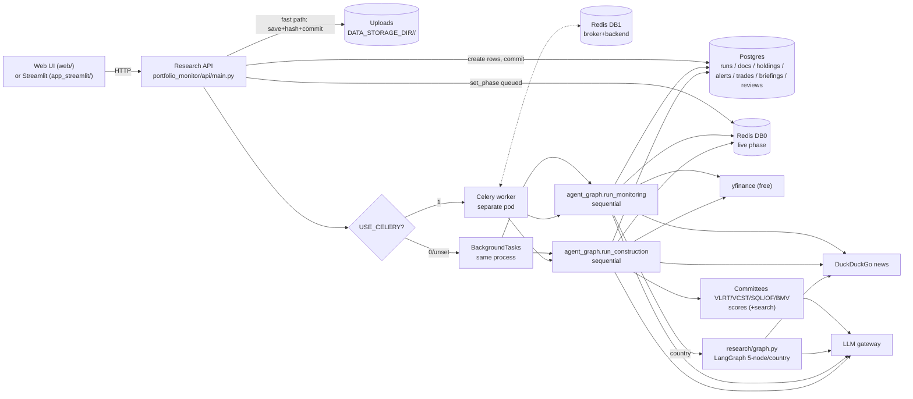
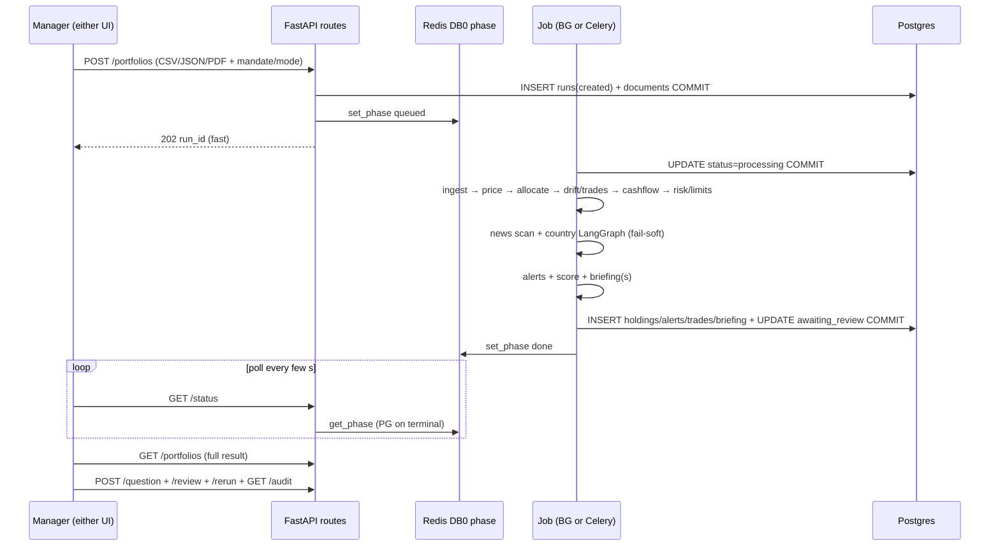
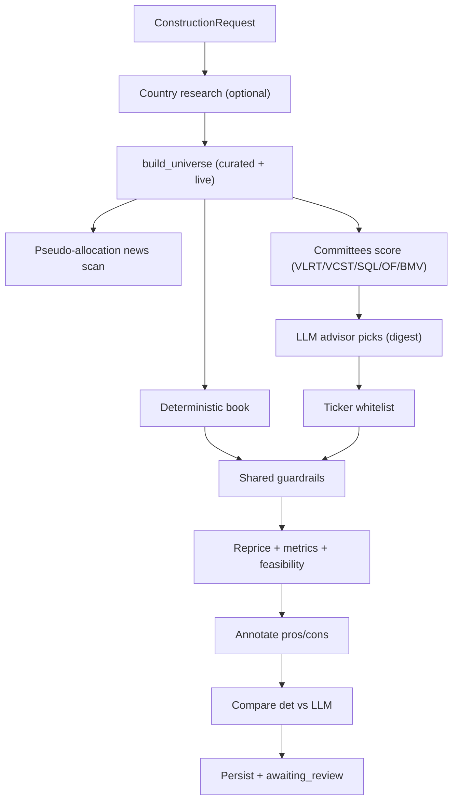
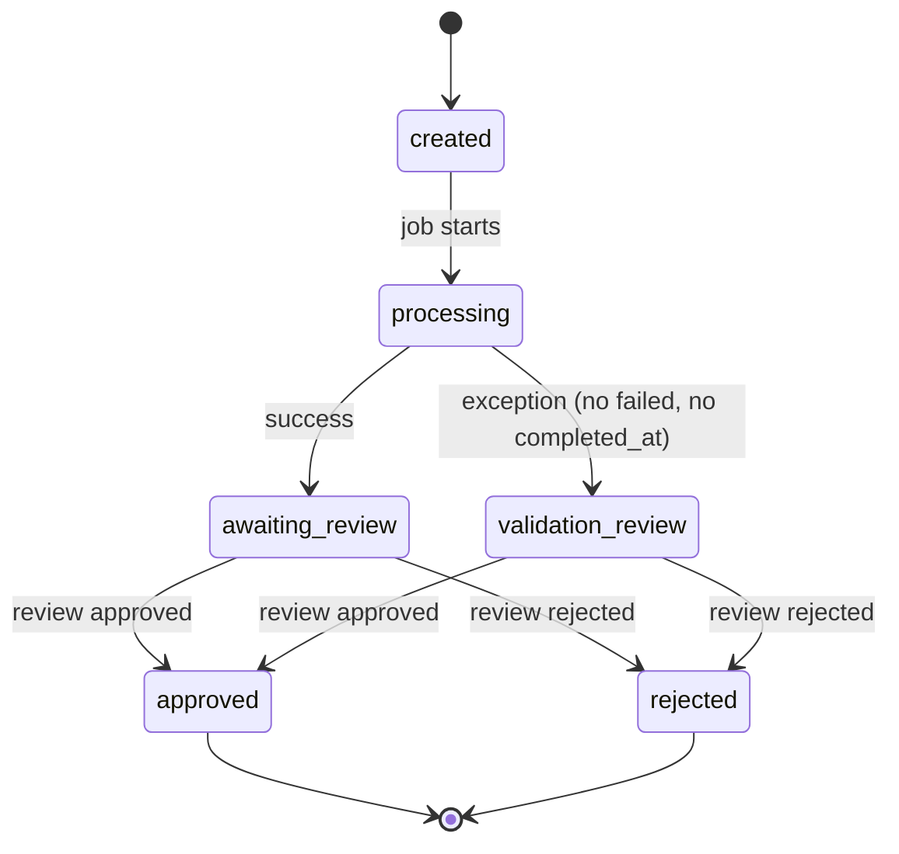
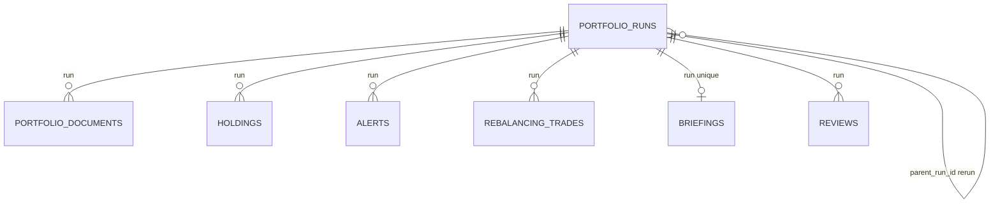

# Investment Research Copilot — NEW_CASE_STUDY (Complete Engineering Replication Guide)

> Purpose: single document describing **every detail of the code** in
> `Investment_Research_Copilot/` so a new / fresher engineer can **rebuild the project
> without reading the source**.
>
> Covers: inputs (mandatory/optional), what the user submits, step-by-step pipeline,
> every task/agent, exact prompts and I/O schemas, sample LLM payloads, the internet/news
> module contract, deterministic math, persistence (types, modelling, S3/warehouse
> guidance), APIs, config, run-book, and mermaid diagrams.
>
> Codebase snapshot: single FastAPI service `portfolio_monitor/api/main.py:app` + production
> vanilla-JS UI (`web/`) + working Streamlit dev UI (`app_streamlit/ui.py`, excluded from
> Docker), Postgres + Redis (DB 0 = live phase, DB 1 = Celery broker/backend), dual-mode
> job dispatch (`USE_CELERY=0` → in-process `BackgroundTasks`; `=1` → Celery worker),
> free `yfinance` + DuckDuckGo data, OpenAI-compatible LLM gateway, real LangGraph only in
> `research/graph.py` (country research). `agent_graph.py` is sequential Python despite its name.
> Entry: `uvicorn portfolio_monitor.api.main:app --host 0.0.0.0 --port 8000`.
>
> Core invariant: **LLM does language only** (news classification, briefing prose,
> construction picks/reasons, Q&A, statement transcription, committee commentary).
> **Every decision-bearing number is deterministic Python** (pricing, allocation, drift,
> trades, cash variances, risk metrics, limits, alerts, health score, guardrails).

---

## Table of contents

1. [Repo map](#1-repo-map)
2. [System principle + two pipelines](#2-system-principle--two-pipelines)
3. [Inputs — what the end user submits](#3-inputs--what-the-end-user-submits)
4. [What happens after Submit — end-to-end](#4-what-happens-after-submit--end-to-end)
5. [Pipeline tasks and agents](#5-pipeline-tasks-and-agents)
6. [Agent detail sheets (prompt, I/O, sample)](#6-agent-detail-sheets-prompt-io-sample)
7. [Deterministic engine](#7-deterministic-engine)
8. [Internet / news OSINT module](#8-internet--news-osint-module)
9. [Investment committees (VLRT/VCST/SQL/OPCO-FINCO/BMV)](#9-investment-committees-vlrtvcstsqlopco-fincobmv)
10. [Construction + guardrails + briefing/Q&A](#10-construction--guardrails--briefingqa)
11. [Persistence — where and how data is stored](#11-persistence--where-and-how-data-is-stored)
12. [API contract](#12-api-contract)
13. [Config / env vars](#13-config--env-vars)
14. [Mermaid diagrams](#14-mermaid-diagrams)
15. [Fresher run-book — replicate from zero](#15-fresher-run-book--replicate-from-zero)
16. [Sample end-to-end payloads](#16-sample-end-to-end-payloads)
17. [Known gaps](#17-known-gaps)

---

## 1. Repo map

```
Investment_Research_Copilot/
  portfolio_monitor/
    api/main.py, routes.py, schemas.py, exceptions.py  # HTTP layer (prefix /portfolios)
    agent_graph.py        # assess_portfolio + run_monitoring + run_construction + CLI (sequential, NOT LangGraph)
    jobs.py               # execute_monitoring/construction_job + celery_enabled + dispatch_*
    tasks.py              # Celery tasks portfolio_monitor.run_monitoring/construction (2 retries, 30s)
    celery_app.py         # broker/backend redis://…/DB1, json ser, UTC, acks_late, prefetch 1
    status_tracker.py     # Redis DB0 live phase {phase,detail,updated_at}, TTL 3600, fail-soft once
    ingest.py             # CSV/JSON -> Holding/CashFlow (alias maps, no LLM)
    statement_extract.py  # PDF statement -> Holding[] via 1 LLM transcription (text PDFs, max 12 pp)
    marketdata.py         # yfinance Quote/get_quote(s)/get_price_history/histories + caches
    analytics.py          # numpy primitives: returns, vol, DD, VaR, beta, TE, HHI, effective N
    allocation.py         # price_holdings + compute_allocation
    drift.py              # compute_drift + build_rebalance_plan
    cashflow.py           # analyse_cash_flows (expected vs actual)
    risk.py               # compute_risk_metrics + check_limits
    alerts.py             # build_alerts (8 sources, severity-sorted)
    scoring.py            # score_portfolio (8 factors, 0-100, health band)
    reference.py          # IPS targets/bands/benchmarks, risk limits, yields, universe seeds, weights
    universe.py           # Candidate + build_universe (live-enriched pool)
    compare.py            # compare_constructions (Jaccard + sleeve/metric deltas)
    feasibility.py        # implied_target_annual + assess_feasibility
    schemas.py            # all Pydantic contracts (inputs, outputs, news, construction, briefing)
    config.py             # Config dataclass + get_llm()/llm_available()
    logconf.py            # stderr logger + PM_LOG_FILE
    construct/common.py, deterministic.py, llm_advisor.py, guardrails.py, annotate.py
    construct/vlrt_agents.py, vcst_agents.py, sql_agents.py, opcofinco_agents.py, bmv_agents.py
    monitor/deterministic.py, llm_briefing.py
    osint/search.py, collect.py, scan.py
    research/collect.py, deterministic.py, graph.py, nodes.py   # real LangGraph StateGraph
    db/models.py, persist.py, session.py
  web/index.html + js/    # production UI (upload, mandate/mode, poll, Q&A, review)
  app_streamlit/ui.py     # working dev UI (Monitor/Construct × Deterministic/LLM/Both)
  data/uploads/<uuid>/    # runtime uploads (git-ignored); sample_data/ has example CSVs
  tests/test_api.py (stale), test_scoring.py, test_monitoring.py
  Dockerfile, k8s/deployment.yaml + celery-worker.yaml + service.yaml + configmap.yaml + secret.yaml
  Makefile, pyproject.toml, requirements.txt, .env.example
```

---

## 2. System principle + two pipelines

| Pipeline | Entry | Evidence | LLM roles | Deterministic tail |
|---|---|---|---|---|
| **Monitoring** | holdings CSV/JSON (+ optional ledger, optional PDF statement) | user files + yfinance + DDG news | statement transcription, news classification, LLM briefing, Q&A | price → allocation → drift/trades → cashflow → risk/limits → alerts → score → templated briefing |
| **Construction** | `ConstructionRequest` (mandate, amount, style, countries, constraints, framework) | curated universe + yfinance + DDG (committees) | committee commentary, LLM picks/reasons, annotation pros/cons | universe → deterministic book + LLM book → shared guardrails → metrics/feasibility → diff |

News/committee LLM failures **never** abort a run — keyword fallbacks / deterministic reasons take over; fully-offline path always works.

---

## 3. Inputs — what the end user submits

### 3.1 Transports

- `POST /portfolios` = `multipart/form-data` (monitoring; web Upload tab, Streamlit task=Monitor).
- `POST /portfolios/construct` = `multipart` or JSON `ConstructionRequest` (construction; web/Streamlit task=Construct).
- `POST /portfolios/{id}/rerun|question|review` = JSON. All reads GET.

### 3.2 Monitoring field table

| Field | Location | Mandatory? | Type / constraints | What to type | Default if blank |
|---|---|---|---|---|---|
| `holdings_file` | form-file (CSV/JSON) | **Mandatory unless `statement_file` given** (else 500 `ValueError` — known bug, should be 400) | CSV headers aliased (`ticker/symbol/security`, `qty/quantity/shares/units`, `price/last_price`, `market_value/value/mv`, `asset_class/class`, `sector/industry`, `region/geography/country→region`, `currency/ccy`, `cost_basis/cost`) or JSON list / `{holdings:[]}` | symbol (uppercased, required per row), name?, asset_class?, sector?, region?, currency (default USD), quantity (default 0), cost_basis?, price? | missing file → error path |
| `transactions_file` | form-file (CSV/JSON) | Optional | aliased (`date/trade_date`, `type/transaction_type` → dividend/coupon/interest/contribution/withdrawal/fee/tax/trade_buy/trade_sell, `symbol`, `amount`, `currency`, `note`) or `{transactions:[]}` | dated income/flow rows for reconciliation | none → cashflow notes "no ledger", expected-only |
| `statement_file` | form-file (PDF) | Optional fallback | text PDF (max 12 pages read, no OCR; scanned → raise) | brokerage statement holdings table | none |
| `mandate` | form-text | Optional | `conservative/balanced/growth/aggressive` (+ aliases: defensive/income→conservative, moderate/60-40→balanced, equity→growth, high_growth→aggressive; else balanced) | selects IPS targets, bands, benchmark (AOK/AOM/AOR/AOA), vol ceiling (10/14/18/24%) | `balanced` |
| `mode` | form-text | Optional | `det|deterministic|llm|both` | briefing modes: templated only / LLM only (falls back to det if gateway down) / both | `both` |
| `base_currency` | form-text | Optional | `str` (default USD; no FX conversion — label only) | `USD` | `USD` |
| `portfolio_name/client_name` | form-text | Optional | `str` (255) | account label | `Portfolio` |
| `enable_news` | form-bool | Optional | `true/false` | uncheck for offline (skips news + country research) | `true` |
| `question` | form-text | Optional | free text | e.g. `Why did the equity sleeve breach?` | `""` → no Q&A call |
| `requested_by` | form-text | Optional | free text, no auth | analyst id | `local-advisor` |

### 3.3 Construction field table (`ConstructionRequest`)

| Field | Mandatory? | Type / default | Meaning |
|---|---|---|---|
| `mandate` | optional | `balanced` | SAA sleeve targets unless `equity_pct/debt_pct` override |
| `invest_amount/base_currency` | optional | `1_000_000.0 / USD` | finalise math (`amount=w×invest`, `shares=round(amount/price,4)`) |
| `risk_tolerance/horizon_years` | optional | `medium / 5` | committee risk shaping; feasibility projection horizon |
| `constraints` | optional | `single_name_cap=0.10, sector_cap=0.30, min_position=0.01, exclusions[]` (+ region_preference, max_holdings, min_div/max_pe/max_expense, min_credit_rating) | hard guardrails (both books) |
| `universe_symbols[]` | optional | `[]` → curated pool | explicit tickers bypass curated selection |
| `weighting_method` | optional | `equal_weight` (also `inverse_vol/risk_parity/return_tilted`) | within-sleeve weights (deterministic book) |
| `geography_mode/countries/style/cap_mix/theme/instrument_types` | optional | `global / [] / multi_cap / {} / None / []` | `country_specific` = first country; `country_list` = named; styles route equity selection; theme substring basket; MF/ETF/stock filter |
| `equity_pct/debt_pct` | optional | `None` → SAA | explicit equity/debt override (cash/alts from SAA, renormalised) |
| `target_return_pct/target_value` | optional | `None` | feasibility verdict (`>1` treated as %) |
| `framework` | optional | `both` (=VLRT+VCST legacy) | `vlrt/vcst/sql/opcofinco/bmv/both/all` committee lens; UI dropdown |
| `cycle_stance` | optional | `neutral` | passed to committees |
| `enable_country_research/enable_vcst_search/enable_of_search/enable_bmv_search` | optional | `true` | kill-switches to fundamentals-only committees |

### 3.4 What the user should actually submit

1. Monitoring: a holdings export (CSV/JSON) with `symbol, quantity` minimum; add `price`
   to override live quotes, `cost_basis` as pricing fallback, `asset_class/sector/region`
   to avoid `other/Unclassified` buckets; add the transactions ledger for cashflow value;
   mandate matching the IPS. PDF only when no export exists.
2. Construction: mandate + amount + constraints first; add `universe_symbols` for an
   approved list, or `countries/style/theme` for curated discovery; pick `framework`
   matching the house view (SQL for QGLP, BMV for Kotak-style gates); set a return target
   only if feasibility review is wanted.

---

## 4. What happens after Submit — end-to-end

### 4.1 Fast accept vs slow execute

`POST /portfolios` does only: save files → sha256 → INSERT `portfolio_runs(created)` +
`portfolio_documents` → commit → `set_phase(queued)` → dispatch (Celery if
`USE_CELERY=1` else `BackgroundTasks`) → **202 + run id** in <1 s. Pipeline (live
quotes/history per symbol + up to 18 committee LLM calls + news) runs after; client polls
`GET /portfolios/{id}/status` (Redis first, Postgres on terminal), then `GET` full result.

### 4.2 Monitoring step-by-step (code pointers)

| # | Step | Code | What happens |
|---|---|---|---|
| 1 | Save+hash | `routes._save_uploads` | `DATA_STORAGE_DIR/<uuid>/<filename>` ×N. Missing holdings+statement → `ValueError` → 500 (bug). |
| 2 | Row | `routes.create_portfolio` | `PortfolioRun(status=created, mandate/mode/currency/question…)` + `persist_documents` (sha256, abspath, doc_type) → commit → `set_phase queued` → `_schedule_job` → 202. |
| 3 | Start | `jobs.execute_monitoring_job` | own session; `status=processing`, `model_name` if LLM; `set_phase ingesting_holdings`. |
| 4 | Load | `agent_graph.run_monitoring` | `load_holdings/transactions` (alias maps) **or** `extract_holdings_from_statement` (1 LLM, verbatim copy) → `build_portfolio`. |
| 5 | Price+allocate | `marketdata.get_quotes/histories` + `allocation` | per-symbol quote/history (soft-fail `{}`/`[]`); `price_holdings` priority input→market→cost→missing; `compute_allocation` 7 breakdowns + coverage. |
| 6 | Drift+trades | `drift` | IPS targets/bands → per-sleeve status → sized trades for breaches only. |
| 7 | Cashflow | `cashflow` | expected (dividend×qty×frac **or** assumed yield×MV×frac) vs actual ledger → per-symbol variance + unexpected-flow flags. |
| 8 | Risk+limits | `risk` | vol/DD/VaR/beta/TE/yield/HHI from histories + 7 limit checks. |
| 9 | News (optional) | `osint.scan.run_risk_scan` | company-name queries (top-3 holdings, top-2 sectors, macro) → LLM classify else keyword fallback. Symbol→name map passed (tickers with `.NS/.L` query badly). |
| 10 | Country (optional) | `research.graph.run_country_research` | top-3 held countries → LangGraph 5-node profiles (fail-soft `{}`). |
| 11 | Alerts+score | `alerts` + `scoring` | 8 alert sources sorted by severity; 8-factor 0–100 + band + summary. News/country capped medium (discount). |
| 12 | Briefings | `monitor/deterministic` + `monitor/llm_briefing` | templated always per `mode`; LLM if `mode ∈ {llm,both}` and gateway up (else det fallback when `llm`-only). Optional `answer_question`. |
| 13 | Persist | `db/persist.persist_monitoring_result` | INSERT holdings/alerts/trades (+0/1 briefing with `key_findings=actions+watch`) + UPDATE run (`awaiting_review`, score/band, `raw_result=MonitoringResult dump`, reasoning, latency, llm count, `completed_at`) → one commit → `set_phase done`. |
| On exception | `jobs` except | re-fetch run → `status=validation_review` (never `failed`, never `completed_at`) → `set_phase failed` → commit. |
| 14 | Read | UIs | `GET /status` → `GET /portfolios/{id}` → `question/review/rerun/audit`. |

`metrics = {task:monitoring, mode, holdings, market_value, health_band, risk_score,
n_alerts, drift_breaches, data_coverage, market_data bool, llm_calls, latency_ms}`;
`reasoning` = step strings (ingest/pricing/drift/cash/risk/news/score).

### 4.3 Construction step-by-step

| # | Step | Code |
|---|---|---|
| 1–2 | Same accept + `execute_construction_job` (validates `ConstructionRequest`, `result_type=construction`) | `routes` + `jobs` |
| 3 | Country research (if enabled + countries) | `research.graph` |
| 4 | Universe | `universe.build_universe` (user symbols **or** curated equity/ETF/MF/non-equity sleeves, exclusions, ratio/credit/country filters, live enrichment) |
| 5 | Pseudo-allocation news scan (top-5 priced equity) | `osint.scan` via `_universe_pseudo_allocation` |
| 6 | Deterministic book | `construct/deterministic` (sleeve targets → sector-diverse picks → method weights) + `annotate(use_llm=False)` |
| 7 | LLM book | `construct/llm_advisor` (committees score → digest sorted by avg → LLM picks → whitelist → **same guardrails**) + `annotate(use_llm=True)` |
| 8 | Both → `common.compute_expected_metrics` + `feasibility` + `compare` (if both) | `construct/common`, `feasibility`, `compare` |
| 9 | Persist (same tables; holdings = deterministic book if present else LLM; briefing = deterministic narrative) + `awaiting_review` | `persist` + `jobs` |

LLM-call count construction ≈ news classify + country nodes + active committees×commentary + LLM constructor + annotations (up to ~18 committee calls when `framework=all`).

---

## 5. Pipeline tasks and agents

| # | Task | Agent / function | File | LLM? | Input | Output |
|---|---|---|---|---|---|---|
| T1 | Ingest holdings/ledger | `load_holdings/load_cash_flows(/_from_text)` | `ingest.py` | No | CSV/JSON path/text | `Holding[]/CashFlow[]` |
| T2 | Statement transcription | `extract_holdings_from_statement` | `statement_extract.py` | Yes ×1 | PDF text (≤12 pp) | `Holding[]` (verbatim numbers) |
| T3 | Quotes/history | `get_quotes/get_histories/get_price_history` | `marketdata.py` | No (yfinance) | symbols | `Quote{price,currency,sector,cap,div,PE…}`, `float[]` |
| T4 | Price+allocate | `price_holdings/compute_allocation` | `allocation.py` | No | holdings+quotes | `AllocationBreakdown` + `price_source` per holding |
| T5 | Drift+trades | `compute_drift/build_rebalance_plan` | `drift.py` | No | weights+mandate+MV | `DriftReport` + `RebalancePlan` |
| T6 | Cashflow | `analyse_cash_flows` | `cashflow.py` | No | holdings+ledger+quotes | `CashFlowReport` |
| T7 | Risk+limits | `compute_risk_metrics/check_limits` | `risk.py` | No | holdings/alloc/histories/bench/quotes | `RiskMetrics` + `RiskLimitCheck[]` |
| T8 | News evidence | `collect_evidence` | `osint/collect.py` | No (DDG) | allocation (+names) | `NewsEvidenceItem[]` |
| T9 | News classification | `run_risk_scan` | `osint/scan.py` | Yes ×1 (fallback keywords) | evidence compact | `MarketRiskScan` |
| T10 | Country research | `run_country_research` | `research/graph.py` | Yes (5 nodes/country + merges) | top-3 countries | `dict[str,CountryResearchProfile]` |
| T11 | Alerts+score | `build_alerts/score_portfolio` | `alerts.py/scoring.py` | No | all above | `Alert[]` + `PortfolioRiskScore` |
| T12 | Briefings | `build_briefing / build_briefing_llm` | `monitor/*` | Templated + Yes ×1 | `MonitoringResult` / compact JSON | `MonitoringBriefing` |
| T13 | Q&A | `answer_question` | `monitor/llm_briefing.py` | Yes ×1 | compact + question | `str` |
| T14 | Universe | `build_universe` | `universe.py` | No (+quotes/histories) | request (+country research) | `Candidate[]` |
| T15 | Committees | `vlrt/vcst/sql/of/bmv_agents` | `construct/*_agents.py` | Scores No + commentary Yes | candidates (+bounded DDG) | `{symbol:{combined, legs…, view}}` + stance/summary |
| T16 | Deterministic book | `construct_deterministic` | `construct/deterministic.py` | No | request+universe | `ConstructedPortfolio(method=deterministic)` |
| T17 | LLM book | `construct_llm` | `construct/llm_advisor.py` | Yes ×1 | digest + committee scores | `ConstructedPortfolio(method=llm)` |
| T18 | Guardrails | `enforce/finalise_positions` | `construct/guardrails.py` | No | weights+meta+constraints | capped weights + `corrections[]` + positions/amounts |
| T19 | Annotation | `annotate_positions` | `construct/annotate.py` | Yes ×1 (fallback rules) | positions+scan | pros/cons per holding |
| T20 | Compare/feasibility | `compare_constructions/assess_feasibility` | `compare.py/feasibility.py` | No | both books / request+returns | `ConstructionComparison` + `FeasibilityVerdict` |

How info is given: T2/T9/T12/T13/T17/T19 receive **pasted JSON/text blocks** (PDF text, news
compact, computed snapshot, universe digest) with "quote-only / use-only-supplied" system
prompts and return **JSON-only** (fence-tolerant parse) or prose string; T15 receives
candidate stats + bounded search snippets per name and returns deterministic scores
(structured) plus one-line views (LLM, fail-soft). Nothing numeric from an LLM is trusted:
T17 filters to universe tickers + guardrails + deterministic repricing; T9/T11 discount news.

---

## 6. Agent detail sheets (prompt, I/O, sample)

Parse convention everywhere: strip ``` fences → `json.loads` → skip invalid rows (never raise into pipeline); enums via map-with-fallback (`other`/`OTHER`).

### 6.1 T2 — Statement holdings transcription

- Function: `extract_holdings_from_statement(pdf_path) -> Holding[]` (raises if gateway down or PDF unreadable).
- PDF text: `_read_pdf_text` (fitz, first 12 pages, `--- PAGE i ---` joins).
- System (verbatim): brokerage-statement transcriber; page text ONLY; one record per position;
  copy `quantity/price/market_value` EXACTLY (no compute/sum/infer/rescale); map asset_class ∈
  8 values, region ∈ 5 values (best effort, `other` if unclear); output ONLY JSON array
  `[{"symbol":str,"name"|null,"asset_class":str,"sector"|null,"region":str,"currency"|null,
  "quantity"|null,"price"|null,"market_value"|null,"cost_basis"|null}]`.
- User: `Statement text:\n<text>\n\nReturn the holdings JSON array.` Fail → `[]`.
- Post: `_ASSET_CLASS_MAP/_REGION_MAP` else enum fallback; `_num` (`,%$£` strip, `(x)` negative);
  symbol uppercased; `price_source="input"` if price else `"marketdata"`.
- Sample out: `[{"symbol":"RELIANCE.NS","name":"Reliance Industries","asset_class":"equity",
  "sector":"Energy","region":"emerging_markets","currency":"INR","quantity":120,"price":2850.5,
  "market_value":342060.0,"cost_basis":null}]`.

### 6.2 T12 — LLM monitoring briefing

- Function: `build_briefing_llm(result) -> MonitoringBriefing` (`monitor/llm_briefing.py:80`).
- Input compact: `{portfolio, mandate, market_value, base_currency, health_band, risk_score,
  asset_class_mix{}, drift_breaches[{sleeve,actual,target,status}], rebalance_summary,
  risk_metrics{volatility,max_drawdown,var_95_1d,beta,hhi,effective_n,top1,largest_position,
  data_coverage}, limit_breaches[{name,observed,limit,status}], cashflow{expected,actual,
  net,flags[]}, alerts[{type,severity,title,action}], emerging_risk{tone,findings[]}|None}`.
- System (verbatim): investment-risk officer; snapshot AUTHORITATIVE — do NOT recompute/change/
  invent; quote figures + alert titles; news = colour only, never override a breach; output ONLY
  JSON `{"executive_summary":str,"allocation_commentary":str,"risk_commentary":str,
  "cashflow_commentary":str,"recommended_actions":[str],"watch_items":[str]}`.
- User: `Computed snapshot (authoritative):\n<json>\n\nWrite the briefing JSON now.`
  Fail → `MonitoringBriefing(method="llm", executive_summary="(LLM briefing unavailable.)")`.
- Output struct: `MonitoringBriefing{method, executive_summary, allocation_commentary?,
  risk_commentary?, cashflow_commentary?, recommended_actions[], watch_items[]}`.

### 6.3 T13 — Monitoring Q&A

- Function: `answer_question(result, question) -> str` (empty Q → `""`; no gateway →
  `(LLM not configured — set LLM_ENDPOINT / LLM_API_KEY…)`).
- System: use ONLY supplied figures; admit absence; never invent metric/weight/alert/band.
- User: `Question:\n{q}\n\nSnapshot:\n<compact>\n\nAnswer concisely.`
- Sample: Q `Why did equity breach?` → A cites `Actual 68% vs target 55% (band 50–60%)…`.

### 6.4 T17 — LLM constructor

- Function: `construct_llm(request, universe, risk_scan?) -> ConstructedPortfolio`
  (`construct/llm_advisor.py`; gateway down → deterministic fallback labelled `llm`).
- Digest row per candidate (sorted by avg committee score): `{symbol,name,asset_class,sector,
  region,volatility,dividend_yield,pe_ratio,market_cap,expected_return,has_price,news_risk,
  vlrt?/vcst?/sql?/of?/bmv?{combined,…}}`.
- System (structure verbatim): portfolio manager for `{mandate}` (tolerance, horizon);
  INVESTOR PROFILE (`style`, countries+mode, equity/debt, cap mix, theme, instruments,
  return target); per-committee READ blocks; build USING scores (favour high-combined,
  explain low inclusions); HARD RULES (weights ≈1.0, single ≤cap%, sector ≤cap%, respect
  exclusions, near SAA unless override; flag unrealistic target); per pick `reason` +
  per-framework objects; ONLY supplied candidates/tickers/numbers; output ONLY JSON
  `{"positions":[{"symbol":str,"weight":number,"reason":str[,vlrt/vcst/sql/of/bmv:{…}…]}],
  "narrative":str}`.
- User: `Investable amount: A CUR.\nCandidate universe…\nReturn your portfolio JSON now.`
- Post: drop unknown/≤0-weight symbols (invented tickers die here) → `guardrails.enforce` →
  `finalise_positions` (amounts/shares repriced) → metrics/feasibility → attach committee
  scores/reasons → narrative `LLM-advised (FW) construction… proposed N; after guardrails M…`.
- Sample out: `{"positions":[{"symbol":"VTI","weight":0.35,"reason":"Core large-cap anchor;
  vlrt 0.78 on liquidity…","vlrt":{"view":"…"},…}],"narrative":"Balanced 60/40… "}`.

### 6.5 T19 — Pros/cons annotation

- Function: `annotate_positions(positions, scan?, use_llm=True)`.
- System: equity analyst; per holding 2–3 PROS + 2–3 CONS grounded ONLY in stats + news
  (weave regulation/tariffs/supply-chain/sanctions where present); no invented facts/numbers;
  output ONLY JSON `{"<symbol>":{"pros":[str],"cons":[str]},…}`.
- User payload row: `{symbol,name,asset_class,sector,country,market_cap,expected_return,
  weight,news:[{category,severity,summary}]}`.
- Fallback (no gateway): `er≥8%→pro else con`, `large→liquid pro`, `small→volatile con`,
  `country→diversification pro`, `news→"News risk (cat): …" con`, defaults.

### 6.6 Final output structures

- `MonitoringResult{portfolio, allocation, drift, rebalance, cashflow, risk_metrics,
  limit_checks[], risk_scan?, country_research{}, alerts[], score, briefing_deterministic?,
  briefing_llm?}` (persisted whole as `raw_result`).
- `ConstructedPortfolio{method, weighting_method, style, countries[], positions[
  SelectedPosition{symbol,…,target_weight,amount,shares,price,expected_return,rationale,
  pros[],cons[],vlrt/vcst/sql/of/bmv_scores{}+*_reason}]…, sleeve/cap/country_allocation,
  expected_metrics, feasibility, excluded[], guardrail_corrections[], narrative,
  total_invested, cash_residual, *_regime/stance+summary}`.
- `MonitoringBriefing{method, executive_summary, allocation/risk/cashflow_commentary?,
  recommended_actions[], watch_items[]}` — string-only schema (no numeric field to corrupt).

---

## 7. Deterministic engine

All pure Python; same inputs (fixed prices) → same outputs. Money rounded 2, weights 6, metrics 4.

### 7.1 Pricing + allocation (`allocation.py`, `marketdata.py`, `analytics.py`)

- Quote: `fast_info.last_price/currency` → `info.currentPrice|regularMarketPrice|previousClose`,
  sector/country/cap/div/PE/expense; history `Close auto_adjust` (`PM_HISTORY_PERIOD` default
  `1y`), NaN/≤0 filtered; per-process caches; all fail-soft.
- Price priority per holding: `price>0 → input`; else quote price → `marketdata` (+ fill
  country/cap/instrument); else `cost_basis/quantity → cost_basis`; else `missing`
  (flagged, excluded; `coverage = priced MV / all MV`).
- Breakdowns by asset_class/sector/region/country/market_cap (equity only)/currency/position
  (MV desc, weight 6); `equity_debt = {equity: EQ+RE, debt: FI, cash, other}`.
- Primitives (`analytics.py`): `daily_returns`, `vol = std(ddof=1)×√252`,
  `ann_ret = mean×252`, `max_drawdown = min(p/cummax−1)`, `VaR95 = max(0,−q5%)` (needs ≥20),
  `beta = cov/var`, `tracking_error = std(active)×√252`, `HHI = Σw²`, `effective_n = 1/HHI`,
  `portfolio_returns` (renorm covered, shortest tail). `None` on short/missing.

### 7.2 Drift + rebalancing (`drift.py`, `reference.py`)

- IPS targets/bands/benchmarks: conservative `{eq .30, fi .55, cash .10, alt .05, band .05,
  AOK}`, balanced `{.55,.35,.05,.05,.05,AOM}`, growth `{.75,.18,.02,.05,.06,AOR}`,
  aggressive `{.90,.05,.00,.05,.07,AOA}` (`*_PATH` JSON overrides; mandate aliases resolved).
- Sleeve band `(max(0,t−b), min(1,t+b))` (`t=0 → (0,b)`); classify `>upper BREACH_OVER`,
  `<lower BREACH_UNDER`, `>target OVERWEIGHT`, `<target UNDERWEIGHT`, else WITHIN;
  `active_share = ½Σ|drift|`; `n_breaches` count.
- Trades for breaches only: `delta = target−actual`, `trade_value = delta×MV`
  (`buy>0/sell<0`), `turnover = sells/MV`, `est_cost = (buys+sells)×5bps`
  (`TRANSACTION_COST_BPS`). Rationale quotes `Actual X% vs target Y% (band L–U%)…`.

### 7.3 Cashflow (`cashflow.py`)

- Fraction `(max−min).days/365` (min 1 day; <2 dates → 1.0).
- Expected per holding: `div_rate×qty×frac` (yfinance basis) → else `0` if quoted but
  distribution-free → else `MV×assumed_yield[class]×frac` (equity 1.5%, FI 4%, cash 5%,
  alts 3%, RE 3.5%, multi 2%, commodity/other 0). Skip `expected≤0∧actual≤0` and
  `0<expected<250∧actual=0` (`MATERIAL_INCOME_FLOOR`).
- Status: `exp>0∧act=0 missing`; `exp≤0∧act>0 excess`; `|var|/exp≤10% on_track`
  (`CASHFLOW_TOLERANCE`); else shortfall/excess. Severity INFO (on_track/excess),
  MEDIUM (missing/unexpected), shortfall LOW→MEDIUM→HIGH at 40% (`SHORTFALL_HIGH`).
  Non-held income → `unexpected/MEDIUM`; fee/withdrawal/tax `|amt|≥10k → unexpected`
  (`UNEXPECTED_FLOW_ABS`), HIGH at ≥50k.

### 7.4 Risk + limits (`risk.py`)

- From histories: vol/DD/VaR95/exp_ret/HHI/effN/top1/top5/largest + beta/TE if benchmark +
  dividend yield (yfinance `≥1.0 → /100` else as-is, else assumed) + `var_value = var%×MV`;
  coverage note if <50% (`LOW_COVERAGE_THRESHOLD`).
- Limits (`risk_limits()` + `vol_ceiling` 10/14/18/24%): single-name 10%, sector 30%,
  vol ceiling, DD alert 20%, VaR95 4%, TE 10% (if set), min cash (only if >0).
  Higher-worse: `>limit breach/HIGH`, `≥90% warn/MEDIUM` (`NEAR_LIMIT_WARN_FRACTION`);
  lower-worse mirrored; missing → `not_available/INFO`.

### 7.5 Alerts (`alerts.py`, severity-sorted desc)

Rebalance per breach (HIGH) → single-name >10% (HIGH if >15% else MEDIUM) → sector >30%
(MEDIUM, Unclassified exempt) → limit breach/warn (HIGH/MEDIUM; DD → `drawdown` type) →
cashflow off-track ≥MEDIUM → unpriced (LOW data_quality) → news/country findings
(`low→LOW, medium→MEDIUM, HIGH→MEDIUM` — **credibility discount**) as `emerging_risk`.
Each `{type, severity, title, detail, evidence[], recommended_action, symbols[]}`.

### 7.6 Health score (`scoring.py`, `reference.py`)

Weights `drift 20, concentration 18, volatility 18, drawdown 16, cashflow 10,
limit_breach 22, emerging 12, country 10`; multipliers `low×0, medium×0.6, high×1,
critical×1.5`; `contribution = round(w×m,2)`; `raw = Σ`, `normalized = min(100,raw)`;
bands `≤25 healthy, ≤50 watch, ≤75 elevated, else critical` (`SCORE_TO_BAND`).
Severities: drift (≥2 breach HIGH; 1/active>10% MEDIUM); concentration (HHI≥.20 or
top1>15% HIGH; HHI≥.12 or top1>10% MEDIUM); vol (>1.25×ceil HIGH; >ceil MEDIUM); DD
(same ×1.5/1.0 on 20%); cashflow (≥1 HIGH-sev or ≥3 off MEDIUM; ==1 LOW; any MEDIUM);
limits (≥2 breach CRITICAL; 1 HIGH; warn MEDIUM); emerging/country (any findings/tone →
MEDIUM — capped — else LOW). Summary `Portfolio health: BAND. Ns sleeves… M limits…
Vol X%. / No breaches.`

---

## 8. Internet / news OSINT module

This is the "news from the internet" module. Runs in **both** pipelines (monitoring scan,
construction pseudo-scan, committee sentiment/governance legs, country research) — always
bounded, always fail-soft, always discounted downstream.

### 8.1 Input

- Monitoring: `AllocationBreakdown` + `symbol_to_name {SYM: company}` (company names —
  tickers with `.NS/.L` query badly) + optional `region`.
- Construction: pseudo-allocation (top-5 priced equity by weight) built by
  `_universe_pseudo_allocation`.
- Committees: per-stock `{name}` + sector (+ `PM_*_MAX_NAMES=15`, `MAX_RESULTS=3`).
- Env: `PM_NEWS_REGION=wt-wt`, `PM_NEWS_DELAY=0.5s`, `PM_NEWS_DEBUG` on, retry-once with
  fallback query, 5 s sleep on ratelimit. `search_available()` gates VCST UI warning.

### 8.2 Collection (`osint/search.py`, `collect.py`)

- Backends: `news_search(query, max=6, region)` via `ddgs.news`
  `[{title,url,snippet,source=news,published,publisher}]`; `web_search` via `ddgs.text`
  (implemented, **dead** — nothing calls it).
- Queries (`collect_evidence`, `top_n_holdings=3`, `top_n_sectors=2`): per held company
  `{name} stock risk warning OR lawsuit OR downgrade OR guidance cut` +
  `{name} regulatory investigation OR fine OR probe` (exchange suffixes stripped; fund
  tickers `VTI/VOO/…/GLD/…/NIFTYBEES/…` skipped); per sector `{sec} sector outlook risk
  selloff 2026`; macro `stock market volatility selloff… / inflation interest rates… /
  geopolitical risk markets tariffs conflict`. Output
  `NewsEvidenceItem{dimension, query, title?, url?, snippet?, source, published?,
  related_symbol?}`.

### 8.3 LLM output + how passed on

- `run_risk_scan`: compact `[{dimension, related_symbol, title, snippet[:300], url}]` →
  system (verbatim §6-style): risk analyst; SNIPPETS ONLY; per finding
  `scope(portfolio|position|sector), subject, category(8 RiskDimensions), severity,
  summary, url` + tone `calm|normal|elevated|stressed`; benign → few/no findings;
  output ONLY JSON `{overall_risk_tone, summary, findings[], watchlist_symbols[]}`
  (summaries ≤240/600 chars, symbols uppercased). Empty evidence → `normal / "No
  public-news evidence collected." / gap`. LLM fail → **keyword fallback**
  (lawsuit/probe flags; HIGH if ≥2 else MEDIUM; tone elevated if ≥3 else normal).
- Passed on: `MarketRiskScan{overall_risk_tone, summary, findings[EmergingRiskFinding{
  scope, subject, category, severity, summary, url}], evidence[], watchlist_symbols[],
  data_gaps[]}` → `build_alerts` (HIGH→MEDIUM cap) + `score_portfolio` (MEDIUM cap) +
  briefing compact (`tone + findings`) as colour only + universe digest `news_risk` per
  symbol + annotation `news[]` per holding. Sample: in `[{related_symbol:"RELIANCE.NS",
  title:"…probe…", snippet:"regulator opened…"}]` → out `{overall_risk_tone:"elevated",
  findings:[{scope:"position", subject:"RELIANCE.NS", category:"regulatory",
  severity:"high", summary:"…", url:"…"}]}` → alert MEDIUM + score MEDIUM at most.

---

## 9. Investment committees (VLRT/VCST/SQL/OPCO-FINCO/BMV)

Selected via `framework` (`vlrt/vcst/sql/opcofinco/bmv/both=VLRT+VCST/all`);
`_use_committees` maps to 5 booleans. Every committee returns per-symbol
`{combined 0–1, leg scores…, view (LLM one-liner, fail-soft deterministic), stance,
summary}`; combined attached to every `SelectedPosition` (`vlrt_scores` etc. + reasons)
as the audit trail. LLM writes **commentary only** (`{"views":[{"symbol","view"}]}`).

| Committee | Style | Blend / gate | Legs (deterministic) | Live search |
|---|---|---|---|---|
| VLRT | Quant | V30 L25 R25 T20 | Valuation (PE≤12→1, ≥35→0; yield≥4%→1; drift; `.5+(pe−.5)×.6+(y−.5)×.4+(m−.5)×.2`, .05–.95) · Liquidity (large .90/mid .70/small .45/unk .50, +ETF/MF .05, unpriced ≤.30) · Risk appetite (`(0.50−vol)/0.40`, tol-shaped, news −.25/−.12) · Timing (sharpe→(−), risk_off −.10); regime `risk_on/off/neutral` from avg vol + `stress=2×high+med` | none (offline) |
| VCST | ICICI | V30 C25 S25 T20, contrarian stance (`buy_dip >.58 / take_profit <.45`) | Valuation as VLRT · Cycle (weak: cyclic .80/neutral .55/defensive .35; strong inverted; neutral from exp_ret; keyword sector lists) · Sentiment (stock `{name} stock analyst rating outlook` + sector `{sector} sector outlook…` searches; `.5+.08×(neg−pos)`, .15–.85; coverage fraction recorded) · Trigger (≥2 adverse →.30; catalyst →.70; else .55) | stock+sector DDG (news+web), keyword fallback |
| SQL | Motilal Oswal | S25 Q40 L35 | Size (opp large-cap-sector .75 else .45; headroom small .85/mid .75/large .55; funds ≤.60, unpriced ≤.35) · Quality **multiplicative** `Qbiz×Qmgmt/0.7` (stability/payout × execution, news-discounted) · Longevity (momentum/vehicle/relevance; durable sectors .75) | none (offline) |
| OPCO-FINCO | WhiteOak | O20 F15 B35 V30 | OpCo (excess/payout/lightness; light sectors .75, heavy .35) · FinCo (yield/calm/scale; large +.15, unpriced −.15) · Business (incremental/scalable − governance/obsolescence/news/substitution sectors) · Value (PE+yield .7/.3) | per-stock + per-sector governance/disruption DDG |
| BMV | Kotak | **Sequential gate** B40/M35/V25 | Business (industry/growers/moat; fad →.20; moat bonus) · Management (execution/payout − governance + uplift − news) · Valuation (cheap wins; moat premium if B≥.60&M≥.55&12≤PE≤28; PE≥35 w/o yield ≤.30). Gates: `B<.35 → combined .30 (dropped)`; else `M<.35 → .40`; trips named | per-stock + per-sector governance DDG |

---

## 10. Construction + guardrails + briefing/Q&A

### 10.1 Universe (`universe.py`)

`Candidate{symbol,…,asset_class,sector,region,country,market_cap(+value),instrument_type,
price,volatility,expected_return,dividend_yield,pe_ratio,expense_ratio,has_market_data}`.
Sources: explicit `universe_symbols` → `_add` each; else per country (global defaults
US/UK/Japan/Germany/India; `country_specific` first only): equity by style/caps/theme
(`THEMATIC` → theme basket: clean-energy `ICLN/TAN/…`, AI `BOTZ/ROBO/…`, semiconductor,
tech, healthcare/biotech, cyber, EV, water, infra, ESG, gold, RE, dividend — substring
match), ETF equity/bond/commodity/RE/sector, granular MF categories first (18
`_MF_CATEGORY_INFO` keys) then legacy lists, non-equity sleeves from country lists else
seed pool (`VTI/VOO/…/AGG/BND/…/BIL/…/GLD/…`). Filters: exclusions, `min_div` (yield),
`max_pe` (stocks), `max_expense` (funds), country exclude/credit-floor
(`should_exclude_country`: stressed + ≥2 high)/penalty (`country_risk_penalty`
0/.015/.03 subtracted), instrument/region filters. Enrichment: cap hint wins (avoids FX
misclassify), sector yfinance-else-hint, ETF hint over quoteType.

### 10.2 Deterministic constructor (`construct/deterministic.py`)

Sleeve targets (SAA or equity/debt override, cash/alts renormalised) → equity
(country-split + cap-mix or global rank; pure-MF/ETF/special paths; `_MAX_PER_SLEEVE=8`,
`_MAX_PER_SECTOR=2`, sector-diverse pass1 + return-fill pass2, overflow excluded) +
FI/cash/alt sleeves → `_weights_within` (`return_tilted (max(0,er)+.01)/Σ`,
`inverse_vol/risk_parity (1/vol)/Σ` else equal) → guardrails → metrics/feasibility →
narrative `Deterministic construction for a {mandate} mandate, {style} ({method}),
geography: … Sleeve targets: … Selected N holdings…`.

### 10.3 Guardrails (`construct/guardrails.py`) — the hard gate both books pass

`enforce(weights, meta, constraints)`: drop excluded symbols/sectors (upper match) →
normalise → drop `<min_position` → **50-iter alternate**: single-name water-fill
(clip, redistribute ∝ under-cap, 200 inner iters; infeasible → all at cap, residual cash)
+ sector proportional scale-down (freed weight redistributed; `Unclassified` exempt).
Every fix → `corrections[]` (`Excluded/Dropped/Capped/Scaled…`). `finalise_positions`:
`amount = w×invest`, `shares = round(amount/price,4)` if priced, `invested = Σshares×price`,
`cash = invest−invested`, weights 6 / amounts 2. Share counts, dollar amounts, expected
metrics **always recomputed** — never from LLM text.

### 10.4 Briefing + Q&A + feasibility + compare

- Templated briefing (`monitor/deterministic.py`): exec (name, band, score, MV, holdings,
  breaches, high alerts) + allocation (mix + rebalance summary + breached lines) + risk
  (vol/DD/VaR/HHI/effN/beta/coverage) + cashflow (expected/actual/net/flags or no-ledger
  note) + actions (top deduped ≥MEDIUM, max 8) + watch (MEDIUM titles ≤6).
- LLM briefing + Q&A (§6.2–6.3); feasibility (`implied_target_annual`: `>1 → /100`;
  value-target → `(target/invest)^(1/horizon)−1`; verdicts: no-target/expected,
  unrealistic (>50% `MAX_REALISTIC` or >universe ceiling), ambitious (>expected+5%),
  achievable, no-history); compare (`compare_constructions`: Jaccard, sleeve deltas,
  metric deltas, guardrail counts, `≥2%` largest-sleeve note).

---

## 11. Persistence — where and how data is stored

### 11.1 Files (local disk, single pod)

- `_save_uploads`: `DATA_STORAGE_DIR (default ./data/uploads)/<batch-uuid>/<original filename>`
  (`mkdir parents`). `persist_documents` stores `storage_uri = abspath`, `sha256(file bytes)`,
  `doc_type ∈ {holdings, transactions, statement}`.
- Rerun re-reads parent `storage_uri` paths (deleted dir → bare `FileNotFoundError`, not 404).
- Consequence: `k8s/deployment replicas: 1` pinned deliberately (comment cites wrong
  `routes.py::_save_uploads` path — real logic inline in `routes.py` + `api/routes.py`).

### 11.2 Postgres (source of truth) — 7 tables, full column types

PKs `UUID(as_uuid=False)` Python-side `uuid4()`; children FK → `portfolio_runs.id`,
`delete-orphan`; enums as plain `String`; `raw_result/reasoning/construction_params`
`JSONB`; `requested_at/completed_at` tz-aware; `init_schema = create_all()` (no Alembic).

| Table | Columns (type) |
|---|---|
| `portfolio_runs` | `id UUID PK, parent_run_id UUID FK→self? (rerun only), status String(32) (created/processing/awaiting_review/validation_review/approved/rejected — no literal failed), result_type String(20) (monitoring/construction), portfolio_name String(255), client_name String(255)?, mandate String(64)=balanced, base_currency String(16)=USD, mode String(32)=both, enable_news Bool=true, question Text?, answer Text? (latest only), instruction Text? (rerun only), construction_params JSONB?, model_name String(128)?, health_score Float?, health_band String(32)?, latency_ms Float?, llm_call_count Int?, raw_result JSONB? (full Monitoring/ConstructionResult dump), reasoning JSONB? (list[str]), requested_by String(128)=local-advisor (free text), requested_at/completed_at timestamptz (completed only on success)` |
| `portfolio_documents` | `id UUID PK, portfolio_run_id UUID FK!, filename String(255), storage_uri Text (abspath), sha256_hash String(64), doc_type String(32)=holdings` |
| `holdings` | `id, run FK!, symbol String(32), name String(255)?, asset_class/sector/region String?, currency String(16)?, quantity Float, market_value Float?` (priced snapshot only — no qty history) |
| `alerts` | `id, run FK!, alert_type String(64) (7 values), severity String(32), title String(255), message Text (= Alert.detail), recommended_action Text?` |
| `rebalancing_trades` | `id, run FK!, bucket String(128), action String(16) (hold/buy/sell), trade_value Float (signed), rationale Text?` |
| `briefings` | `id, run FK! UNIQUE (double-declared), method String(32)=deterministic, executive_summary Text?, key_findings JSONB? (= recommended_actions+watch_items, misnamed)` |
| `reviews` | `id, run FK!, reviewer String(128) (free text), action String(16) (any string accepted; only approved/rejected transition), corrected_fields JSONB?, reason Text?, reviewed_at timestamptz` |

`raw_result` holds everything else (drift lines, risk metrics, cash variances, news scan,
country profiles, constructed positions, committee scores). One query per child table
(same fan-out rule as sibling agents); lineage via `parent_run_id`; no secondary indexes
(status/requested_at unindexed despite list ordering).

### 11.3 Redis (ephemeral, two DBs)

- DB 0 (`status_tracker.py`): key `portfolio_monitor:run_status:{id}` =
  `{phase, detail, updated_at}`, TTL 3600. Phases: `queued, ingesting_holdings,
  persisting_results, done, failed` (+ detail strings). `set_phase` never raises; first
  ping failure latches `_unavailable` permanently (no recovery). `GET /status` reads Redis
  unless terminal/missing → Postgres `status`.
- DB 1 (`celery_app.py`): Celery broker + result backend (`CELERY_REDIS_DB` else
  `REDIS_DB` else 1). Task `portfolio_monitor.run_monitoring` (+ construction), 2 retries
  at 30 s, json ser, UTC, `acks_late`, prefetch 1.

### 11.4 Modelling notes

One-hop-from-anchor (children filtered by `portfolio_run_id`); briefing 1:1 enforced in DB;
rerun links `parent_run_id`; construction reuses same tables (holdings = deterministic book
if present else LLM; briefing = deterministic narrative). `completed_at` NULL on failure
breaks "finished" checks; `key_findings` misnomer; unique constraint duplicated.

### 11.5 Do we need S3 / warehouse?

- **S3: yes before any scale-out, rolling-restart safety, or rerun durability.** Today
  absolute local paths are the record; second replica/wiped volume = lost uploads +
  broken reruns. Minimal migration: `DATA_STORAGE_DIR` → `s3://bucket/<batch-uuid>/…`,
  keep `filename/sha256/doc_type` columns, store URI (add `storage_backend` enum if
  dual-running); download-to-scratch for any local-only reader. No schema redesign.
- **Warehouse: not needed.** Reads are run-scoped (one run → its rows + blob); no
  cross-run analytics, trend reporting, or bulk screening exists. If built later, replicate
  `portfolio_runs + alerts + rebalancing_trades + reviews` nightly (append-only on `id`);
  keep `raw_result` JSONB out of facts — flatten score/band/breaches/trades.

---

## 12. API contract

Base `http://localhost:8000`. Run ids are UUID strings.

| Method + path | Req | Resp |
|---|---|---|
| `GET /health` | — | `{"status":"ok"}` |
| `GET /portfolios` | — | `[PortfolioSummary{portfolio_id,parent_run_id?,status,result_type,portfolio_name,client_name?,mandate,health_score?,health_band?,requested_at,completed_at?}]` newest first, no pagination |
| `POST /portfolios` → 202 | multipart `holdings_file?, transactions_file?, statement_file?, mandate=balanced, mode=both, base_currency=USD, portfolio_name=Portfolio, client_name?, enable_news=true, question="", requested_by=local-advisor` | `PortfolioResponse` (`status=created`, `result=null` until done) |
| `POST /portfolios/construct` → 202 | `ConstructionRequest` JSON (or multipart equivalent) | `PortfolioResponse(result_type=construction)` |
| `GET /portfolios/{id}` | — | `PortfolioResponse` (summary + currency/mode/flags/question/answer/instruction/construction_params/latency/llm/model/result/reasoning/requested_by/documents[]) |
| `GET /portfolios/{id}/status` | — | `StatusResponse{portfolio_id,status,phase?,phase_detail?}` (Redis first; bogus IDs can look `processing` — bug) |
| `POST /portfolios/{id}/rerun` → 202 | JSON `RerunRequest{instruction?,question?,mandate?,enable_news?}` | new `PortfolioResponse` (re-links parent docs) |
| `POST /portfolios/{id}/question` | JSON `{question}` | `{answer}` (409 if no `raw_result`) |
| `POST /portfolios/{id}/review` | JSON `ReviewRequest{reviewer,action,corrected_fields?,reason?}` (any string accepted) | `ReviewResponse{id,reviewer,action,reason?,reviewed_at}` (+ status flip only for approved/rejected) |
| `GET /portfolios/{id}/audit` | — | `AuditTraceResponse{portfolio_id,parent_run_id,status,model_name?,requested_by,requested_at,completed_at?,documents[],holdings[],alerts[],reviews[]}` |

Errors: bad UUID/missing → 404; question before result → 409; missing files → 500 (should be
400); else 500. No auth on any route.

curl:

```bash
curl -X POST http://localhost:8000/portfolios -F "holdings_file=@holdings.csv" -F "transactions_file=@ledger.csv" -F "mandate=balanced" -F "mode=both"
# → {"portfolio_id":"…","status":"created",…}
curl http://localhost:8000/portfolios/<id>/status
curl http://localhost:8000/portfolios/<id>
curl -X POST http://localhost:8000/portfolios/construct -H "Content-Type: application/json" -d '{"mandate":"growth","invest_amount":1000000,"framework":"all"}'
curl -X POST http://localhost:8000/portfolios/<id>/question -H "Content-Type: application/json" -d '{"question":"Why did equity breach?"}'
curl -X POST http://localhost:8000/portfolios/<id>/review -H "Content-Type: application/json" -d '{"reviewer":"rm","action":"approved"}'
curl -X POST http://localhost:8000/portfolios/<id>/rerun -H "Content-Type: application/json" -d '{"instruction":"Use growth mandate"}'
```

---

## 13. Config / env vars

`Config.from_env()` + cached `get_config()` (+ `reset_config` for tests);
`get_llm()` lazy `ChatOpenAI(model, api_key, base_url, temperature=0.0, max_tokens=4096)`,
raises without key; `llm_available()` = import ok + key set + non-placeholder endpoint.
Defaults: model `anthropic.claude-4-5-haiku`, gateway `https://your-gateway.example.com/`.

| Var | Code default (`from_env`) | Effect |
|---|---|---|
| `LLM_ENDPOINT / LLM_API_KEY / LLM_MODEL_NAME / LLM_TEMPERATURE / LLM_MAX_TOKENS` | `https://your-gateway.example.com/ / "" / haiku / 0.0 / 4096` | gateway for all 6 LLM roles |
| `PG_HOST / PG_PORT / PG_USER / PG_PASSWORD / PG_DATABASE` | `localhost / 5432 (dataclass 5433!) / investment_research_user (dataclass postgres!) / "" / investment_research_db` | `postgresql+psycopg://…` (`db/session` real reader; `.env.example` uses `PGHOST/PGPORT…` no-underscore names the code ignores — copy-paste bug) |
| `REDIS_HOST / REDIS_PORT / REDIS_PASSWORD / REDIS_DB` | `127.0.0.1 / 6379 / None / 0` | DB0 phases (`.env.example` uses `REDISHOST…` — same bug) |
| `CELERY_BROKER_URL / REDIS_URL / CELERY_REDIS_DB` | unset → `redis://REDIS_HOST:PORT/DB1` | Celery broker/backend |
| `USE_CELERY` | falsy → BackgroundTasks | `1/true/yes` → Celery worker (local `.env.example` 0; k8s configmap 1) |
| `DATA_STORAGE_DIR` | `./data/uploads` | upload root |
| `IPS_TARGETS_PATH / RISK_LIMITS_PATH` | unset → built-ins | JSON overrides (advertised `UNIVERSE_SEED_PATH` never implemented) |
| `PM_HISTORY_PERIOD / PM_API_HOST / PM_API_PORT / PM_LOG_FILE / PM_LOG_LEVEL` | `1y / 0.0.0.0 / 8000 / unset / INFO` | history window, bind, logging |
| `PM_NEWS_REGION / PM_NEWS_DELAY / PM_NEWS_DEBUG / PM_NEWS_MAX_RESULTS` | `wt-wt / 0.5 / on / 4` | news scope |
| `PM_VCST/OF/BMV_MAX_NAMES|MAX_RESULTS` | `15 / 3` | committee search bounds |
| `MAX_UPLOAD_SIZE_MB` | `100` | documented, not enforced |
| `CASHFLOW_TOLERANCE / CASHFLOW_SHORTFALL_HIGH / MATERIAL_INCOME_FLOOR / UNEXPECTED_FLOW_ABS / TRANSACTION_COST_BPS / MAX_REALISTIC_ANNUAL_RETURN` | `.10 / .40 / 250 / 10000 / 5 / .50` | engine thresholds (env-overridable) |

k8s `configmap.yaml` uses the **correct** `PG_HOST/REDIS_HOST` names; `secret.yaml` holds
`PGUSER/PGPASSWORD/LLM_API_KEY`-equivalents.

---

## 14. Mermaid diagrams

### 14.1 High-level architecture (dual dispatch + two pipelines)



### 14.2 Monitoring sequence (accept → poll → read)



### 14.3 Construction sequence (committees → guardrailed books)



### 14.4 Run lifecycle (literal `status` values)



(`corrected` inserts a row, no transition; `failed` is Redis-phase-only.)

### 14.5 Entity-relationship (literal tables)



---

## 15. Fresher run-book — replicate from zero

1. **Prereqs**: Python 3.12, Postgres 15+, Redis (both DBs), free egress to
   `query1.finance.yahoo.com` + `duckduckgo.com`, LLM gateway URL+key (OpenAI-compatible).
2. **Install + env**:
   ```bash
   pip install -r requirements.txt
   cp .env.example .env   # THEN rename PGHOST→PG_HOST, PGPORT→PG_PORT, PGUSER→PG_USER,
   # PGPASSWORD→PG_PASSWORD, PGDATABASE→PG_DATABASE, REDISHOST→REDIS_HOST, REDISPORT→REDIS_PORT
   # fill LLM_ENDPOINT, LLM_API_KEY; set USE_CELERY=0 locally, DATA_STORAGE_DIR=./data/uploads
   ```
3. **DB**: `python -c "from portfolio_monitor.db.session import init_db"` or `make init-db`
   (also on API `lifespan`). No migrations. Verify `portfolio_runs` + 6 children exist.
4. **Run API**: `uvicorn portfolio_monitor.api.main:app --host 0.0.0.0 --port 8000 --reload`
   (or `make run`) → `GET /health` (`{"status":"ok"}`) → open `http://localhost:8000/`
   (needs `web/` present or API-only warning). Worker (optional): `make run-worker`
   (needs Redis + `USE_CELERY=1`).
5. **Streamlit (optional)**: `make run-streamlit` (port 8501, CORS allow-listed) —
   task Monitor/Construct × mode Det/LLM/Both, framework dropdown, Q&A + review forms.
6. **First monitoring run**: upload `sample_data/holdings.csv` (+ ledger) with
   `mandate=balanced, mode=both` → poll `/status` → read allocation/drift/trades/cashflow/
   risk/alerts/score/briefings. Try `mode=det` offline (no gateway) and `enable_news=false`.
7. **First construction run**: `POST /portfolios/construct`
   `{"mandate":"growth","invest_amount":1000000,"framework":"all"}` → compare
   `deterministic` vs `llm` books + `guardrail_corrections` + feasibility + diff.
8. **Docker**: `docker build -t research-copilot .` (py3.12-slim, bakes API + `web/`, not
   Streamlit; `HEALTHCHECK /health`; `CMD uvicorn …:8000`); compose must add
   Postgres + Redis + volume for `DATA_STORAGE_DIR` (S3 later).
9. **k8s**: apply `configmap.yaml` (already correct names) + `secret.yaml` + `service.yaml`
   + `deployment.yaml` (API `replicas:1`) + `celery-worker.yaml` (`USE_CELERY=1` path).
   CI `quality → build-and-push` real; `deploy` needs `KUBE_CONFIG` secret.
10. **Tests**: `pytest tests/ -v` — expect `test_api.py` failures (stale: wrong health shape,
    JSON-vs-multipart, 200-vs-202); `test_scoring/monitoring` exercise the deterministic core.
    Fix API tests + add briefing/committee/guardrail goldens before prod.
11. **Rebuild checklist**: Pydantic schemas (§6.6) → alias-map ingest → verbatim statement
    prompt → yfinance quotes/histories + caches → numpy analytics → price priority +
    7-breakdown allocation → IPS drift + breach-only trades → dividend/assumed-yield cashflow
    → vol/DD/VaR/beta/TE/HHI + 7 limit checks → news collect/classify + keyword fallback →
    LangGraph 5-node country research → severity-sorted alerts (news HIGH→MEDIUM) →
    8-factor score (news/country capped) + bands → templated + compact-JSON LLM briefing/Q&A →
    curated universe + live enrichment → 5 committee scorers + commentary → digest-sorted LLM
    picks → whitelist → shared water-fill guardrails → deterministic repricing →
    feasibility/compare → 7 tables + Redis phases → dual dispatch → 9 endpoints + 2 UIs.

---

## 16. Sample end-to-end payloads

Monitor create + read (truncated):

```bash
curl -X POST http://localhost:8000/portfolios -F "holdings_file=@holdings.csv" -F "mandate=balanced" -F "mode=both"
# → {"portfolio_id":"…","status":"created","mandate":"balanced",…}
curl http://localhost:8000/portfolios/<id>/status
curl http://localhost:8000/portfolios/<id>
# result.allocation = {"total_market_value": 1250000.0, "by_asset_class": [{"name":"equity","market_value":850000.0,"weight":0.68}], "priced_coverage": 0.98, …}
# result.drift = {"lines":[{"bucket":"equity","target_weight":0.55,"actual_weight":0.68,"status":"breach_over",…}], "n_breaches":1, "active_share":0.13}
# result.score = {"normalized_score":42.5,"health_band":"watch","summary":"Portfolio health: WATCH. 1 allocation sleeve(s)…"}
```

Construction create:

```bash
curl -X POST http://localhost:8000/portfolios/construct -H "Content-Type: application/json" -d '{"mandate":"growth","invest_amount":1000000,"framework":"all","weighting_method":"equal_weight"}'
# result.deterministic.positions[0] = {"symbol":"VTI","target_weight":0.12,"amount":120000.0,"shares":400.0,"vlrt_scores":{"combined":0.78},…}
# result.llm.guardrail_corrections = ["Capped AAPL from 14.0% to cap 10.0%"]
# result.comparison = {"jaccard":0.45,"allocation_diff":[{"sleeve":"equity","deterministic":0.75,"llm":0.72,"diff":-0.03}],…}
```

News scan (mini trace): evidence `[{related_symbol:"RELIANCE.NS", title:"…probe…",
snippet:"regulator opened…"}]` → `MarketRiskScan{overall_risk_tone:"elevated",
findings:[{scope:"position",subject:"RELIANCE.NS",category:"regulatory",severity:"high",
summary:"…",url:"…"}]}` → alert `emerging_risk/MEDIUM` (capped) + score factor MEDIUM at most.

---

## 17. Known gaps

1. `.env.example` PG/Redis names (`PGHOST…`/`REDISHOST…`) don't match code (`PG_HOST…`/
   `REDIS_HOST…`) — copy-paste connects to hardcoded defaults (incl. fallback password
   `7194`); k8s manifests are correct, local template is stale.
2. `tests/test_api.py` entirely stale (health shape, JSON-vs-multipart, 200-vs-202) — API
   coverage effectively zero.
3. Missing-files input raises bare `ValueError` → HTTP 500 instead of 400.
4. Failed runs: `status=validation_review` (review-sounding, not error) + `completed_at=NULL`
   forever; no literal `failed` in Postgres (Redis-phase-only).
5. Local-disk uploads (`replicas:1` pinned); rerun on cleaned dir → bare `FileNotFoundError`.
6. No auth (free-text `requested_by/reviewer`); `ReviewRequest.action` unenforced (any string
   persisted); `/status` can report `processing` for never-created IDs (Redis-first, no row check).
7. Redis outage latches `_unavailable` permanently (no recovery); no `status/requested_at`
   indexes; `briefings.key_findings` misnamed (holds actions+watch); duplicate unique constraint.
8. No post-hoc grounding validation (briefing/Q&A/pros-cons/rationale trusted by prompt);
   `osint/search.web_search` dead; advertised `UNIVERSE_SEED_PATH` unimplemented;
   hardcoded fallback secrets despite "no secrets" docstring; `agent_graph.py` name overstates
   (sequential, not LangGraph — real graph only in `research/graph.py`).
9. Roadmap (same as §8 of prior study): S3/ADLS migration, SSO/RBAC, WebSocket status,
   cross-run analytics, premium news + disambiguation, richer universe, grounding validation.

